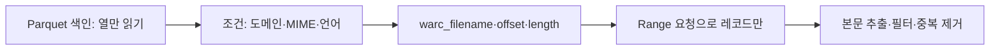
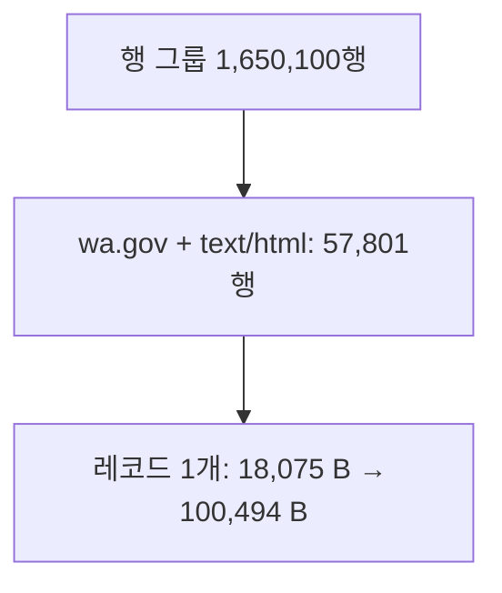

# 도메인 특화 코퍼스 만들기

> Common Crawl 전체를 받지 않고 **색인으로 원하는 도메인·언어·MIME 형식의 페이지만 골라 그 WARC 레코드만 내려받아** 특정 분야 코퍼스를 만드는 방법이다. 색인 조회 → 위치 확인 → 범위 요청 → 텍스트 추출 순서다.

## 쉽게 말하면
도서관 전체를 복사하지 않고 카드목록에서 "정부 기관 웹페이지"만 골라 해당 서가·쪽수를 보고 그 쪽만 복사해 오는 것이다.

## 자세히
(Parquet 색인과 WARC를 직접 읽어 끝까지 실행, `CC-MAIN-2024-10`, 2026-11-20. 첫 `subset=warc` 파일의 첫 행 그룹 하나만 사용한 소규모 시연)
1. **색인 조회**([Parquet 색인](#columnar-index-parquet)): `url`, `url_host_registered_domain`, `content_mime_detected`, `content_languages`, `warc_filename`, `warc_record_offset`, `warc_record_length` 열만 읽었다(행 그룹 1,650,100행).
2. **조건 선별**: 등록 도메인이 `wa.gov`이고 감지된 MIME이 `text/html`인 행 → **57,801행**(전체 행 그룹의 약 3.5%). 이 구간 상위 도메인은 `wa.gov` 114,789행, `weather.gov` 62,461행, `wisconsin.gov` 58,461행, `aegean.gr` 43,646행. (SURT 순 정렬의 한 구간이라 크롤 전체 분포가 아님)
3. **레코드 위치로 받기**: 선별된 첫 행의 `warc_filename`, `warc_record_offset`(263,991,293), `warc_record_length`(18,075)로 **HTTP Range 요청**([범위 요청](#http-range-sampling))해 **18,075바이트**만 받았다. 해당 레코드는 gzip 한 멤버라 단독으로 풀려 **100,494바이트**의 `WARC/1.0 ... WARC-Type: response` 레코드(HTTP 응답 포함)가 나왔다.
4. **다음 단계**(제안): 레코드의 HTML 본문을 [본문 추출기](#text-extraction-warc)로 텍스트화 → 언어·품질 필터 → [중복 제거](#datatrove-fineweb-example) → [옵트아웃·라이선스 점검](#robots-txt-basics).
- 이 방법의 장점: 전체 크롤(수십 TB) 대신 필요한 부분만 가져와 비용·시간이 크게 줄어든다. 색인 열에 `content_languages`가 있어 언어 선별도 쉽다.
- 한계(제안): ① 색인의 언어·MIME 판정은 자동 추정이라 오류가 있다 ② 크롤은 웹의 무작위 일부이므로 도메인 대표성이 보장되지 않는다 ③ 정부 사이트 같은 공공 콘텐츠라도 이용 조건과 개인정보를 확인해야 한다 ④ 시연은 레코드 1개이며 전체 파이프라인의 성능·품질은 측정하지 않았다.

## 그림으로 보기



## 예시
```python
t = pf.read_row_group(0, columns=[...])
sel = t.filter(pc.equal(t["url_host_registered_domain"], "wa.gov"))
# → warc_filename, offset, length 로 requests.get(..., headers={"Range": f"bytes={o}-{o+l-1}"})
```
- 의료·법률·금융 등 분야별 웹 코퍼스 구성에서 도메인 목록을 정해 같은 절차를 적용.
- 교육: "전체를 다 모으지 않고 필요한 것만 모으는" 데이터 수집 전략.

## 헷갈리는 것과 비교
| 개념 | 차이 |
|---|---|
| 도메인 특화 선별 | 색인으로 일부만 수집 |
| 전체 크롤 처리 | 모든 WARC를 읽음 |
| 파인튜닝 데이터 | 수집 후 라벨·정제를 거친 학습용 데이터 |

## 더 읽을거리
- [Common Crawl 데이터 호스트](https://data.commoncrawl.org/) — 색인 테이블과 WARC(이 시연에서 직접 사용).
