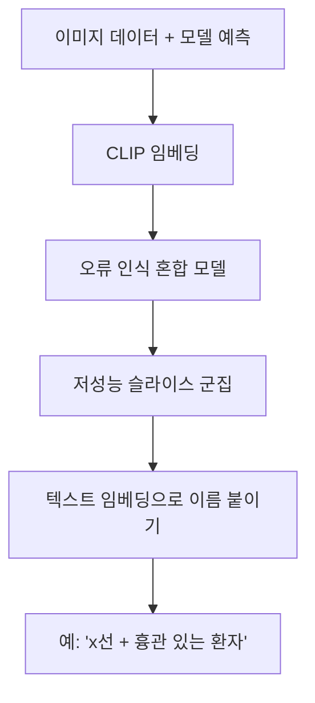
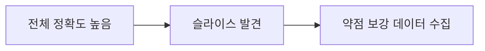

# Domino 슬라이스 발견

> Domino는 모델이 체계적으로 틀리는 데이터 부분집합(슬라이스)을, 이미지·텍스트를 같은 공간에 놓는 **교차 모달 임베딩**(예: CLIP)으로 찾아 **자연어 이름까지 붙여 주는** 방법이다(Eyuboglu 외, ICLR 2022 oral).

## 쉽게 말하면
시험 평균은 높은데 특정 유형 문제만 계속 틀리는 학생이 있다. 어떤 유형인지 라벨이 없을 때, 틀린 문제들을 비슷한 것끼리 묶고 "이건 '도형 넓이 문제'네"라고 이름까지 달아 주는 도구다.

## 자세히
- **문제**: 정확도가 높은 모델도 특정 슬라이스에서 체계적으로 실패한다. 이미지·오디오는 슬라이스 라벨이 없다. 기존 슬라이스 발견 방법(SDM)은 정량 평가가 없었고 결과가 일관되지 않는 경우가 많았다(논문 초록, arXiv 2203.14960 직접 확인).
- **Domino의 접근**: 교차 모달 임베딩 위에 **오류 인식 혼합 모델(error-aware mixture model)**을 얹어, 성능이 낮고 의미적으로 일관된 슬라이스를 찾고, 텍스트 임베딩으로 슬라이스를 말로 설명한다.
- **평가 프레임워크**: 자연 이미지·의료 이미지·시계열에 걸친 1,235개 슬라이스 설정으로 방법들을 비교. 보고된 결과: Domino가 1,235개 슬라이스 중 36%를 정확히 식별(기존보다 약 12%p 높음), 정확한 슬라이스 이름을 35% 설정에서 생성한다.
- **도구(GitHub HazyResearch/domino, 직접 확인)**: Apache-2.0, 별 143개, 커밋 112개(확인 시점). 설치는 `pip install "domino[clip,text] @ git+https://github.com/HazyResearch/domino@main"`. 유지보수 활발도는 페이지에서 확인되지 않아 현재 쓸 때 직접 점검이 필요하다.
- **한계(해석)**: 슬라이스 이름이 정답인 경우는 35%뿐이므로 사람이 검증해야 한다. 임베딩 모델(CLIP)의 편향이 발견 결과에 영향을 줄 수 있다.

## 그림으로 보기

## 예시
- 의료 영상 분류기가 특정 장치가 찍힌 사진에서 자주 틀린다는 점을 Domino식으로 찾아 추가 데이터를 모음.
- 교육 소재: "평균 정확도의 함정"을 보여 주는 슬라이스 분석 사례.

## 헷갈리는 것과 비교
| 개념 | 차이 |
|---|---|
| 수동 슬라이싱 | 사람이 속성으로 나눔(라벨 필요) |
| Domino | 라벨 없이 자동 발견 + 설명 |
| [CheckList 행동 테스트](#checklist-behavioral-testing) | 사람이 설계한 능력별 테스트 |
| [집단별 성능 보고](#subgroup-performance-report) | 정의된 집단별 보고 |

## 더 읽을거리
- [Domino 논문 (arXiv 2203.14960)](https://arxiv.org/abs/2203.14960) — 초록·결과 수치 직접 확인.
- [HazyResearch/domino (GitHub)](https://github.com/HazyResearch/domino) — 설치·Colab 튜토리얼 안내(직접 확인).
