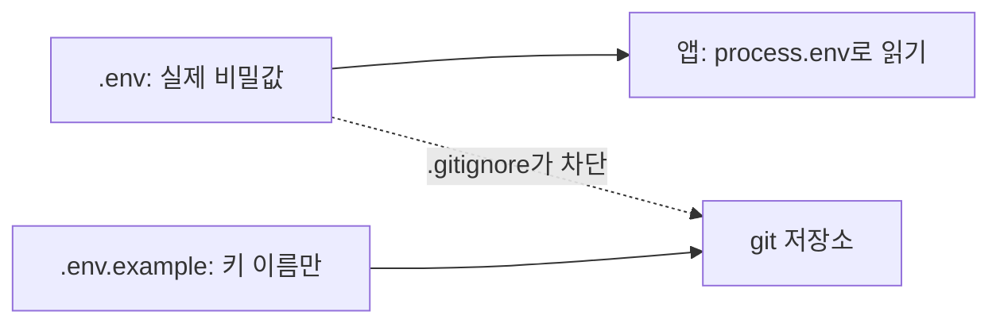
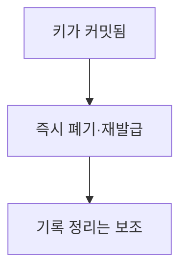

# .env와 .gitignore

> `.env`는 키·비밀번호 같은 환경 변수를 적어 두는 로컬 파일이고, `.gitignore`는 그 파일이 git에 올라가지 않게 막는 목록이다. 둘은 항상 같이 쓴다.

## 쉽게 말하면
집 열쇠(.env)를 현관문에 걸어 두지 않고 주머니에 넣는 습관이다. `.gitignore`는 "이 주머니는 사진 찍어 공유하지 마"라는 표시다. 한 번 올라간 키는 되돌려도 기록에 남는다.

## 자세히
- Twelve-Factor App의 설정 원칙: 배포마다 달라지는 값(DB 주소, 외부 서비스 자격 증명)은 코드와 엄격히 분리하고 환경 변수로 둔다. 시험 기준: "지금 당장 코드를 공개해도 자격 증명이 새지 않는가?"
- 버전 관리에서 제외한 설정 파일도 실수로 커밋되기 쉽고 형식이 흩어진다는 단점이 있어, 환경 변수가 낫다고 한다. `.env`는 로컬 개발 편의를 위한 도구이고, 운영에서는 배포 환경의 비밀 관리 기능을 쓴다([환경 변수와 비밀값](#env-variables-secrets)).
- 실천: ① `.gitignore`에 `.env`를 **첫 커밋 전에** 적는다. ② 실제 값 없이 키 이름만 담은 `.env.example`을 커밋한다. ③ 코드는 `os.environ`·`process.env`로 읽는다.
- 이미 커밋했다면 파일을 지우는 것만으론 부족하다. 키를 **폐기·재발급**하는 게 정답이다([비밀값 유출 대응](#secret-leak-response)).
- 바이브코딩에서는 AI가 키를 코드에 직접 박는 경우가 있으니 커밋 전에 확인한다.

## 그림으로 보기



## 예시
```
# .gitignore
.env
.env.*
!.env.example
```
```
# .env
OPENAI_API_KEY=여기에_실제_값
```

## 헷갈리는 것과 비교
| 개념 | 차이 |
|---|---|
| `.env` | 로컬 개발용 비밀값 파일 |
| `.env.example` | 이름만 담은 공유용 견본 |
| 운영 비밀 관리 | 배포 플랫폼의 [시크릿 관리](#secrets-manager) |

## 더 읽을거리
- [The Twelve-Factor App: III. Config](https://12factor.net/config) — 설정을 코드와 분리하는 원칙.
