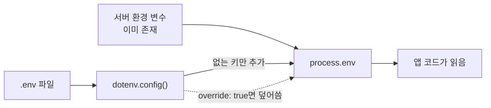

# dotenv 로딩 방식

> dotenv는 프로젝트의 `.env` 파일을 읽어 `process.env` 같은 환경 변수로 올려 주는 라이브러리이며, 이미 설정된 변수와의 우선순위와 불러오는 순서를 이해해야 버그가 안 난다.

## 쉽게 말하면
이사 갈 때 "방마다 필요한 짐 목록"을 들고 가서 방에 풀어 놓는 일이다. 이미 방에 놓인 짐(실제 서버 환경 변수)이 있으면 기본적으로 그대로 두고 목록 쪽 물건은 건너뛴다.

## 자세히
Node용 dotenv README(2026-11 확인) 기준:
- 설치 `npm install dotenv --save`. 코드 맨 앞에서 `require('dotenv').config()` 또는 ESM `import 'dotenv/config'`.
- **우선순위**: 이미 환경에 있는 변수는 `.env` 값이 덮어쓰지 않는다. `override: true`를 주면 `.env`가 이긴다. 그래서 운영 서버 설정이 로컬 `.env`보다 우선한다.
- **경로·다중 파일**: 기본은 현재 작업 폴더의 `.env`. `path` 옵션으로 바꾸고, 배열로 여러 파일을 넘기면 먼저 나온 값이 이긴다(override 시 마지막 값).
- **로딩 순서 함정**: ESM에서 import는 먼저 평가되므로 환경 변수를 읽는 모듈보다 `dotenv/config`를 앞에 import해야 한다. CLI `dotenv run -- node index.mjs`는 Node 시작 전에 주입해 이 문제를 피한다.
- **주의**: 값에 `#`가 있으면 따옴표로 감싼다(v15부터 주석 처리). 여러 줄 값은 v15 이상. 안 읽히면 대개 파일 위치 문제 → `debug: true`.
- 브라우저 코드는 `.env`를 직접 못 읽는다(번들러 접두사 필요: CRA `REACT_APP_` 등). 암호화·다중 환경은 dotenvx가 다룬다. 암호화하지 않은 `.env`는 커밋하지 않는다.

## 그림으로 보기

## 예시
- 오류: `API_KEY`가 undefined → import 순서를 확인(`import 'dotenv/config'`를 맨 위로).
- 프롬프트: "이 Node 프로젝트에서 dotenv가 다른 모듈보다 먼저 로드되는지, 운영 환경 변수가 .env에 덮어씌워지지 않는지 점검해 줘."

## 헷갈리는 것과 비교
| 개념 | 차이 |
|---|---|
| dotenv 로딩 | 파일 → 환경 변수 주입 동작 |
| [.env와 .gitignore](#dotenv-gitignore) | 파일을 커밋하지 않는 쪽의 관리 |
| [env.example](#env-example) | 값 없이 필요한 키 목록만 공유 |
| [12-Factor](#twelve-factor) | 설정을 환경에서 주입하라는 원칙 |

## 더 읽을거리
- [motdotla/dotenv](https://github.com/motdotla/dotenv) — 옵션·우선순위·주의사항.
