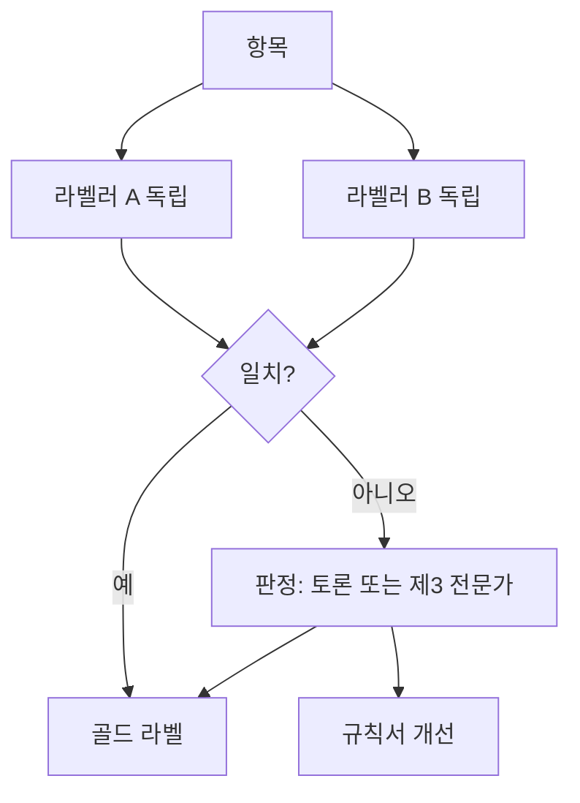
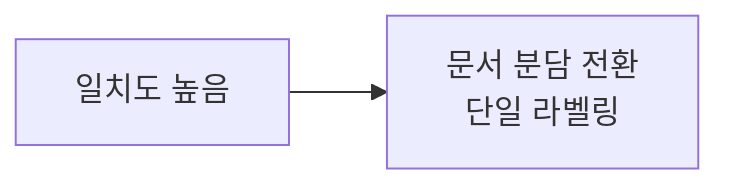

# 이중 라벨링과 판정

> 같은 항목을 서로 독립적으로 두 명 이상이 라벨링(이중 라벨링)하고, 의견이 갈린 항목은 합의나 제3자 전문가의 판정(adjudication)으로 하나의 정답(골드 스탠더드)으로 확정하는 방식이다.

## 쉽게 말하면
논문 심사에서 심사위원 두 명이 따로 점수를 매기고, 갈리면 편집위원이 최종 판정을 하는 것과 같다. 둘이 서로 못 보게 해야 "우연히 같은 생각"인지 "진짜 기준이 같은지"를 알 수 있다.

## 자세히
(TRAM 위키·Snorkel 문서를 직접 열어 확인.)
- **이중 라벨링**: 문서마다 둘 이상이 태깅한다. 단일 라벨링보다 문서 수는 적지만 품질이 높은 말뭉치가 된다.
- **독립성**: 일치도를 재려면 서로 따로 작업해야 한다. 단일 라벨링 체제에서도 공통 문서 일부는 독립 라벨링하길 권한다.
- **판정**: 한 문서의 여러 라벨링을 하나의 골드 버전으로 합친다. 라벨러들이 함께 조정하거나 제3의 전문가가 판정자가 될 수 있다(MITRE Annotation Tool의 재조정 화면이 예). **판정 결과는 규칙서 개선으로 되돌려야 한다.**
- **하이브리드**: 일치도가 충분히 높아지면 문서를 나눠 맡는 방식으로 전환해 비용을 줄일 수 있다.
- 일치도 지표: [Cohen의 카파](#cohens-kappa) 등. 다수결은 여러 명일 때 강한 기준선이라는 검색 결과 요약(출처 확인 필요).
- **비용 트레이드오프(제안)**: 이중 라벨링은 라벨링 비용이 약 2배. 전부 이중으로 하지 않고 일부 표본·어려운 항목만 하는 설계도 가능.

## 그림으로 보기

## 예시
- 계약서 조항 분류 3,000건: 변호사 2명이 독립 라벨링 → 불일치 12%는 선임 변호사가 판정 → 판정 사례를 규칙서에 추가.
- 교육 활용: 수강생을 두 팀으로 나눠 같은 20건을 라벨링하고 판정까지 해 보는 실습.

## 헷갈리는 것과 비교
| 개념 | 차이 |
|---|---|
| 이중 라벨링+판정 | 모든(또는 일부) 항목을 둘이 하고 갈리면 확정 |
| [시범 라운드](#annotation-pilot-round) | 본 작업 전 연습 |
| [보정 문항](#calibration-items) | 단일 라벨링 중 공통 문서로 일관성 점검 |
| 다수결 | 3명 이상일 때 표 많은 쪽을 채택 |

## 더 읽을거리
- [TRAM: Data Annotation Best Practices Guide](https://github.com/center-for-threat-informed-defense/tram/wiki/Data-Annotation-Best-Practices-Guide) — 이중 라벨링·판정(열어 확인).
- [Snorkel: Guideline goal](https://docs.snorkel.ai/docs/0.93/user-guide/best-practices/guideline-goal) — 독립 라벨링 후 토론(열어 확인).
