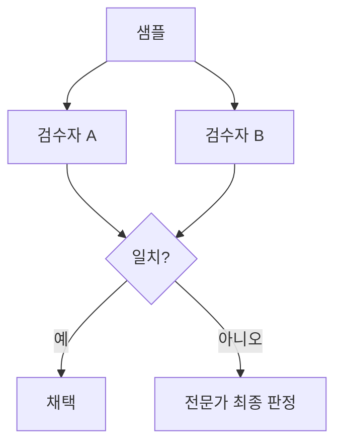
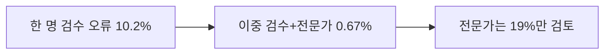

# 이중 검수

> 이중 검수는 같은 샘플을 검수자 두 명이 독립적으로 판정하고, 둘이 일치하면 그대로 채택하고 불일치하면 전문가가 최종 판정하는 방식이다. 검수자 한 명의 실수를 크게 줄이면서, 전문가의 시간은 불일치 샘플에만 쓴다.

## 쉽게 말하면
두 조교가 각자 따로 채점해서 점수가 같으면 그대로 확정하고, 서로 다르게 매긴 답안지만 교수가 다시 본다. 두 조교가 같은 실수를 우연히 똑같이 할 확률은 낮으므로, 교수는 전체의 일부만 보고도 오류를 크게 줄인다.

## 자세히
- **직접 해 본 시뮬레이션(샘플 10만 개, 5개 클래스, 검수자가 틀릴 때는 나머지 클래스 중 균등하게, 두 검수자는 독립, 전문가 정확도 0.98 가정)**:

| 검수자 정확도 | 한 명 검수 오류율 | 두 사람 불일치율 | 둘이 같은데 틀린 비율 | 이중 검수+전문가 최종 오류율 | 전문가 부담 |
| --- | --- | --- | --- | --- | --- |
| 0.80 | 0.197 | 0.349 | 0.0099 | 0.0170 | 35% |
| 0.90 | 0.102 | 0.188 | 0.0026 | 0.0067 | 19% |

  검수자 정확도가 0.9일 때 한 명 검수는 오류가 약 10%, 이중 검수+전문가는 0.67%로 약 15분의 1이다. 그동안 전문가는 전체의 19%만 보면 된다. 검수자 정확도가 0.8로 낮으면 전문가 부담이 35%로 커지고 최종 오류율도 1.7%로 높아진다. 전문가 정확도를 0.98로 정한 것과 검수자가 독립이라는 가정은 이 시뮬레이션의 설정이며, 실제 사람들은 같은 방향으로 틀리는 경향이 있어 독립이 아닐 수 있다.
- **남는 오류의 정체(해석)**: 최종 오류는 ① 두 검수자가 같은 오답에 합의한 경우(위 표 0.26%~0.99%) ② 전문가의 오류로 이뤄진다. 합의된 오답은 아무도 다시 보지 않으므로 줄이려면 검수자 교육·가이드 개선([혼동 쌍 중심 라벨 가이드](#confusion-pair-guideline))이 필요하다.
- **운영(해석)**: ① 검수자 독립 보장(서로 답을 못 보게) ② 불일치 샘플 큐를 전문가에게 ③ 불일치율을 검수자 품질 지표로 모니터링 ④ 모델 점수로 우선순위를 정한 샘플부터 이중 검수([precision@k 검수 효율](#precision-at-k-review)) ⑤ 언제 멈출지는 [검수 정지 규칙](#review-stopping-rule).
- **비용**: 모든 샘플을 두 번 보므로 검수 비용이 2배 이상이다. 비용이 크면 모델이 의심하는 상위 샘플에만 이중 검수를 적용한다.

## 그림으로 보기

## 예시
- 의료 영상 라벨링: 판독의 두 명이 독립 판독하고 불일치만 수석 판독의가 결정한다. 불일치율이 높은 판독의에게는 가이드를 보강한다.
- 교육 활용: 검수자 정확도를 바꿔 가며 최종 오류율과 전문가 부담 표를 직접 만들어 본다.

## 헷갈리는 것과 비교
| 개념 | 차이 |
| --- | --- |
| 이중 검수 | 두 명 독립 판정 + 불일치는 전문가 |
| 다수결(3명) | 세 명 중 다수 의견 채택 |
| [검수 정지 규칙](#review-stopping-rule) | 언제까지 검수할지 |
| [precision@k 검수 효율](#precision-at-k-review) | 어떤 샘플을 먼저 검수할지 |

## 더 읽을거리
- [Confident Learning (arXiv 1911.00068)](https://arxiv.org/abs/1911.00068) — 모델 기반 라벨 오류 후보 선정(검수 대상 정하기)
