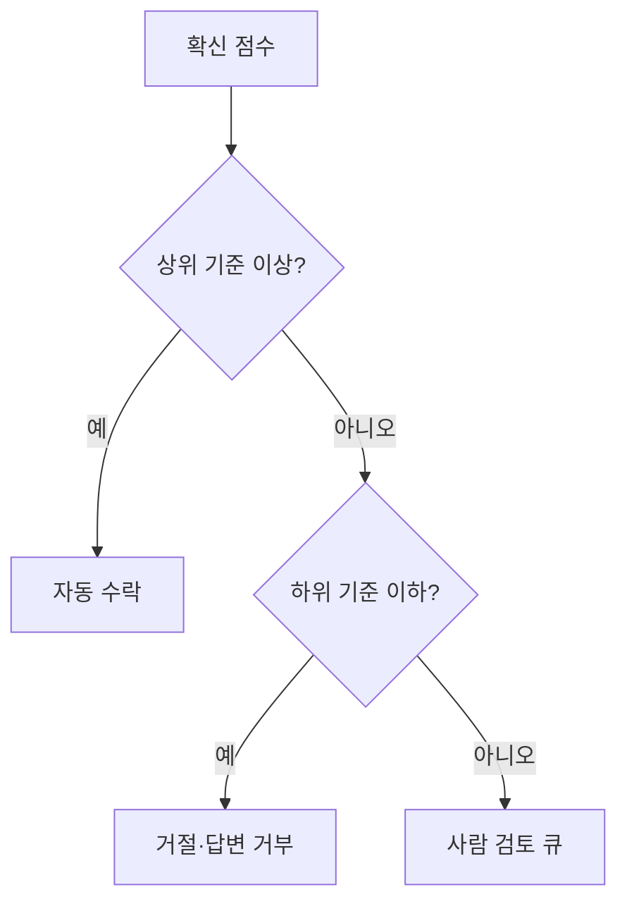
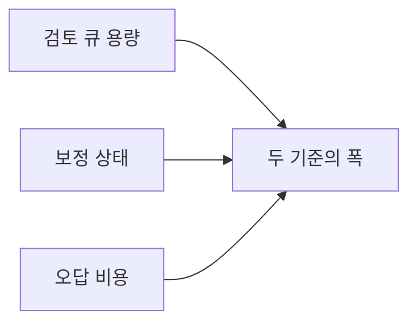

# 이중 임계값 정책

> 확신 점수에 기준선 두 개(위·아래)를 두어, 높은 건 자동 수락, 낮은 건 자동 거절(또는 답변 거부), 가운데 애매한 건 사람 검토로 보내는 3구간 라우팅 방식.

## 쉽게 말하면
공항 보안 검색에서 "확실히 문제없음"은 통과, "확실히 문제"는 별도 처리, "애매함"은 직원이 열어 보는 것과 같다. 기준선이 하나면 애매한 건도 반드시 통과·불통과 중 하나로 갈라야 하지만 두 개면 사람에게 넘길 구간이 생긴다.

## 자세히
- **구조**: 낮은 기준 미만은 한쪽 클래스로 자동 배정, 높은 기준 초과는 다른 쪽으로 자동 배정, 그 사이는 불확실로 보고 사람이 검토. 목표는 정확도를 유지하거나 높이면서 검토 건수를 최소화하는 것이다(Muric·Minton 백서, arXiv 2601.05974, 초록 열람). 해석적 유도와 몬테카를로 시뮬레이션으로 확신 분포에 따른 사람 노력의 효율을 보였고 추가 검토의 이득이 작은 "수확 체감 구간"을 찾았다. 적용 예로 엔티티 해소, 사기 탐지, 의료 분류(triage), 콘텐츠 검수를 든다.
- **Nyckel 문서(열람)**: 두 기준으로 자동 수락/사람 검토/거절 세 구간을 만든다. 구체 숫자는 사용자 몫이고 3구간 구조가 재사용 가능한 부분이다. 시작값은 오답 비용으로 정해 의료·법률·사기 같은 고위험은 약 0.95, 탐색 용도는 0.60까지 낮출 수 있고 보수적으로 시작해 풀어 간다. 올바른 예측이 검토로 자주 가면 자동 수락 기준을 낮추고, 오답이 통과하면 올린다. 분포가 평평해지면 입력이 변한 신호다. 가운데가 평평하면 검토 업무량이자 라벨링 기회이고, 쌍봉 분포는 임계값이 아니라 라벨 품질 문제다. 경계 근처 예측의 검토가 가장 영향이 크다.
- **Tianpan 글(열람, 개인 블로그)**: 단일 임계값은 "답하지 않기"와 "사람에게 넘기기"라는 두 결정을 섞는다. 이를 거부(abstain)와 이관(escalate) 기준으로 나눈다. 먼저 보정하라: 토큰 확률은 표현 불확실성과 사실 불확실성이 섞이고 말로 한 확신은 90~100%에 몰린다. 보정 곡선이 대각선에서 멀면 임계값을 어떻게 골라도 해결되지 않는다. **검토자 용량이 하한**: 글의 계산 예로 일 10만 건 × 이관 15% × 3분 검토 = 하루 약 750 검토자-시간. 소비자 기능에서 지속 가능한 이관율을 약 8~15%로 보고 30%에 가까우면 배포 준비가 안 된 신호라고 쓴다(개인 의견·예시 수준).
- 한 정책에는 한 명의 책임자를 두어 지표가 서로 얽혀 한 번에 하나만 조정하지 않게 한다는 제안도 있다.
- 오래된 학술 배경인 reject option·selective classification(Bartlett·Wegkamp, El-Yaniv·Wiener)은 검색 요약 기준이며 원문은 열지 않았다.

## 그림으로 보기

## 예시
- 송장 자동 분류: 확신 0.95 이상 자동 처리, 0.5 미만은 "분류 불가" 반려, 그 사이는 담당자 검토.
- 교육 실습: 표본 20건의 (확신, 정답)으로 두 기준을 바꿔 가며 자동 처리 건수, 오류 건수, 검토 건수의 표를 만든다.

## 헷갈리는 것과 비교
| 개념 | 차이 |
|---|---|
| 단일 임계값 | 통과/불통과 둘뿐 |
| 이중 임계값 | 가운데 사람 검토 구간 |
| [신뢰도 보정과 이관](#confidence-calibration-handoff) | 임계값이 의미 있으려면 필요한 전제 |
| [ECE(기대 보정 오차)](#ece-metric) | 보정 상태를 재는 지표 |

## 더 읽을거리
- [A Framework for Optimizing Human-Machine Interaction in Classification Systems (arXiv 2601.05974)](https://arxiv.org/abs/2601.05974v2) — 두 임계값과 수확 체감(초록 열람)
- [Nyckel: Tuning Confidence Thresholds](https://www.nyckel.com/docs/best-practices/confidence-scores-and-thresholds/) — 3구간 튜닝(벤더)
- [Tianpan: The two-threshold problem](https://tianpan.co/blog/2026/04/27/two-threshold-problem-confidence-gated-ai) — 검토자 용량 한계(개인 블로그)
