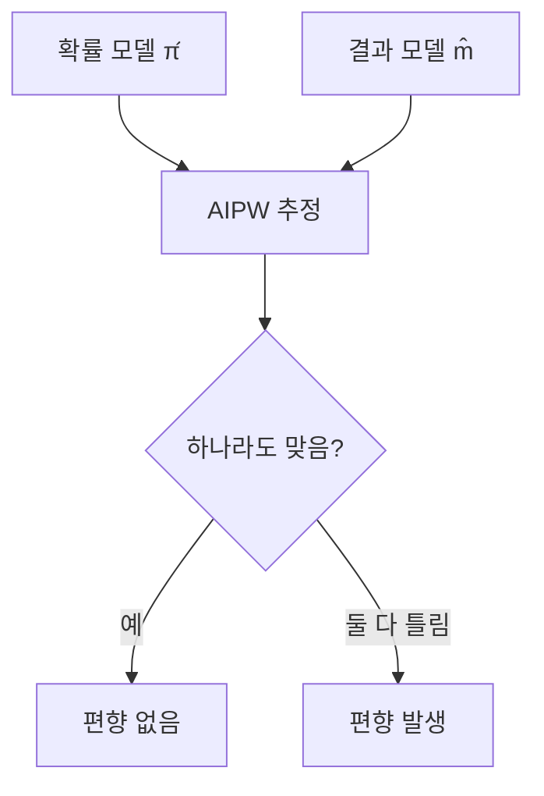

# 이중 강건 추정량

> **이중 강건(doubly robust) 추정량**은 "관측될 확률 모델"과 "결과 예측 모델" 두 가지를 함께 쓰되, **둘 중 하나만 맞아도 편향 없는(일관된) 추정**을 하는 방법이다. 한쪽 모델에 모든 것을 거는 위험을 줄인다.

## 쉽게 말하면
여행 일정을 짤 때 지도 앱(모델 A)과 현지 가이드(모델 B) 둘 다 참고한다고 하자. 둘 중 하나만 정확해도 목적지에 제대로 도착할 수 있다. 둘 다 틀려야만 길을 잃는다.

## 자세히
(이 세션에서 numpy로 **직접 시뮬레이션**했다. 이 노드는 설계한 단순한 한 가지 시나리오의 결과이며 일반 증명이 아니다. Wikipedia IPW 문서는 이 방법을 "augmented IPW(AIPWE)"로 소개하고 이중 강건 대안으로 언급한다(직접 확인).)
- **시나리오(실행)**: 모집단 N=20,000, 공변량 x~N(0,1), 결과 y = 1 + 2x + 1.5x² + 잡음(진짜 평균을 알고 있음). **y의 일부만 관측**되며 관측 확률은 x와 x²에 비선형으로 의존한다. 목표는 전체 y 평균 추정. 400회 반복.
  - **맞는 모델**: x와 x²를 넣은 로지스틱(확률) / 선형(결과). **틀린 모델**: x만 넣은 모델.
- **추정량**
  - IPW(Hájek): Σ(r·y/π̂)/Σ(r/π̂)
  - 결과 모델(OM): 결과 예측값 m̂의 평균
  - **AIPW(이중 강건)**: mean(m̂) + mean( r·(y−m̂)/π̂ )
- **결과(실행, 편향 / 표준편차)**
  | 추정 | 확률모델 | 결과모델 | 편향 | 표준편차 |
  |---|---|---|---|---|
  | 관측값 평균(naive) | – | – | **+1.109** | 0.020 |
  | IPW | 맞음 | – | −0.001 | 0.009 |
  | IPW | 틀림 | – | +0.615 | 0.026 |
  | 결과모델 | – | 맞음 | −0.001 | 0.008 |
  | 결과모델 | – | 틀림 | +0.519 | 0.021 |
  | **AIPW** | 맞음 | 맞음 | −0.001 | 0.008 |
  | **AIPW** | **틀림** | **맞음** | **−0.001** | 0.008 |
  | **AIPW** | **맞음** | **틀림** | **−0.001** | 0.009 |
  | AIPW | 틀림 | 틀림 | **+1.025** | 0.040 |
  → IPW와 결과모델은 **자기 모델이 틀리면 편향**(+0.615, +0.519)이 생기지만, AIPW는 **둘 중 하나만 맞으면 편향이 사라졌다**(−0.001). **둘 다 틀리면 편향이 naive 수준(+1.025)으로 돌아왔다.** 이것이 "이중 강건"의 의미다.
- **주의(해석)**: "강건"은 모델 오류에 대한 보호이지 만능이 아니다. 둘 다 틀리면 소용없고, 확률이 매우 작을 때의 분산 문제는 남는다. → [극단 가중치 불안정](#extreme-weight-instability)
- **한계**: 단일 공변량·특정 비선형 구조의 시뮬레이션이다. 고차원, 모델 선택, 신뢰구간 계산은 다루지 않았다.

## 그림으로 보기

## 예시
- 설문 무응답이 있을 때 응답 확률 모델과 응답 점수 예측 모델을 함께 써서 전체 평균을 추정.
- 교육 활동: 확률 모델과 결과 모델 중 어느 쪽이 더 믿을 만한지 토론하며 둘 다 쓰는 이유를 설명.

## 헷갈리는 것과 비교
| 개념 | 차이 |
|---|---|
| 이중 강건 | 두 모델 중 하나만 맞아도 일관 |
| [역확률 가중](#inverse-probability-weighting) | 확률 모델만 사용 |
| 결과 회귀(OM) | 결과 모델만 사용 |
| [극단 가중치 불안정](#extreme-weight-instability) | AIPW에서도 확률이 작으면 분산 문제 |

## 더 읽을거리
- [Inverse probability weighting (Wikipedia)](https://en.wikipedia.org/wiki/Inverse_probability_weighting) — AIPWE를 이중 강건 대안으로 소개(직접 확인). 표의 수치는 이 노드의 직접 시뮬레이션이다.
