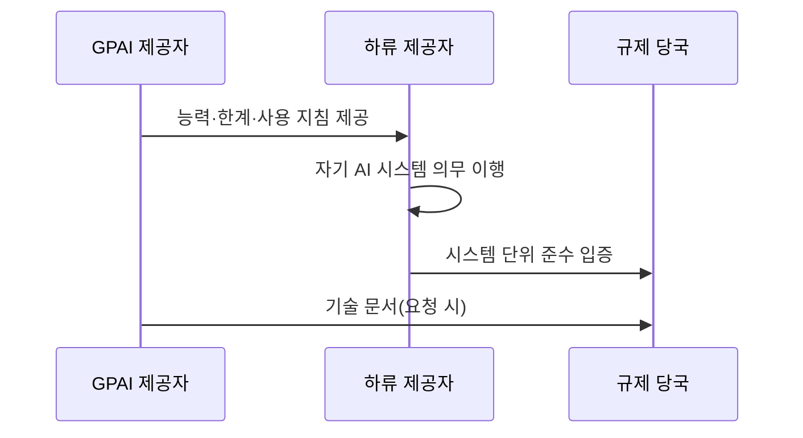

# 하류 제공자 정보 의무

> 범용 모델 제공자가 그 모델을 자기 AI 시스템에 넣어 쓰는 업체(하류 제공자)에게, 모델의 능력과 한계를 이해해 의무를 지킬 수 있을 만큼의 정보를 줘야 하는 의무(AI Act 53조 1항 b호).

## 쉽게 말하면
부품 공급사가 완성차 업체에 부품 사양서를 주는 것과 같다. 사양서 없이는 완성차 업체가 안전 인증을 통과시킬 수 없다.

## 자세히
출처: AI Act 53조(2026-11-15 확인).
- **내용**: 하류 제공자가 모델의 능력·한계를 이해하고 자기 의무를 이행하기에 충분한 정보. 구체 항목은 **부속서 XII**에 있다(이 글에선 항목 목록을 직접 확인하지 못함).
- **보호**: 지재권·영업 비밀은 지키며 제공.
- **오픈소스 면제(2항)**: 자유 오픈소스 라이선스로 가중치·구조·사용 정보를 공개한 모델은 이 의무가 면제된다. 단 시스템 리스크 모델은 면제되지 않는다.
- **방식**: 53조 4항에 따라 [실천 규범](#gpai-code-of-practice)을 따르면 준수를 보일 수 있다. 따르지 않으면 다른 적절한 수단으로 입증해야 한다.
- **하류 쪽 의미**: 고위험 AI를 만드는 사업자는 이 정보를 자기 위험 관리·기술 문서에 쓴다. 모델 카드가 실무적 전달 수단이다.

## 그림으로 보기

## 예시
- 대형 모델 API 위에 채용 평가 서비스를 만드는 업체가 제공사의 한계(편향 평가 결과, 금지 용도)를 받아 위험 관리 문서에 반영.
- 한국 SaaS가 해외 모델을 쓰며 모델 카드·사용 정책을 계약 부속서로 확보.

## 헷갈리는 것과 비교
| 개념 | 차이 |
|---|---|
| 하류 제공자 정보 | 모델 → 통합 업체 |
| 기술 문서 | 모델 → 당국 |
| [학습 데이터 요약](#training-data-summary) | 공개 대상 |

## 더 읽을거리
- [AI Act Article 53](https://artificialintelligenceact.eu/article/53/) — 1항 b호와 부속서 XII 참조
