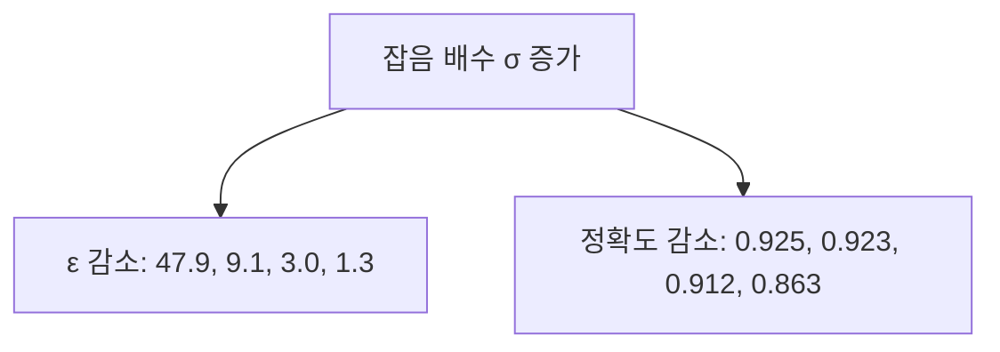

# DP-SGD

> 확률적 경사하강법(SGD)을 바꿔 **각 학습 예제가 모델에 미치는 영향을 일정 크기로 자르고(clipping), 거기에 잡음을 섞어서** 학습하는 알고리즘이다. 어느 한 사람의 데이터가 있었는지 없었는지를 모델에서 알아내기 어렵게 만든다(차분 프라이버시).

## 쉽게 말하면
설문 결과를 낼 때 한 사람의 답이 결과를 크게 좌우하지 못하도록 ① 한 사람의 영향을 최대치로 제한하고 ② 결과에 약간의 노이즈를 섞는 것이다. 평균은 거의 그대로인데, "이 사람이 설문에 참여했는가"는 결과만 봐서는 가려내기 어렵다.

## 자세히
- **핵심 단계**(Abadi 외 2016, arXiv 1607.00133 초록 확인: 비볼록 목적의 심층 신경망을 "적당한 프라이버시 예산"으로 학습할 수 있다고 주장): ① 미니배치에서 **예제별 그래디언트**를 계산 ② 각 그래디언트의 크기(노름)를 `C`로 **자름** ③ 합한 뒤 `N(0, (σC)²)` **가우시안 잡음**을 더함 ④ 평균해 갱신. 학습에서 쓴 만큼의 프라이버시 비용 ε(델타 δ 포함)은 **회계 도구(accountant)**로 누적 계산한다.
- **직접 실행**(numpy로 구현한 DP-SGD 소프트맥스 회귀, scikit-learn 숫자 손글씨 `digits` 1,797장 중 학습 70%, 30 에폭, 배치 64, 자르기 C=1, Opacus의 RDP accountant로 ε 계산, δ=1e-5, 3 시드 평균 정확도):

| 잡음 배수 σ | 시험 정확도 | ε |
|---|---|---|
| 0(잘라내기만) | 0.925 | 없음(무한) |
| 0.5 | 0.925 | 47.9 |
| 1.0 | 0.923 | 9.1 |
| 2.0 | 0.912 | 3.0 |
| 4.0 | 0.863 | 1.3 |

- 해석: 잡음이 커질수록 ε(프라이버시 비용)이 작아져 더 안전하지만 정확도가 떨어진다. 이 작은 문제에서는 σ=2까지 정확도 손실이 약 1.3%p로 적고 σ=4에서 6%p 정도 떨어졌다. **프라이버시-정확도 교환**이 숫자로 보인다. 단순한 선형 모델·작은 데이터이며 대형 언어 모델에서는 비용 구조가 훨씬 나쁘다(대형 모델 수치는 이번에 확인하지 못했다). ε의 의미는 "작을수록 강한 보장"이고 적정값은 정해진 것이 없어 맥락(데이터 민감도)으로 정한다.
- **암기와의 관계**: 한 예제의 영향을 잘라 제한하므로 한 번 본 문장을 통째로 외우기 어려워진다. 그래서 [학습 데이터 추출 공격](#training-data-extraction-attack)의 방어 수단으로 거론된다.
- **실무 부담**: 예제별 그래디언트 계산이 필요해 메모리·시간이 늘고, 큰 배치와 하이퍼파라미터 조정이 필요하다(제안 수준의 일반 설명). 구현은 Opacus(PyTorch) 같은 라이브러리를 쓴다.

## 그림으로 보기

## 예시
- 병원 기록으로 모델을 학습할 때 DP-SGD로 환자 개인의 포함 여부를 추정하기 어렵게 함.
- 교육: 위 표를 재현해 "ε가 작아질수록 정확도가 얼마나 내려가는가"를 그래프로 그려 보기.

## 헷갈리는 것과 비교
| 개념 | 차이 |
|---|---|
| DP-SGD | 학습 중 잡음·자르기로 개별 영향 제한 |
| [중복 제거](#training-data-deduplication) | 반복된 문장을 줄여 암기를 줄임. 보장은 없음 |
| 데이터 익명화 | 식별자를 지움. 재식별 위험 남음 |
| 연합학습 | 데이터를 모으지 않고 학습. 그 자체로는 DP 보장 아님 |

## 더 읽을거리
- [Deep Learning with Differential Privacy (Abadi 외 2016)](https://arxiv.org/abs/1607.00133) — DP로 딥러닝 학습(초록 확인).
- [Opacus](https://opacus.ai/) — PyTorch용 DP 학습 라이브러리(위 ε 계산에 accountant를 직접 설치해 사용).
