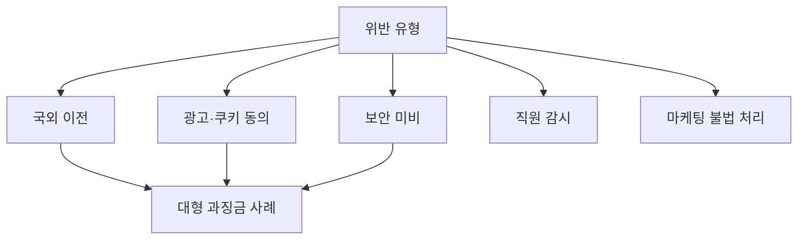

# 감독기관 집행 사례 (GDPR 과징금)

> 실제로 GDPR 위반에 부과된 대형 과징금의 사례. 어떤 유형의 위반(국외 이전, 광고·쿠키 동의, 보안 미비, 직원 감시, 마케팅)이 큰 금액으로 이어졌는지 감을 잡는 용도다. 이 글의 표는 2차 출처(위키백과)의 스냅샷이라 불완전하다.

## 쉽게 말하면
교통 단속 통계표에서 "어떤 위반이 큰 벌금으로 이어졌나"를 훑어보는 것과 같다. 한도(최대 4%)와 달리 실제 부과액은 사건 사정에 따라 정해진다.

## 자세히
출처는 위키백과 "GDPR fines and notices"(열람, 2차 출처). 표가 "불완전하다"고 표시돼 있고, 이 스냅샷에는 TikTok(2025, 5억 3천만 유로 보도)와 Instagram이 보이지 않아 제외했다. 사유는 페이지의 요약이며 개별 결정문은 열어 보지 못했다. 법률 자문이 아니다.

| 순위 | 회사 | 금액 | 날짜 | 당국 | 사유(요약) |
|---|---|---|---|---|---|
| 1 | Meta Platforms | 12억 유로 | 2023-05-12 | 아일랜드 | EU 데이터를 적절한 보호 없이 미국으로 이전 |
| 2 | Amazon Europe Core | 7억 4,600만 유로 | 2021-06-16 | 룩셈부르크(CNPD) | 표적 광고와 관련(당시 최대 과징금이라고 표기) |
| 3 | WhatsApp Ireland | 2억 2,500만 유로 | 2021-09-02 | 아일랜드 | 페이지에 사유 없음 |
| 4 | British Airways | 1억 8,300만 파운드 | 2019-07-08 | 영국(ICO) | 취약한 보안으로 2018년 웹 스키밍 공격, 소비자 50만 명 영향. 이후 2,000만 파운드로 감액 |
| 5 | Google LLC | 6,000만 유로 | 2020-12-10 | 프랑스(CNIL) | 동의 없는 쿠키, 불충분한 안내, 결함 있는 옵트아웃 |
| 7 | H&M | 3,530만 유로 | 2020-10-01 | 독일(함부르크) | 직원 수백 명에 대한 불법 감시 |
| 9 | TIM S.p.A. | 2,780만 유로 | 2020-01-15 | 이탈리아(GPDP) | 마케팅 목적의 불법 처리 |
| 10 | Marriott International | 1,840만 파운드 | 2020-10-30 | 영국(ICO) | 수백만 고객 개인정보 보안 실패 |

- **읽는 법(해석)**: 큰 금액의 사유는 국외 이전, 광고·쿠키 동의, 보안 미비, 직원 감시, 마케팅으로 나뉜다. 모두 83조 2항의 고려 요소(위반의 성격·규모, 영향받은 정보주체 수, 책임 정도 등)와 연결해 볼 수 있다([과징금 결정 요소](#fine-factors)).
- **감액 사례**: British Airways는 1억 8,300만 파운드에서 2,000만 파운드로 줄었다고 페이지에 있다. 발표된 금액이 최종 금액이 아닐 수 있다는 점을 보여 준다.
- **AI와의 관련(해석)**: 위 사건은 AI 전용이 아니다. AI 개발에서는 학습 데이터 수집의 적법 근거, 국외 이전, 보안이 같은 위험 축에서 문제될 수 있다.
- **확인 방법**: 최신 현황은 각국 당국 결정문과 EDPB 자료, 집행 추적 데이터베이스로 확인해야 한다.

## 그림으로 보기

## 예시
- 교육 실습: 위 표에서 사유가 비슷한 사건끼리 묶고, 자기 회사 AI 서비스에서 같은 유형의 위험이 있는 데이터 흐름을 찾아 표시.
- 한도 대비 감각: 과징금 한도는 높은 등급 2,000만 유로 또는 매출 4% 중 큰 금액이지만(83조 5항), 실제 부과액은 사건마다 다르다.

## 헷갈리는 것과 비교
| 개념 | 차이 |
|---|---|
| 집행 사례 | 실제 부과된 금액과 사유 |
| 법정 한도 | 부과할 수 있는 상한 |
| [과징금 결정 요소](#fine-factors) | 금액을 정하는 기준 |
| [GDPR 과징금](#gdpr-fines) | 상위 개요 |

## 더 읽을거리
- [Wikipedia: GDPR fines and notices](https://en.wikipedia.org/wiki/GDPR_fines_and_notices) — 대형 과징금 표(2차 출처, 스냅샷)
- [GDPR Art. 83](https://gdpr-info.eu/art-83-gdpr/) — 과징금 조건 원문
