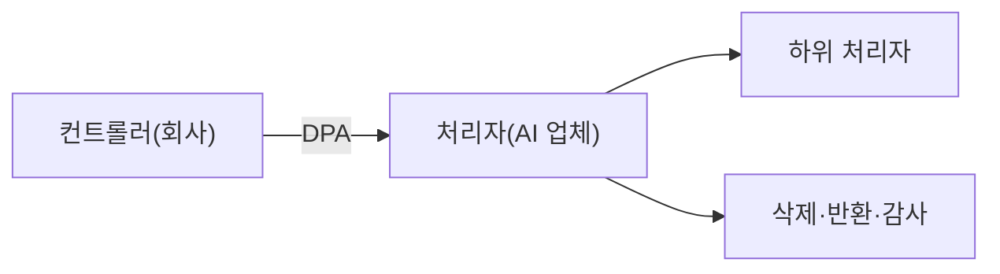
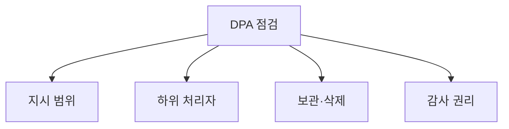

# DPA(데이터 처리 부속계약)

> 개인정보를 **위탁 처리하는 업체와 맺는 계약**으로, 무엇을 어떤 조건에서 처리하는지 정한다. GDPR 28조는 처리자와의 계약에 포함할 내용을 명시한다. AI API 도입 시 가장 먼저 읽을 문서 중 하나다.

## 쉽게 말하면
이삿짐센터에 집 열쇠를 맡길 때 "누가 들어가는지, 무엇을 해도 되는지, 끝나면 열쇠를 어떻게 돌려주는지"를 적는 서약서다.

## 자세히
GDPR 28(3)조 원문 요약(gdpr-info.eu 열람 2026-11-28). 처리자 계약이 담아야 하는 것:
- **기본 조건**: 처리의 대상·기간, 성격과 목적, 개인정보 유형과 정보주체 범주, 컨트롤러의 의무와 권리.
- **지시**: 처리자는 컨트롤러의 **문서화된 지시**에 따라서만 처리(제3국 이전 포함), 법이 달리 요구하지 않는 한.
- **비밀 유지**: 처리 권한자는 비밀 유지 의무 부담.
- **보안**: 32조에 따른 조치를 취한다.
- **하위 처리자**: 다른 처리자를 쓰려면 정해진 조건을 따른다.
- **지원**: 정보주체 권리 요청 대응과 32~36조 의무 이행을 돕는다.
- **삭제·반환**: 서비스 종료 후 컨트롤러의 선택에 따라 모든 개인정보를 반환하거나 삭제하고, 법적 보존 의무가 없으면 기존 사본도 삭제.
- **감사**: 준수를 입증할 정보를 제공하고 감사·점검을 허용·협조.
- AI 맥락의 읽는 요령(내 정리): ① 입력·출력이 모델 학습에 쓰이는가 ② 하위 처리자 목록과 변경 통지 ③ 데이터 보관 기간과 [ZDR](#zero-data-retention) 적용 여부 ④ 처리 위치([데이터 거주성](#data-residency)) ⑤ 사고 통지 기한.
- 한계: 이 글은 EU 규정 기준이다. 한국 개인정보보호법상 위탁 계약 요건은 이번에 확인하지 않았다. 법률 자문이 아니다.

## 그림으로 보기

## 예시
- AI 번역 API를 쓰기 전 DPA의 하위 처리자 목록과 학습 미사용 조항을 확인.
- 교육: 가상의 DPA 발췌문을 주고 위 체크리스트로 위험 조항을 찾는 실습.

## 헷갈리는 것과 비교
| 개념 | 차이 |
|---|---|
| DPA | 처리 위탁 계약(법적 요건) |
| [제로 데이터 보관](#zero-data-retention) | 저장 안 함 옵션 |
| [데이터 거주성](#data-residency) | 데이터 위치 요건 |

## 더 읽을거리
- [GDPR Art. 28](https://gdpr-info.eu/art-28-gdpr/) — 처리자 계약 내용(읽음).
