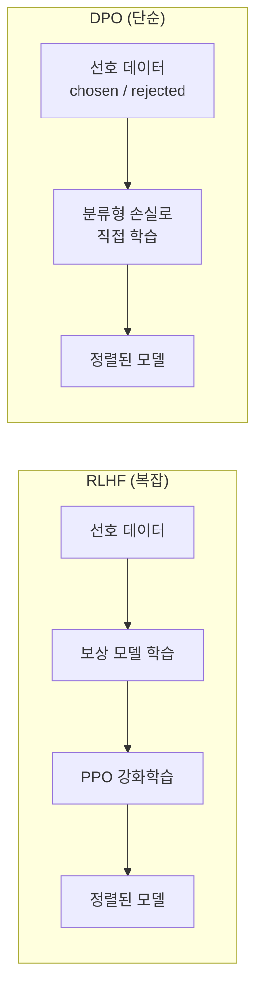
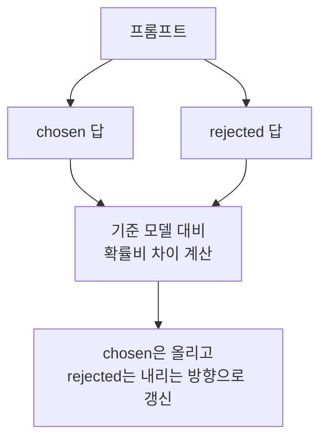

# DPO

> Direct Preference Optimization. "A답이 B답보다 낫다"는 선호 쌍만으로, 보상 모델이나 강화학습 없이 LLM을 직접 사람 취향에 맞추는 학습법. 2023년 5월 Stanford 팀(Rafailov 외)이 제안했다.

## 쉽게 말하면
요리사에게 "이 요리가 저 요리보다 맛있다"는 비교 평가만 계속 알려 주는 상황을 떠올려 보자. 예전 방식(RLHF)은 먼저 "맛 점수를 매기는 심사위원"을 따로 훈련시키고, 요리사가 그 심사위원 점수를 높이도록 연습시킨다. DPO는 심사위원 없이 비교 평가를 요리사에게 바로 보여 주고 "이긴 쪽은 더 자주, 진 쪽은 덜 만들어라"라고 가르친다. 단계가 줄어 안정적이고 가볍다.

## 자세히
- **데이터**: `prompt`, `chosen`(선호), `rejected`(비선호) 세 칸으로 된 선호 데이터셋. 예: UltraFeedback.
- **핵심 아이디어**: RLHF의 목표를 수학적으로 변형하면 보상 모델이 정책(모델 자신)의 확률비로 표현된다. 그래서 RL 대신 단순한 분류 손실 하나로 풀린다. 학습 중 모델에서 답을 새로 샘플링할 필요도 없다(논문 주장).
- **손실**: 학습 중인 모델과 **기준(reference) 모델**의 로그확률비를 선호/비선호 답에서 각각 구해 그 차이를 키운다. 실제로는 비선호 답의 확률을 낮추는 효과가 크다(TRL 문서).
- **β(베타)**: 기준 모델에서 얼마나 벗어나도 되는지 조절. TRL 기본값 0.1, 클수록 덜 벗어난다.
- **학습률**: TRL 기본 1e-6(LoRA 어댑터는 약 1e-5 권장).
- **변형이 많다**: IPO, SimPO(길이 정규화), BCO, KTO 계열 등. TRL의 `loss_type`으로 고른다.
- **한계**: 데이터가 미리 정해진 오프라인 방식이라, 모델이 학습 중 새로 만들어 내는 답에 대한 피드백은 못 준다. 선호 라벨에 노이즈가 있으면 영향받는다(Robust DPO 등이 대응).

## 그림으로 보기




## 예시
Hugging Face TRL로 소형 모델을 DPO하는 최소 코드(공식 문서 Quick start):
```python
from trl import DPOTrainer
from datasets import load_dataset

trainer = DPOTrainer(
    model="Qwen/Qwen3-0.6B",
    train_dataset=load_dataset("trl-lib/ultrafeedback_binarized", split="train"),
)
trainer.train()
```
업무 예: 고객 응대 챗봇의 답 두 개 중 상담팀이 고른 쪽을 `chosen`으로 모아, 우리 회사 말투·정책에 맞게 모델을 다듬는다.

## 헷갈리는 것과 비교
| 개념 | 차이 |
|---|---|
| [SFT](#sft) | 정답 예시 하나를 따라 쓰기. DPO는 두 답의 우열을 배움 |
| [보상 모델](#reward-model) | RLHF에서 점수를 내는 별도 모델. DPO는 생략(암묵적으로 내장) |
| [RLHF](#rlhf) | 보상 모델 + 강화학습. 더 복잡하지만 온라인 샘플링 가능 |

## 더 읽을거리
- [Direct Preference Optimization (arXiv 2305.18290)](https://arxiv.org/abs/2305.18290) — 원 논문
- [TRL DPO Trainer 문서](https://huggingface.co/docs/trl/dpo_trainer) — 데이터 형식·손실 변형·β 설명과 코드
