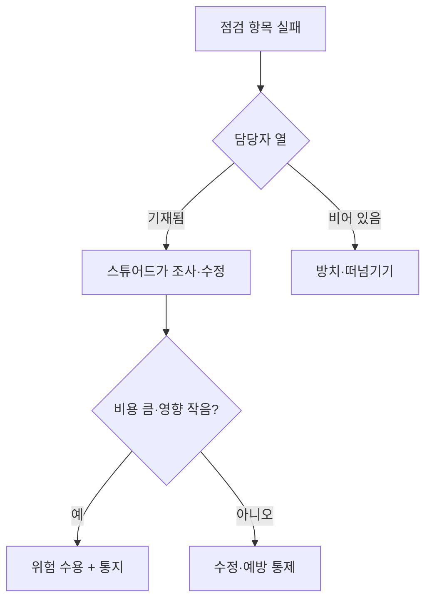
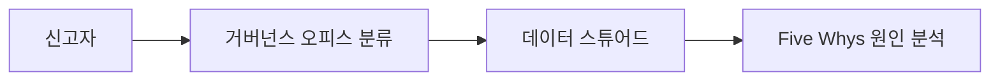

# 점검표 담당자 열

> 데이터 품질 점검표의 각 행에 **"실패했을 때 누가 조치하는가"** 를 적는 열이다. 담당자가 없으면 경보는 울려도 아무도 고치지 않는다.

## 쉽게 말하면
화재경보기가 울렸는데 "누가 소화기를 들지"를 정해 두지 않았다면 모두 서로 쳐다볼 뿐이다. 점검표의 담당자 열은 비상구 옆에 붙인 "이 구역 책임자: 김○○, 연락처 ○○" 표지판과 같다.

## 자세히
(카네기멜런대학교(CMU)의 데이터 품질 이슈 해결 절차 페이지를 직접 읽었다. 대학 한 곳의 사례이므로 보편 표준이 아니라 한 가지 운영 예로 본다. 아래 검색 요약은 직접 확인하지 못했다.)
- **CMU의 역할 분담(페이지 확인)**
  - **신고자**: 문제 해결 안내서의 점검 단계를 따른 뒤 상담 양식을 제출.
  - **거버넌스 오피스(DGO)**: 티켓을 받아 데이터 스튜어드가 다룰지 분류(triage), 배정, 회의 일정을 잡고 조사·원인 분석·이행을 지원.
  - **데이터 거버넌스 매니저**: 회의에 참석해 이슈가 확인되면 접수 양식과 업무 영향 평가를 이해관계자와 작성.
  - **데이터 스튜어드(또는 위임자)**: 조사, 근본 원인 파악, 업무 영향 평가, 우선순위 설정, 수정 방법 결정·이행.
  - 페이지에는 **데이터 소유자** 역할 언급이 없다.
- **절차**: 신고 → (3~5영업일 내 회의) → 조사(데이터 수집 방식·업무 절차·변환·시점·계보·수명주기) → 근본 원인 분석(사람·프로세스·기술, **Five Whys** 권장) → 해결(가능하면 예방 통제 추가, 원천에서 수정) → 소통·측정.
- **위험 수용**: 해결 비용이 크고 영향이 작으면 스튜어드가 **고치지 않는 위험을 수용**할 수 있고 신고자에게 알린다. 우선순위·기한은 스튜어드가 영향·자원·품질을 보고 정한다. 진행은 스코어카드와 "업무 영향" 지표로 추적. 에스컬레이션 절차는 이 페이지에 없고 별도 페이지로 연결된다.
- **점검표 열 설계(제안, 위 사례와 일반 원칙에서)**: ① 1차 조치자(스튜어드·담당 팀) ② 대체자 ③ 연락 채널 ④ 응답 기한 ⑤ 에스컬레이션 대상. 담당자 이름이 아닌 역할·팀으로 적어 인사이동에 견디게 한다.
- **검색 요약(직접 확인 못 함)**: 여러 실무 글이 소유자=책임(A), 스튜어드=실행(R)로 나누고, 도메인별 RACI 공개·대체자 지정·SLA 없는 이슈는 거버넌스 위원회로 에스컬레이션하라고 권한다. Gartner는 RACI 표만으로 역할 정의가 어렵다고 지적했다고 소개된다.

## 그림으로 보기

## 예시
| 특성 | 항목 | 합격선 | 담당 역할 | 대체자 | 응답 기한 |
|---|---|---|---|---|---|
| 최신성 | orders.updated_at | ≤ 24시간 | 주문 데이터 스튜어드 | 데이터 플랫폼 팀 | 4시간 |
- 교육 소재: "알람이 울렸을 때 누구에게 전화하나?"를 팀별 비상 연락망 만들기 실습으로.

## 헷갈리는 것과 비교
| 개념 | 차이 |
|---|---|
| 담당자 열 | 점검표의 조치 책임 칸 |
| 데이터 소유자 | 책임을 지는 역할(일반적 구분) |
| 데이터 스튜어드 | 일상 운영 실무자(일반적 구분) |
| [공급사 계약 품질 부속서](#supplier-quality-annex) | 외부 공급자에 대한 책임을 계약에 적음 |

## 더 읽을거리
- [Data Quality Issue Resolution Process (CMU)](https://www.cmu.edu/data/quality/resolution-process.html) — 역할·절차·위험 수용(직접 읽음).
