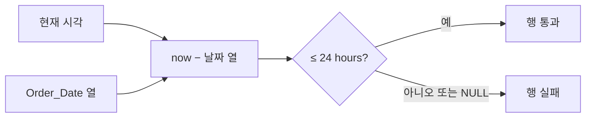
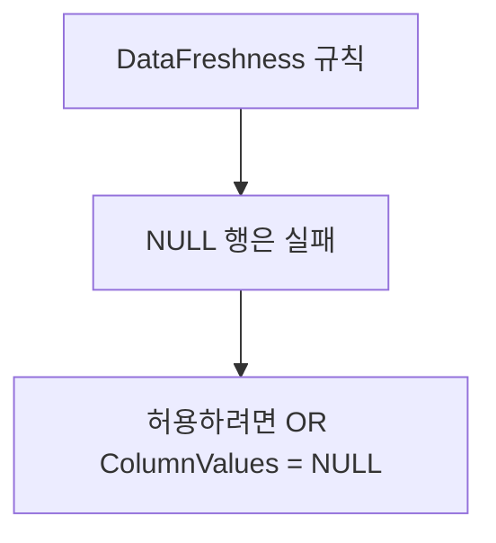

# DataFreshness 규칙

> AWS Glue Data Quality의 DQDL에서 **날짜 열의 값이 현재 시각보다 얼마나 오래됐는지**를 시간·일 단위로 검사하는 규칙이다. 데이터 최신성을 실행 가능한 한 줄로 바꾼 예다.

## 쉽게 말하면
우유 팩의 유통기한 스티커를 모든 팩에서 읽어 "24시간 이내에 만든 것만 합격"이라고 검수하는 일이다. 날짜가 비어 있는 팩은 확인할 수 없으니 불합격으로 친다.

## 자세히
(AWS Glue 개발자 가이드의 DQDL 참조와 `DataFreshness` 규칙 페이지를 직접 읽었다.)
- **문법**: `DataFreshness <COL_NAME> <EXPRESSION>`. 열은 **날짜(Date) 타입**이고, 표현식은 **시간 또는 일 단위가 반드시 붙은** 숫자 표현식이다.
- **예(문서)**: `DataFreshness "Order_Date" <= 24 hours`, `DataFreshness "Order_Date" between 2 days and 5 days`.
- **동작**: 현재 시각과 날짜 열 값의 차이를 평가한다. 행 단위로 판정되며, 일부 행이 실패하면 "80.00 % of rows passed the threshold"처럼 통과 비율로 실패 사유가 표시된다.
- **NULL 처리**: `NULL` 값 행은 **실패**한다. NULL을 허용하려면 복합 규칙으로 `(DataFreshness "Order_Date" <= 24 hours) OR (ColumnValues "Order_Date" = NULL)`처럼 명시한다. DQDL 문서의 일반 설명에 따르면 복합 규칙은 기본적으로 열 전체를 각각 평가해 결과를 합치며, 행 단위 평가를 원하면 `compositeRuleEvaluation.method`를 `ROW`로 지정해야 한다(NULL 키워드와 OR을 섞을 때 필요하다고 문서에 명시). 이 규칙에 그 옵션이 필요한지는 해당 페이지에 적혀 있지 않아 확인하지 못했다.
- **S3 객체 최신성**: 파일 생성 시각으로 검사하려면 `_metadata.file_modification_time`을 새 열(예: `file_ts`)로 만든 뒤 `DataFreshness "file_ts" < 24 hours`를 적용한다(문서 예).
- **주의(일반 원칙)**: ① 열의 시각이 사건 시각인지 적재 시각인지에 따라 의미가 다르다([사건 시각 vs 적재 시각](#event-time-vs-ingestion-time)) ② 이 규칙은 "가장 최근 값이 새로운가"가 아니라 **행 단위 나이**를 보므로, 테이블 전체의 마지막 갱신 여부를 보려면 별도 설계가 필요할 수 있다. 문서가 후자를 어떻게 다루는지는 읽은 페이지에서 확인하지 못했다. ③ 시간대 처리는 문서에 없어 확인하지 못했다.
- 점검표 한 행에 쓰는 법: 특성=최신성, 대상=`orders.updated_at`, 합격선=24시간 이내, 규칙=위 한 줄.

## 그림으로 보기



## 예시
```
Rules = [
  (DataFreshness "Order_Date" <= 24 hours) OR (ColumnValues "Order_Date" = NULL)
]
```
- 교육 소재: "우리 데이터의 유통기한을 규칙 한 줄로 써 보기".

## 헷갈리는 것과 비교
| 개념 | 차이 |
|---|---|
| DataFreshness | 날짜 열 값 기준 행 단위 나이 검사 |
| FileFreshness | 파일 기준 최신성 규칙(DQDL 규칙 목록에 이름만 확인, 문법은 미확인) |
| [데이터 최신성](#data-currentness) | 규칙이 측정하려는 품질 특성 |
| [특징 TTL](#feature-ttl) | 특징 값 유효 기간 설정 |

## 더 읽을거리
- [DataFreshness (AWS Glue DQDL)](https://docs.aws.amazon.com/glue/latest/dg/dqdl-rule-types-DataFreshness.html) — 문법·예·NULL 동작(직접 읽음).
- [DQDL 참조](https://docs.aws.amazon.com/glue/latest/dg/dqdl.html) — 규칙 구조·복합 규칙·where 절.
