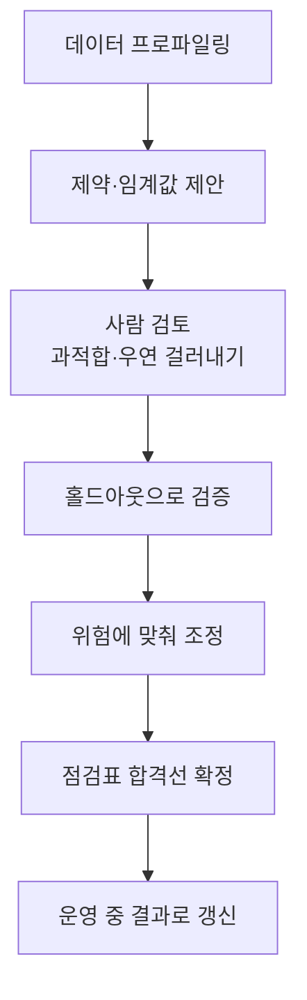
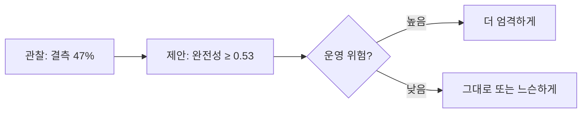

# 합격선 정하기

> 데이터 품질 점검표의 각 항목에서 **"몇 %, 몇 시간, 몇 건까지면 합격인가"** 를 정하는 일이다. 현재 데이터의 분포를 먼저 관찰한 뒤, 오류가 서비스에 주는 위험에 맞춰 조정한다.

## 쉽게 말하면
처음 시험을 출제할 때는 "몇 점이 합격인지"를 모른다. 지난 응시자 점수 분포를 보고, 이 자격이 사람 목숨과 관련된 것이면 엄격하게, 연습용이면 느슨하게 정한다. 한 번 정한 합격선도 시험이 바뀌면 다시 본다.

## 자세히
(AWS Deequ 저장소의 constraint suggestion 예제 문서와 README를 직접 읽었다. 앞서 쓴 [허용 편향 기준](#acceptable-skew-threshold) 글과 같은 원칙을 점검표 항목에 적용한다.)
- **1단계: 데이터를 먼저 본다.** Deequ는 데이터를 **프로파일링**한 뒤 `Rules.DEFAULT` 같은 휴리스틱 규칙으로 제약을 **제안**한다. 예제(16행, 문자열 4열)에서 만든 제안:
  - 값이 불리언처럼 보이는 열은 "Boolean 타입" 검사, 숫자처럼 보이는 열은 "Fractional 타입" 검사
  - 관찰된 결측 비율로 완전성 임계값 생성: `totalNumber`는 결측 47% 미만 → `hasCompleteness(... _ >= 0.53)`, `valuable`은 `>= 0.38`
  - 음수가 없으면 `isNonNegative`, null이 없으면 `isComplete`, 서로 다른 값이 적으면 `isContainedIn(값 목록)`
- **2단계: 제안은 초안이다.** 문서는 제안이 **휴리스틱이며 데이터가 정적이고 올바르다고 가정**하므로 운영 전에 사람이 검토해야 한다고 경고한다. 0.38·0.53 같은 임계값은 작은 표본에 맞춰져 **과적합**일 수 있고, 비음수·고정 값 목록이 표본의 우연일 수 있다. 큰 데이터는 `useTrainTestSplitWithTestsetRatio(0.1)`로 90%에서 제안하고 나머지 10%로 검증하라고 예시한다.
- **3단계: 위험에 맞춰 조정(일반 원칙)**: 오류 비용이 큰 항목(결제 금액, 개인 식별자)은 엄격하게, 참고용 필드는 느슨하게. 점검표에 적은 "합격선"은 그 근거(분포 관찰·위험 평가)를 함께 남긴다.
- **4단계: 시간에 따라 갱신(일반 원칙)**: 결과를 계속 쌓아 평소 변동폭을 알고 합격선을 재조정한다. 경보가 너무 잦으면 무시되고 너무 드물면 놓친다.
- **Deequ README의 검증 예**: `Check`로 행 수·완전성·유일성·허용 값·비음수·URL 포함 여부·근사 중앙값을 검사하고, 출력에서 "Completeness(productName): Value: 0.8 does not meet the requirement!"처럼 측정값과 기준을 같이 보여 준다.
- **한계**: 이 예제는 16행짜리 장난감 데이터이므로 실제 합격선 수치의 근거가 되지 못한다. 방법의 흐름(관찰→제안→검토→검증)만 가져온다.

## 그림으로 보기

## 예시
- 신규 `orders` 테이블: 지난 4주 `email` 결측률이 1.5~2.5%였다면 합격선을 완전성 ≥ 96%로 두고 한 달 뒤 재검토(예시 수치).
- 교육 소재: "AI가 제안한 규칙을 그대로 믿지 않는 이유"를 과적합 사례로.

## 헷갈리는 것과 비교
| 개념 | 차이 |
|---|---|
| 합격선 정하기 | 품질 항목의 통과 기준을 정하는 과정 |
| [허용 편향 기준 정하기](#acceptable-skew-threshold) | 학습-서빙 분포 차이의 경보 기준 |
| [특성별 측정 규칙](#quality-rule-per-characteristic) | 특성을 검사로 번역(무엇을 잴지) |
| 제약 자동 제안 | 합격선 초안을 데이터에서 뽑는 도구 기능 |

## 더 읽을거리
- [Deequ constraint suggestion example](https://github.com/awslabs/deequ/blob/master/src/main/scala/com/amazon/deequ/examples/constraint_suggestion_example.md) — 제안 규칙, 유의점, 홀드아웃 검증(직접 읽음).
- [Deequ README](https://github.com/awslabs/deequ) — VerificationSuite 검사 예(직접 읽음).
