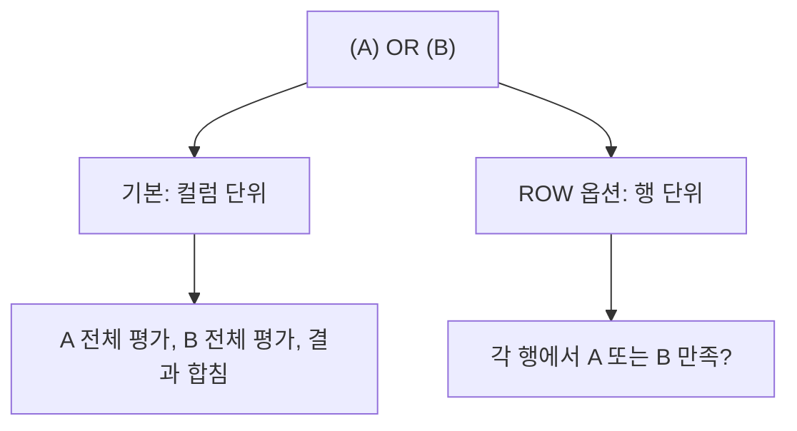
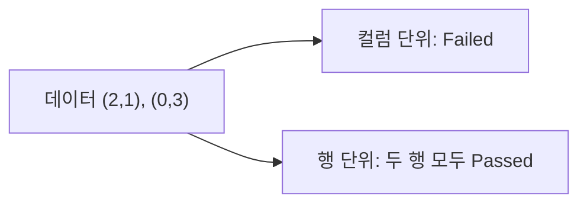

# DQDL 복합 규칙 행 단위 평가

> AWS Glue Data Quality의 **복합 규칙**(`and`·`or`로 규칙을 묶은 것)은 기본적으로 **컬럼(전체 데이터셋) 단위로 각 규칙을 먼저 평가한 뒤 결과를 합친다.** SQL처럼 **한 행씩** 평가하려면 `compositeRuleEvaluation.method`를 `ROW`로 설정해야 한다.

## 쉽게 말하면
"성적이 90점 이상이거나 출석 3회 미만"을 학생 한 명씩 확인하는 것(행 단위)과, 먼저 "성적 90 이상이 전체에 있는가?"를 보고 따로 "출석 조건이 전체에 있는가?"를 본 다음 합치는 것(컬럼 단위)은 결과가 다를 수 있다.

## 자세히
(AWS 공식 문서 「DQDL reference」의 Composite rules 절을 WebFetch로 직접 확인. Glue를 직접 실행하지는 않았다.)
- **복합 규칙 문법(문서)**: `and`, `or`로 연결하며 **각 규칙을 괄호로 감싸야** 한다. 예: `(IsComplete "id") and (IsUnique "id")`, 중첩도 가능: `(RowCount > 0) or ((IsComplete "colA") and (IsUnique "colA"))`.
- **기본 동작: 컬럼 단위(문서)**: 데이터 `myCol1=[2,0]`, `myCol2=[1,3]`에서 `(ColumnValues "myCol1" > 1) OR (ColumnValues "myCol2" > 2)`는 먼저 `myCol1 > 1`(모든 값에 대해: 0 때문에 실패)과 `myCol2 > 2`(1 때문에 실패)를 따로 평가해 둘 다 실패라 **전체 결과가 Failed**다.
- **행 단위로 바꾸기(문서)**: Glue ETL에서 `additionalOptions`에 `"compositeRuleEvaluation.method":"ROW"`를 넣는다(Data Catalog UI에서도 설정 가능). 그러면 복합 규칙이 **한 규칙처럼 행 전체를 평가**한다. 같은 데이터에서 첫 행(2,1)은 `myCol1 > 1`이 참, 둘째 행(0,3)은 `myCol2 > 2`가 참이라 **두 행 모두 Passed**로 나온다. 즉 **같은 규칙·같은 데이터인데 결과가 Failed → Passed로 달라진다.**
- **지원하지 않는 규칙(문서)**: 결과가 **비율**에 의존하는 규칙(`Completeness`, `DatasetMatch`, `ReferentialIntegrity`, `Uniqueness`)과, **threshold가 있는** `ColumnDataType`·`ColumnValues`·`CustomSQL`(threshold 없는 형태는 지원)은 행 단위 평가를 쓸 수 없다.
- **NULL·EMPTY와 함께(문서)**: `(ColumnValues "colA" = NULL) or (ColumnLength "colA" > 5)`처럼 값 또는 NULL을 허용하는 행 수준 조건은 문서가 **ROW 옵션이 필요하다**고 명시한다.
- **주의(해석)**: 컬럼 단위 기본값에서 `or`는 "각 규칙이 전체 데이터에서 성립하는가"의 논리합이므로 직관(행마다 둘 중 하나)과 다르다. 행 단위 의도라면 ROW 옵션을 켜고 결과를 행 수준 출력으로 확인해야 한다.

## 그림으로 보기

## 예시
- `(ColumnValues "age" >= 26) OR (ColumnLength "name" >= 4)`: 나이 또는 이름 길이 중 하나를 만족하는 **행**을 통과시키려면 `compositeRuleEvaluation.method=ROW`.
- 교육 활동: 2행짜리 표에서 두 평가 방식의 결과를 손으로 계산해 차이를 설명하기.

## 헷갈리는 것과 비교
| 개념 | 차이 |
|---|---|
| 컬럼 단위(기본) | 규칙별 전체 평가 후 결합 |
| 행 단위(ROW) | 행마다 조건 평가 |
| [DQDL where 절](#dqdl-where-clause) | 규칙을 적용할 행을 먼저 거름 |
| [DQDL with threshold](#dqdl-threshold-expression) | 비율로 판정(ROW 미지원 규칙 있음) |

## 더 읽을거리
- [DQDL reference (AWS Glue 문서)](https://docs.aws.amazon.com/glue/latest/dg/dqdl.html) — Composite rules, ROW 평가, 미지원 규칙(직접 확인).
