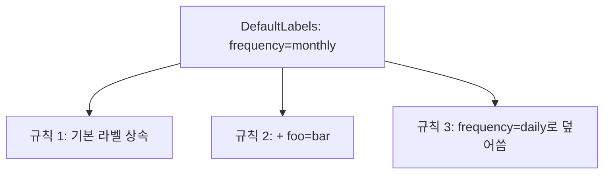
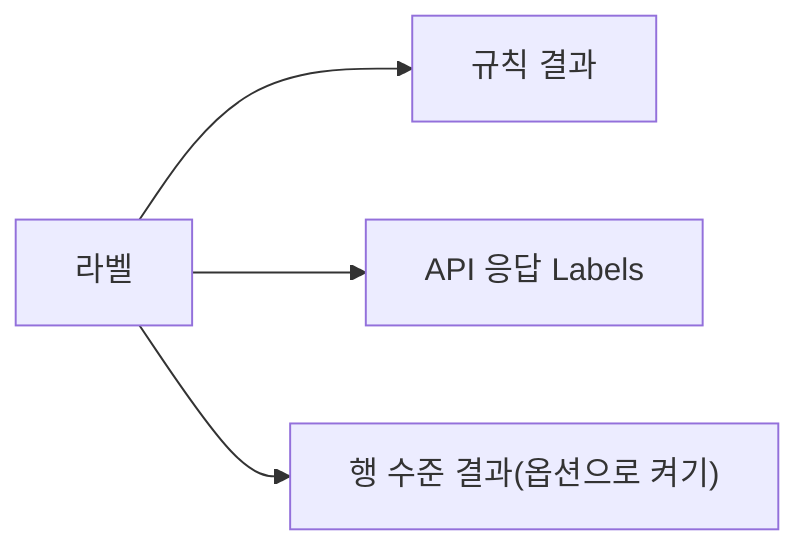

# DQDL 라벨

> AWS Glue Data Quality의 **라벨(labels)**은 규칙에 `"team=finance"` 같은 **키-값 꼬리표**를 붙여, 결과를 팀·중요도·주기별로 모아 보고하게 해 주는 기능이다. 규칙이 많아질 때 "재무팀 규칙만", "중요도 높은 규칙만"처럼 골라 볼 수 있다.

## 쉽게 말하면
서류철에 "재무", "긴급" 스티커를 붙여 두면 나중에 긴급 서류만 한 번에 꺼낼 수 있다. 라벨은 검증 규칙에 붙이는 스티커다.

## 자세히
(AWS 공식 문서 「DQDL reference」의 Labels 절을 WebFetch로 직접 확인. Glue를 직접 실행하지는 않았다.)
- **지원(문서)**: 라벨은 **AWS Glue ETL에서만** 가능하고 Data Catalog 기반 데이터 품질에는 없다.
- **기본 라벨과 규칙 라벨(문서)**: 규칙셋 수준의 `DefaultLabels=["frequency"="monthly"]`는 모든 규칙에 자동 적용되고, 개별 규칙은 `labels=[...]`로 자기 라벨을 더한다. 키·값 쌍이라서 **같은 키를 쓰면 규칙 라벨이 기본 라벨을 덮어쓴다**(예: `frequency`를 `daily`로).
  ```
  DefaultLabels=["frequency"="monthly"]
  Rules = [
    ColumnValues "col" > 21,                                   // frequency=monthly
    RowCount > 0 with threshold > 0.8 labels=["foo"="bar"],   // monthly + foo=bar
    ColumnValues "colA" in ["A","B"] with threshold > 0.8 labels=["foo"="bar","frequency"="daily"],  // frequency=daily로 덮어씀
    (isComplete "col" AND RowCount > 0) labels=["foo"="bar"]  // 복합 규칙은 전체를 괄호로 감싸고 라벨
  ]
  ```
- **복합 규칙 문법(문서)**: 복합 규칙의 라벨은 **전체를 괄호로 감싼 뒤** 붙여야 한다. `(isComplete "colA") AND (RowCount > 0) labels=[...]`처럼 괄호 밖/안에 어긋나게 쓰면 **잘못된 문법**이다.
- **제약(문서)**: 규칙당 **최대 10개** 라벨, 키·값은 **대소문자 구분**, 키는 **최대 128자·비어 있으면 안 됨**, 값은 **최대 256자·비어도 됨**.
- **어디서 보이나(문서)**: 규칙 결과(rule outcomes)와 API 응답(`RuleResults`의 `Labels` 필드)에는 **항상** 보인다. **행 수준 결과에서는 기본 꺼짐**이며 `"rowLevelConfiguration.ruleWithLabels":"ENABLED"`로 켜면 `DataQualityRulesPass/Fail/Skip` 컬럼에 라벨이 들어간다.
- **활용(문서 설명 + 해석)**: 재무팀 규칙에 `team=finance`, 우선순위 높은 규칙에 `criticality=high`를 붙여 팀별 보고서, 규칙 결과 집계, 이해관계자별 리포트를 만들 수 있다고 문서가 설명한다.

## 그림으로 보기



## 예시
- `IsComplete "order_id" labels=["team"="sales","criticality"="high"]`로 영업팀 핵심 규칙을 표시하고, 실패한 규칙 중 `criticality=high`만 모아 알림.
- 교육 활동: 규칙 6개에 팀·주기 라벨을 붙이고 "재무팀 월간 규칙"을 골라내는 표 만들기.

## 헷갈리는 것과 비교
| 개념 | 차이 |
|---|---|
| DQDL 라벨 | 규칙에 붙이는 분류 꼬리표 |
| [Great Expectations 메타](#gx-validation-result-json) | 도구별 결과 메타데이터(다른 방식) |
| [DQDL where 절](#dqdl-where-clause) | 규칙을 적용할 행을 거름 |
| [ResultKey와 태그](#result-key-tags) | Deequ에서 지표를 색인하는 태그 |

## 더 읽을거리
- [DQDL reference (AWS Glue 문서)](https://docs.aws.amazon.com/glue/latest/dg/dqdl.html) — Labels 문법, 제약, 결과·API 노출(직접 확인).
