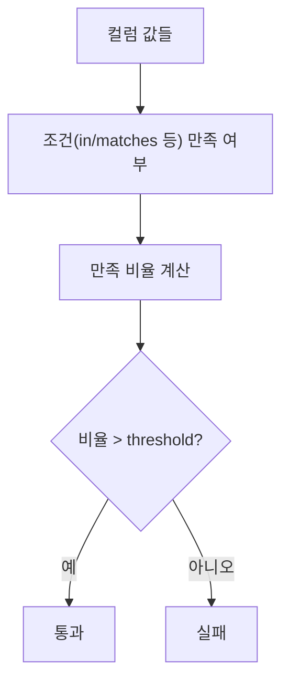
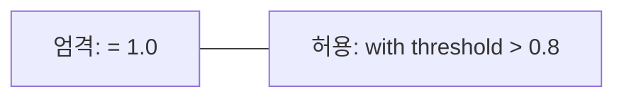

# DQDL with threshold

> DQDL의 **`with threshold`**는 규칙이 **"조건을 만족하는 값의 비율"**로 통과 여부를 판정하게 하는 표현이다. 예: `ColumnValues "colA" in ["A","B"] with threshold > 0.8` — 값의 80% 초과가 A 또는 B이면 통과. 데이터에 약간의 예외를 허용할 때 쓴다.

## 쉽게 말하면
"모든 학생이 합격해야 한다"가 아니라 "80% 넘게 합격하면 통과"라고 정하는 것이다. 완벽 요구 대신 허용 오차를 둔다.

## 자세히
(AWS 공식 문서 「DQDL reference」의 Expressions 절을 WebFetch로 직접 확인. Glue를 직접 실행하지는 않았다.)
- **지원 규칙(문서)**: `matches / in […] / not matches / not in […] with threshold`는 **`ColumnValues`, `ColumnDataType`, `CustomSQL`** 규칙 유형에서만 동작하며, "규칙 조건을 만족하는 값의 **백분율**"을 지정한다.
- **예시(문서)**
  ```
  ColumnValues "colA" in ["A", "B"] with threshold > 0.8
  ColumnValues "colA" matches "[a-zA-Z]*" with threshold between 0.2 and 0.9
  ColumnDataType "colA" = "Timestamp" with threshold > 0.9
  ```
- **일반 표현식(문서)**: threshold 없이는 규칙의 응답과 직접 비교한다. 지원 표현식은 `=`, `!=`, `>`, `<`, `>=`, `<=`, `between x and y`(문서 표는 "exclusive"로 적고 `not between`은 "inclusive"로 적어 서술이 일관되지 않으니 경계 포함 여부는 직접 시험해야 함), `in [...]`, `not in [...]`, `matches /정규식/`, `not matches`, `now()`(ColumnValues에서 날짜 표현식) 등이다.
- **where와 함께(문서)**: where 절이 있으면 **where를 threshold 앞에** 쓴다: `ColumnValues "colB" in ["A","B"] where "colC is not null" with threshold > 0.9`. → [DQDL where 절](#dqdl-where-clause)
- **복합 규칙과의 제약(문서)**: threshold를 쓰는 `ColumnDataType`·`ColumnValues`·`CustomSQL`은 **행 단위 복합 평가(ROW)를 지원하지 않는다**(threshold 없는 형태는 지원). → [DQDL 복합 규칙 행 단위 평가](#dqdl-composite-row-evaluation)
- **NULL 키워드와 함께(문서)**: `ColumnValues "colA" != NULL with threshold > 0.5`는 값의 50% 넘게 NULL이 아니면 참.
- **설계 요점(제안)**: ① 허용 비율을 문서화하고 근거를 남긴다 ② 너무 느슨한(예: 0.5) threshold는 심각한 데이터 문제를 통과시킬 수 있다 ③ 결측·이상 비율을 지표로 추적해 threshold 자체가 적절한지 점검한다. → [결측 비율 모니터링](#missing-percent-monitoring)

## 그림으로 보기



## 예시
- `ColumnDataType "event_time" = "Timestamp" with threshold > 0.99`: 타임스탬프 형식이 99% 넘으면 통과.
- 교육 활동: 10개 값 중 8개가 조건을 만족할 때 `> 0.8`과 `>= 0.8`의 결과를 비교하기.

## 헷갈리는 것과 비교
| 개념 | 차이 |
|---|---|
| with threshold | 만족 비율로 판정 |
| 일반 표현식(`> 10` 등) | 규칙 응답값과 직접 비교 |
| [GX mostly 파라미터](#mostly-parameter) | 다른 도구의 비슷한 허용 비율 |
| [필수 컬럼 규칙 조합](#required-column-rules) | 필수 규칙과 값 규칙을 짝짓는 설계 |

## 더 읽을거리
- [DQDL reference (AWS Glue 문서)](https://docs.aws.amazon.com/glue/latest/dg/dqdl.html) — 지원 표현식, with threshold, where와의 순서(직접 확인).
