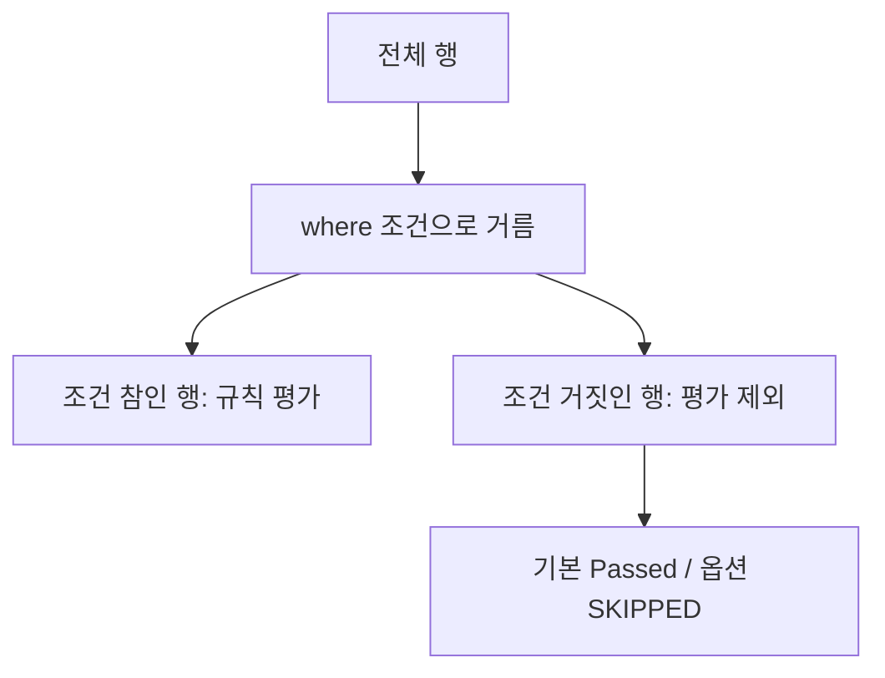
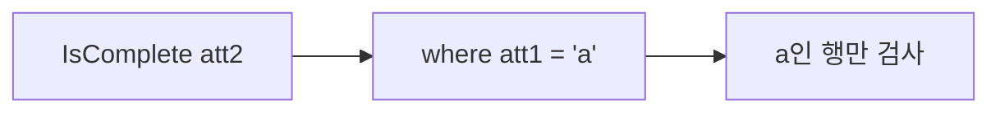

# DQDL where 절

> AWS Glue Data Quality의 DQDL에서 **규칙을 데이터의 일부 행에만 적용**하게 하는 조건절이다. 규칙 뒤에 `where "<SparkSQL 조건>"`을 붙인다. 예: "`colB = 10`인 행에서만 `colA` 완전성을 검사".

## 쉽게 말하면
"모든 학생이 제출했는가?"가 아니라 "3학년 학생 중 제출했는가?"처럼, 검사 대상을 먼저 좁히는 필터다. 조건에 맞지 않는 행은 검사에서 빠진다.

## 자세히
(AWS 공식 문서 「DQDL reference」의 Filtering with Where Clause 절을 WebFetch로 직접 확인. Glue를 직접 실행하지는 않았다.)
- **지원(문서)**: where 절은 **AWS Glue 4.0에서만** 지원된다고 명시한다.
- **문법(문서)**: `<DQDL 규칙> where "<유효한 SparkSQL 조건>"`. 조건은 `where` 키워드 뒤에 **큰따옴표로 감싼 SparkSQL 문장**이다. 규칙에 threshold가 있으면 **where를 threshold 앞에** 쓴다: `<규칙> where "<조건>" with threshold <조건>`.
- **예(문서)**
  ```
  Completeness "colA" > 0.5 where "colB = 10"
  ColumnValues "colB" in ["A", "B"] where "colC is not null" with threshold > 0.9
  ColumnLength "colC" > 10 where "colD != Concat(colE, colF)"
  ```
- **오류 처리(문서)**: 제공한 SparkSQL이 유효한지 검증하고, 유효하지 않으면 규칙 평가가 실패하며 `IllegalArgumentException`을 던진다(메시지 형식: "Rule … has provided an invalid where clause : …").
- **행 수준 결과와의 관계(문서)**: 행 수준 오류 레코드 식별을 켠 상태에서 where로 걸러진 행은 기본적으로 **`Passed`로 표시**된다. 걸러진 행을 따로 **`SKIPPED`**로 표시하려면 `additionalOptions`에 `"rowLevelConfiguration.filteredRowLabel":"SKIPPED"`를 설정한다.
- **문서 예시(IsComplete att2 where "att1 = 'a'")**
  | id | att1 | att2 | 기본 | SKIPPED 옵션 |
  |---|---|---|---|---|
  | 1 | a | f | PASSED | PASSED |
  | 2 | b | d | PASSED | **SKIPPED** (att1이 a가 아니라 걸러짐) |
  | 3 | a | null | **FAILED** | FAILED |
  | 5 | b | null | PASSED | **SKIPPED** |
  → 기본 설정에서는 걸러진 행이 "통과"로 세어져 **통과 비율이 부풀려 보일 수** 있다(해석).
- **쓰임(해석)**: 조건부 규칙(예: 유료 고객에게만 결제 수단 필수)을 표현할 때. 조건이 참인 행이 거의 없으면 규칙이 사실상 검사하지 않을 수 있으니 대상 행 수도 함께 본다.

## 그림으로 보기



## 예시
- `Completeness "email" > 0.9 where "customer_type = 'member'"`: 회원만 이메일 완전성을 검사.
- 교육 활동: 6행 표에서 where 조건으로 걸러진 행이 기본·SKIPPED 옵션에서 어떻게 표시되는지 표를 채워 보기.

## 헷갈리는 것과 비교
| 개념 | 차이 |
|---|---|
| where 절 | 규칙 적용 행을 사전 필터 |
| 복합 규칙 ROW 평가 | 규칙 조합을 행 단위로 평가 |
| [DQDL with threshold](#dqdl-threshold-expression) | 통과 비율로 판정 |
| [DQDL 라벨](#dqdl-labels) | 규칙을 분류·보고용으로 표시 |

## 더 읽을거리
- [DQDL reference (AWS Glue 문서)](https://docs.aws.amazon.com/glue/latest/dg/dqdl.html) — Where Clause 문법, 오류, SKIPPED 라벨(직접 확인).
