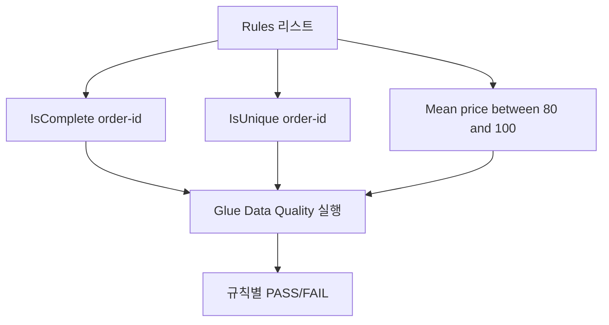
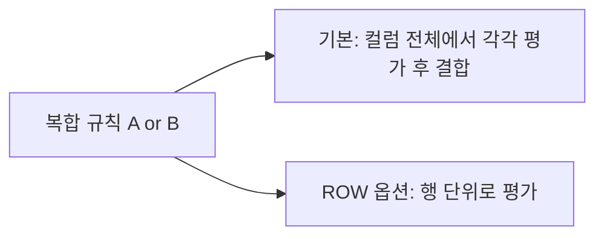

# DQDL(데이터 품질 정의 언어)

> DQDL(Data Quality Definition Language)은 AWS Glue Data Quality에서 **데이터 품질 규칙을 선언적으로 적는 전용 언어**다. `IsComplete "order-id"`처럼 코드 없이 규칙 목록(ruleset)을 쓴다.

## 쉽게 말하면
체크리스트에 "주문번호는 비어 있으면 안 됨", "주문번호는 중복 금지"라고 한 줄씩 적는 것과 같다. 어떻게 검사할지는 시스템이 알아서 하고, 사람은 무엇을 지켜야 하는지만 적는다.

## 자세히
(AWS Glue DQDL 레퍼런스를 직접 읽고 정리. 이번에 Glue에서 실행하지는 않았다.)
- **기본 구조**: 대소문자를 구분하며 `Rules = [ ... ]` 리스트에 규칙을 쉼표로 나열한다.
  ```
  Rules = [
     IsComplete "order-id",
     IsUnique "order-id"
  ]
  ```
  규칙은 대체로 `<RuleType> <Parameter> <Parameter> <Expression>` 형태. `IsComplete`·`IsUnique`처럼 불리언을 바로 주는 타입이 있고, `Mean "colA" between 80 and 100`처럼 값을 내는 타입은 **표현식**으로 불리언을 만든다.
- **규칙 유형 예(목차)**: Completeness, ColumnValues, ColumnLength, ColumnCount, ColumnDataType, DataFreshness, DistinctValuesCount, Distribution, Entropy, IsPrimaryKey, IsUnique, Mean, ReferentialIntegrity, RowCount, RowCountMatch, SchemaMatch, Uniqueness, DetectAnomalies, CustomSql 등.
- **표현식**: `=`, `!=`, `>`, `<`, `>=`, `<=`, `between x and y`, `in [...]`, `matches`(정규식), `now()`(날짜), `with threshold`(규칙을 만족하는 값의 비율, 예 `ColumnValues "colA" in ["A","B"] with threshold > 0.8`). NULL·EMPTY·WHITESPACES_ONLY 키워드도 있다.
- **복합 규칙**: `and`·`or`로 묶고 각 규칙은 괄호로 감싼다. 기본은 규칙을 **컬럼 전체에 대해 각각 평가한 뒤 결과를 결합**한다. 예: `(ColumnValues "myCol1" > 1) OR (ColumnValues "myCol2" > 2)`가 두 행 `(2,1)`, `(0,3)`에서 컬럼 단위로는 Failed가 된다. 행 단위(SQL처럼)로 평가하려면 `compositeRuleEvaluation.method=ROW`를 쓴다(문서 예시). 비율·임계값 기반 규칙은 행 단위 복합 규칙에서 지원되지 않는다.
- **where 절**: `IsComplete "att2" where "att1 = 'a'"`처럼 SparkSQL 조건으로 대상 행을 거른다(Glue 4.0). 행 단위 결과에서 걸러진 행은 기본적으로 Passed이며 옵션으로 SKIPPED로 표시할 수 있다.
- **상수·라벨·주석**: `mySql = "..."` 상수를 `$mySql`로 참조, 라벨(`labels=["team"="finance"]`, 규칙당 최대 10개, Glue ETL 전용)로 규칙을 분류, `#`으로 주석.
- **Deequ와의 관계**: PyDeequ README는 AWS Glue의 DQDL 규칙을 쓸 수 있다고 언급한다(직접 확인).
- **한계(해석)**: AWS Glue 생태계 중심의 언어라 다른 도구와 규칙을 공유하려면 변환이 필요하다. 기능 일부는 Glue ETL 또는 특정 버전에서만 지원된다.

## 그림으로 보기



## 예시
- 비개발자 데이터 담당자가 `Completeness "email" > 0.95`, `ColumnValues "age" between 0 and 120`을 직접 작성.
- 교육 소재: 같은 규칙을 Great Expectations 코드와 DQDL 한 줄로 비교.

## 헷갈리는 것과 비교
| 개념 | 차이 |
|---|---|
| DQDL | 선언적 규칙 언어(Glue) |
| [Great Expectations](#great-expectations) | Python 코드로 Expectation 정의 |
| [PyDeequ](#pydeequ) | Python API로 Deequ 사용 |
| [품질 지표 저장소](#data-quality-metrics-repository) | 지표 이력 저장 |

## 더 읽을거리
- [AWS Glue: DQDL reference](https://docs.aws.amazon.com/glue/latest/dg/dqdl.html) — 문법·표현식·복합 규칙(직접 확인).
- [awslabs/python-deequ](https://github.com/awslabs/python-deequ) — DQDL 규칙 지원 언급(직접 확인).
