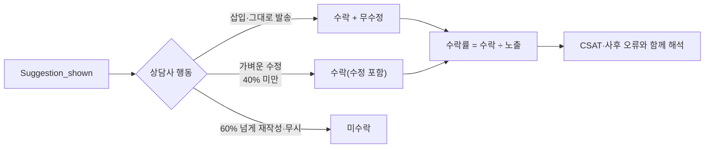

# 초안 수락률 (Draft Acceptance Rate)

> AI가 만들어 준 답변 초안(제안) 가운데 **상담사가 실제로 받아들여 쓴 비율**. 가장 흔한 정의는 `수락된 제안 ÷ 상담사에게 보인 제안`이고, "수정 없이 보냈는가"까지 보려면 최종 발송문과 초안을 비교해 별도로 계산해야 한다.

## 쉽게 말하면
선배가 후배에게 "이 답변 초안을 써 봤어요" 하고 건넸을 때 후배가 그대로 쓰거나 조금만 고쳐 쓴 비율이다. 초안이 쓸 만하면 높고, 매번 새로 쓴다면 낮다. 높다고 항상 좋은 것은 아니다(읽지 않고 보내는 경우).

## 자세히
출처: Zendesk 지원 문서(제안된 첫 응답 보고 레시피)와 Typewise 블로그(둘 다 본문 확인, 2026-11-18). Intercom·Salesforce 공식 문서의 같은 지표는 확인하지 못했다. Typewise는 벤더이며 벤치마크에 출처가 없다.
- **Zendesk의 측정 방식**: 제안된 첫 응답을 상담사가 수락하면 티켓에 `accepted_suggested_first_reply` 태그가 붙는다. 이 태그 유무를 보는 계산 속성 "Suggested reply accepted"(예/아니오)를 Explore에서 만들 수 있다. 보고서는 수락 티켓과 비수락 티켓의 첫 응답 시간을 비교한다. 문서는 **상담사가 제안을 수정하면 태그나 결과가 어떻게 되는지 설명하지 않는다**.
- **Typewise의 정의**: 수락 제안 ÷ 노출된 제안. 상담사가 볼 수 있었던 제안만 센다(억제·만료 제외). 한 번 클릭 삽입, Tab 키, 패널에서 붙여넣기, **가벼운 수정(길이 또는 편집 거리 40% 미만 변화)**, 자동 적용 초안은 수락으로 센다. 60% 넘게 바꾼 재작성은 수락이 아니다. 40~60% 구간은 글에 없다. 편집 거리를 원래 제안과 최종 발송문 중 무엇 기준으로 재는지도 명시되어 있지 않다.
- **계측**: Suggestion_shown, Suggestion_accepted, Message_sent 이벤트를 공통 ID로 연결하고 시각·채널·언어·의도·확신 점수를 저장한다(Typewise).
- **벤치마크(출처 없음, Typewise)**: 도입 초기 10~25%, 개선 중 40~60%, 전문 팀 55~75%. 글도 지침일 뿐 목표가 아니라고 한다.
- **함께 볼 지표**: CSAT·품질 점검. 수락률 상승과 CSAT 하락이 함께 나타나면 맹목적 신뢰 신호일 수 있다(Typewise). 수락률만으로 성과를 판단하지 말라는 권고.
- **엄격한 "무수정 발송률"을 원하면**: 초안과 최종 발송문의 차이를 직접 계산한다([정규화 편집 거리](#normalized-edit-distance)). 기준(예: 거리 0 또는 2% 이하)을 정해 기록.
- **위험 등급 연결(제안)**: 위험 단계 1(초안만)에서는 초안 수락률과 사후 오류율을 함께 보고, 수락률이 높아도 오류가 늘면 승급하지 않는다([승급 조건](#intent-promotion-criteria), [수락률과 품질의 관계](#acceptance-quality-link)).

## 그림으로 보기

## 예시
- 한 달 노출 2,000건, 수락 560건(그중 수정 없이 발송 310건, 가벼운 수정 250건) → 수락률 28%, 무수정 발송률 15.5%(가상 값).
- 교육 활용: 도구 도입 보고서의 "수락률 60%"에 노출 분모와 수정 허용 기준이 적혀 있는지 확인하는 실습.

## 헷갈리는 것과 비교
| 개념 | 차이 |
|---|---|
| 초안 수락률 | 노출 대비 수락(수정 허용 기준에 따라 다름) |
| [무수정 수락률](#accept-without-edit-rate) | 수락한 건 중 수정 없이 확정한 비율 |
| [지속성 지표](#persistence-metric) | 수락 후 시간이 지나도 남는 정도 |
| 사용률(Kore.ai의 Copied·Sent) | 복사·발송 이벤트별 집계 |

## 더 읽을거리
- [Zendesk: 제안된 첫 응답 보고 레시피](https://support.zendesk.com/hc/en-us/articles/8037982400794-Explore-recipe-Reporting-on-suggested-first-replies) — 수락 태그와 보고서 구성
- [Typewise: AI 제안 KPI](https://typewise.app/blog/ai-suggestion-kpi) — 수락 기준 40%, 이벤트 계측(벤더)
