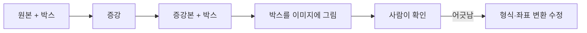
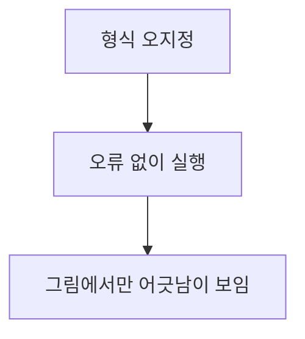

# 박스 그려 보기 점검

> 증강 전후의 이미지 위에 **박스를 직접 그려 눈으로 확인하는** 습관이다. 박스 형식이 틀려도 코드는 오류 없이 돌아가므로, 그림이 가장 빠른 오류 탐지기다.

## 쉽게 말하면
택배 송장 주소를 바꿨으면 지도 앱에 입력해 위치를 확인하는 것과 같다. 숫자만 봐서는 맞는지 알기 어렵지만, 지도(이미지) 위에 점을 찍어 보면 바로 보인다.

## 자세히
- 실험(Albumentations 2.0.8, 640×480 검은 이미지에 (100,50)-(300,250) 흰 사각형, 수평 뒤집기 `p=1`):
  - `pascal_voc`로 `[100,50,300,250]` 입력 → 출력 `[340,50,540,250]`. 실제 흰 영역도 x 340~540, y 50~250 → **일치**.
  - `coco`로 `[100,50,200,200]`(폭·높이) 입력 → 출력 `[340,50,200,200]`(coco 형식이므로 x_min=340, 폭 200) → 일치.
  - **잘못된 경우**: 코너 좌표 `[100,50,300,250]`를 `coco`로 잘못 지정 → 출력 `[240,50,300,250]`. 이 박스는 x 240~540, y 50~300이라 실제 영역(340~540, 50~250)보다 크다. 두 상자의 IoU는 200×200 ÷ (300×250) ≈ 0.53(계산).
  - 어느 경우도 예외나 경고가 없었다.
- 점검 절차(제안): ① 증강 파이프라인 출력 몇 장을 뽑는다 ② PIL `ImageDraw.rectangle` 등으로 박스를 그린다 ③ 물체와 박스가 겹치는지, 뒤집기·자르기·회전 뒤에도 유지되는지 본다 ④ 클래스 라벨 텍스트도 같이 그린다 ⑤ 형식을 바꾸면 반드시 다시 그려 본다.
- 숫자 점검도 병행: 폭·높이가 0 이하이거나 이미지 밖인 박스가 있는지 자동 검사.
- 한계: 몇 장만 보는 표본 점검이라 드문 오류를 놓칠 수 있다. 자동 검사와 함께 쓴다.

## 그림으로 보기



## 예시
```python
from PIL import ImageDraw, Image
im = Image.fromarray(aug["image"]); d = ImageDraw.Draw(im)
x1, y1, x2, y2 = aug["bboxes"][0]   # pascal_voc일 때
d.rectangle([x1, y1, x2, y2], outline="red", width=3)
im.save("check.png")
```
- 교육: "눈으로 확인"을 데이터 품질 검증의 첫 단계로 가르치는 사례.

## 헷갈리는 것과 비교
| 개념 | 차이 |
|---|---|
| 박스 그려 보기 | 시각 확인(표본) |
| 범위 검사 | 좌표가 이미지 안인지 자동 검사 |
| [박스 형식 변환](#bbox-format-conversion) | 변환 절차 |
| [조용한 데이터 버그](#silent-data-bugs) | 이 점검이 막으려는 문제 |

## 더 읽을거리
- [Albumentations 바운딩 박스 문서](https://albumentations.ai/docs/3-basic-usage/bounding-boxes-augmentations/) — 형식 정의 확인.
- 직접 실행: Albumentations 2.0.8 수평 뒤집기 실험.
