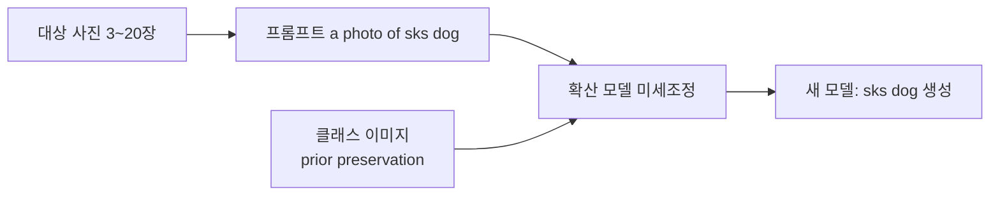
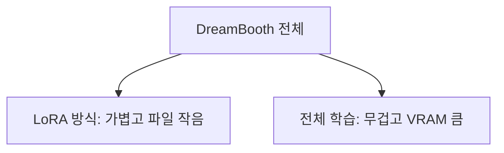

# DreamBooth

> DreamBooth는 특정 대상(내 반려견·제품·화풍)의 사진 몇 장으로 확산 모델을 미세조정하고, 그 대상을 프롬프트의 특별한 단어(예 `sks`)와 연결하는 기법이다.

## 쉽게 말하면
화가에게 우리 집 강아지 사진을 몇 장 보여 주고 "이 아이를 `sks 강아지`라고 부를게"라고 가르치면, 이후 "바닷가의 sks 강아지"를 그려 달라고 할 수 있다.

## 자세히
HF diffusers DreamBooth 가이드 기준:
- **전체 확산 모델을 갱신**하는 학습 기법으로, 대상 또는 스타일의 이미지 몇 장과 특별한 단어를 연결한다. 이미지 폴더(`--instance_data_dir`)와 `--instance_prompt`("a photo of sks dog")를 지정한다.
- 문서 경고: **하이퍼파라미터에 매우 민감하고 과적합되기 쉽다.** 예시 명령은 학습률 5e-6, 400스텝(SD 1.5 기준).
- **Prior preservation loss**: 모델이 직접 생성한 같은 클래스 이미지(`--class_data_dir`, `--class_prompt`)를 함께 학습해 클래스 일반 지식을 잃지 않고 다양한 구도를 유지한다(`--with_prior_preservation`).
- 텍스트 인코더도 함께 학습하면(`--train_text_encoder`) 특히 얼굴 품질이 좋아지지만 24GB 이상 VRAM이 필요하다.
- 메모리 팁: 16GB는 8bit Adam + gradient checkpointing, 12GB는 여기에 xFormers·`--set_grads_to_none`, 8GB 미만은 DeepSpeed(CPU 오프로드, 시스템 RAM 약 25GB).
- LoRA 방식(`train_dreambooth_lora.py`)을 쓰면 파라미터가 크게 줄어 가중치가 약 100MB로 작다([LoRA](#lora-image)). SDXL용 스크립트도 별도.
- 사람 얼굴·초상은 [권리 문제](#image-training-data-ethics)를 먼저 확인한다.

## 그림으로 보기



## 예시
```bash
accelerate launch train_dreambooth.py \
  --pretrained_model_name_or_path=$MODEL_NAME --instance_data_dir=$INSTANCE_DIR \
  --instance_prompt="a photo of sks dog" --resolution=512 --train_batch_size=1 \
  --learning_rate=5e-6 --max_train_steps=400
```
추론: `pipeline("A photo of sks dog in a bucket")`. 자사 제품 사진 몇 장으로 광고 이미지 시안을 뽑을 때 쓴다.

## 헷갈리는 것과 비교
| 개념 | 차이 |
|---|---|
| DreamBooth | 특정 대상을 가르치는 학습 방식 |
| [LoRA](#lora-image) | 가볍게 학습하는 방법(DreamBooth와 결합 가능) |
| 텍스트 인버전 | 새 단어 임베딩만 학습(일반 설명) |
| [프롬프트만 쓰기](#clip-text-encoder) | 학습 없이 설명으로 생성 |

## 더 읽을거리
- [HF DreamBooth 학습 가이드](https://huggingface.co/docs/diffusers/training/dreambooth) — 파라미터, prior preservation, 메모리별 설정.
