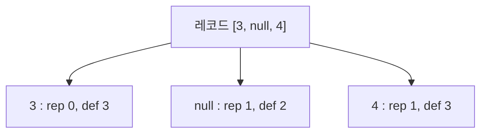

# Dremel 중첩 인코딩

> 리스트·구조체처럼 **중첩된 데이터를 열 형식으로 저장**하기 위해 값마다 두 개의 작은 숫자 — **반복 수준(repetition level)** 과 **정의 수준(definition level)** — 를 붙이는 방식이다. Google의 Dremel에서 나왔고 Parquet이 쓴다.

## 쉽게 말하면
설문 응답에서 "취미 목록"을 열 하나에 평평하게 늘어놓으면 "어느 사람의 취미인가", "목록이 비었나 아니면 아예 답을 안 했나"를 잃어버린다. 값마다 "새 사람이 시작되는가(반복 수준)"와 "어디까지 값이 있었는가(정의 수준)" 꼬리표를 붙이면 평평한 열에서 원래 구조를 복원할 수 있다.

## 자세히
(Parquet 공식 문서의 중첩 인코딩 페이지를 직접 읽었다. 그 페이지에는 완성된 예시가 없어서, 아래 예시는 **이 지도에서 직접 만든 것**이다. 스키마와 최대 수준은 pyarrow로 확인했고 레벨 값은 Dremel 규칙대로 손으로 유도한 뒤 원본이 복원되는지 파이썬으로 자체 검증했다.)
- **정의(Parquet 문서)**: Parquet은 중첩 열을 **Dremel 인코딩**으로 저장하며 정의 수준과 반복 수준을 쓴다.
  - **정의 수준**: 열 경로의 선택(optional) 필드 중 **몇 개가 정의돼 있는지**.
  - **반복 수준**: 경로의 어느 반복(repeated) 필드에서 값이 **되풀이되는지**.
  - 최대 정의·반복 수준은 스키마의 중첩 깊이로 계산되고, 이 최대값이 수준을 저장하는 데 필요한 비트 수를 정한다. 수준은 열의 **모든 값에 대해** 정의된다. 수준 인코딩은 BIT_PACKED와 RLE가 있으나 RLE가 대체하므로 지금은 RLE만 쓴다고 문서가 적는다.
- **직접 만든 예(리스트 열)**: 스키마 `optional xs (List) { repeated list { optional int32 element } }`. pyarrow로 확인한 값은 **최대 정의 수준 3, 최대 반복 수준 1**(경로 `xs.list.element`). 데이터 5개 레코드:

  `[1,2]`, `[]`, `None`, `[3,None,4]`, `[5]`

  | 레코드 | 값 | 반복 수준 | 정의 수준 | 의미 |
  |---|---|---|---|---|
  | [1,2] | 1 | 0 | 3 | 새 레코드, 값 있음 |
  | | 2 | 1 | 3 | 같은 리스트에서 반복 |
  | [] | (값 없음) | 0 | 1 | 리스트 자체는 있으나 비었음 |
  | None | (값 없음) | 0 | 0 | 리스트가 아예 null |
  | [3,None,4] | 3 | 0 | 3 | 새 레코드 |
  | | (null 원소) | 1 | 2 | 원소가 null |
  | | 4 | 1 | 3 | 값 있음 |
  | [5] | 5 | 0 | 3 | 새 레코드 |

  저장되는 **실제 값 열**은 non-null 값만 `[1,2,3,4,5]`이고, 반복 수준 열은 `[0,1,0,0,0,1,1,0]`, 정의 수준 열은 `[3,3,1,0,3,2,3,3]`이다. 이 세 열로부터 위 5개 레코드를 되살려 원본과 같음을 확인했다.
- **정의 수준이 구별해 주는 것**: 3=값이 있음, 2=원소가 null, 1=리스트가 빈 상태, 0=리스트가 null. 평평한 값 열만으로는 이 구분이 불가능하다.
- **왜 이런 방식인가(해석)**: 중첩 구조를 별도 구조 정보 없이 열 단위로 저장해 [열 가지치기](#column-pruning)와 압축을 중첩 필드에도 쓰게 한다. 수준 값은 작은 정수라 RLE로 잘 줄어든다.
- **한계**: 이 글은 리스트 한 단계의 예다. 여러 단계 반복이 중첩될 때의 수준 계산(예: 문서·링크·언어 같은 Dremel 논문 예)은 직접 다루지 않았다.

## 그림으로 보기



## 예시
```python
import pyarrow as pa, pyarrow.parquet as pq
t = pa.table({"xs": pa.array([[1,2], [], None, [3,None,4], [5]], pa.list_(pa.int32()))})
pq.write_table(t, "x.parquet")
pq.ParquetFile("x.parquet").schema.column(0).max_definition_level   # 3
```
- 교육 소재: "빈 목록 [] 과 목록 없음 None은 어떻게 다르게 저장될까?"

## 헷갈리는 것과 비교
| 개념 | 차이 |
|---|---|
| 반복 수준 | 어느 반복 필드에서 새로 반복되는지 |
| 정의 수준 | 경로의 선택 필드 중 몇 개가 정의됐는지 |
| 평평한 열(CSV) | 중첩 구조를 표현할 수 없음 |
| [열 가지치기](#column-pruning) | 중첩 필드도 열 단위로 읽음 |

## 더 읽을거리
- [Nested Encoding (Apache Parquet 문서)](https://parquet.apache.org/docs/file-format/nestedencoding/) — 정의·반복 수준 개념(직접 읽음).
