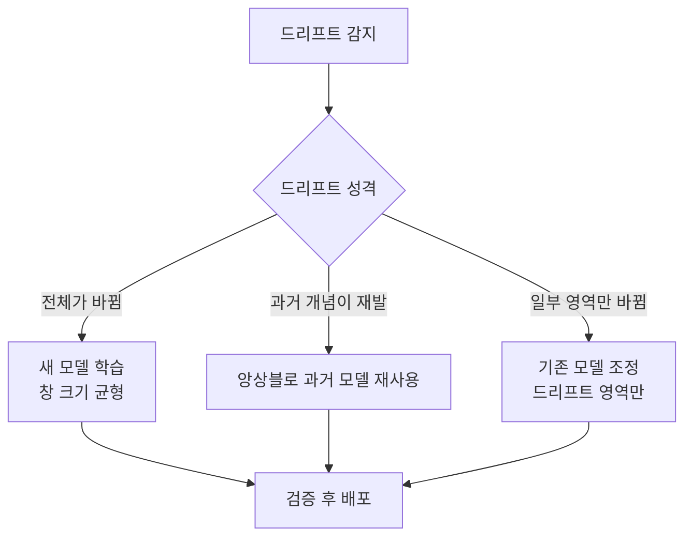

# 드리프트 적응

> 개념 드리프트가 감지된 뒤 모델을 **어떻게 갱신할지**를 다루는 단계. 논문은 세 가지 전략으로 나눈다: 전역 드리프트에는 **새 모델 학습**, 재발 드리프트에는 **앙상블로 과거 모델 재사용**, 국소 드리프트에는 **기존 모델 조정**.

## 쉽게 말하면
교재가 개정됐을 때 책 전체를 새로 쓸지(새 모델), 이전 개정판들을 서가에 두고 알맞은 판을 꺼내 쓸지(앙상블), 바뀐 장만 고칠지(부분 조정)를 정하는 일이다. 변화가 전부인지, 되돌아오는지, 일부인지에 따라 답이 다르다.

## 자세히
출처: Lu 외 "Learning under Concept Drift: A Review"(arXiv 2004.05785, 원문 PDF의 5절 일부를 내려받아 읽음). 5.1~5.3절의 도입부와 제목 위주로 확인했고 세부 알고리즘은 다 읽지 못했다.
- **5.1 전역 드리프트: 새 모델 학습**: 드리프트가 감지되면 낡은 모델을 버리고 **새 모델을 다시 학습**하는 것이 가장 직관적인 방법이다. 재학습에는 어떤 데이터를 쓸지가 핵심이며 창(window) 기반 전략이 흔하다. 창이 작으면 최신 데이터를 잘 반영하지만 표본이 부족하고, 크면 반대 문제가 있어 **창 크기의 균형**이 필요하다는 서술이 있다. 논문은 이 방법이 단순하고 널리 쓰인다고 설명한다.
- **5.2 재발 드리프트: 앙상블로 과거 모델 재사용**: 개념이 재발하는 경우 옛 모델을 **보존·재사용**하면 새 모델을 다시 학습하는 노력을 크게 줄일 수 있다. 앙상블은 서로 다른 유형·파라미터를 가진 기반 분류기들의 집합이며 스트림 마이닝에서 주목받아 왔다. 논문은 갑작스러운·점진적·재발 드리프트를 모두 다루는 앙상블 방법들을 소개하며, 단점으로 분류기 추가가 너무 자주 일어날 수 있음 등을 언급한다.
- **5.3 국소 드리프트: 기존 모델 조정**: 드리프트가 입력 공간의 일부 **영역**에서만 일어난다면 전체를 새로 학습하기보다 **영향받는 영역만 조정**하는 접근이다. 앞 절(4.3)에서 **드리프트 영역**을 식별하면 낡은 사례를 가려내고 새 개념을 구성하는 데 쓸 수 있다고 논문이 설명한다. 예: 드리프트 영역 밖의 충돌하는 낡은 사례만 제거해 새 개념 사례를 최대한 보존.
- **유형과의 연결**: 갑작스러운 드리프트는 빠른 교체, 재발은 과거 모델 재사용, 점진·증분은 서서히 조정하는 전략이 어울린다([드리프트 네 유형](#drift-types-sudden-gradual)). 이 대응은 논문 구조에서 이 지도가 정리한 것이다.
- **의료 AI 맥락**: 허가된 의료기기는 모델 갱신이 곧 변경이므로 PCCP에 정한 범위 안에서만 재학습·조정을 한다([AI PCCP 최종 지침](#pccp-ai-final-guidance)).

## 그림으로 보기

## 예시
- 사기 탐지: 수법이 완전히 바뀌면 최근 6개월 데이터로 재학습, 계절성 패턴이면 과거 시즌 모델을 앙상블에 유지.
- 점검: 갱신 후 모델이 이전 모델보다 나은지 격리된 검증 데이터로 확인하고, 규제 범위 안의 변경인지 기록.

## 헷갈리는 것과 비교
| 개념 | 차이 |
|---|---|
| 드리프트 감지 | 변화 시점을 찾음 |
| 드리프트 적응 | 감지 후 모델을 갱신 |
| [드리프트 감지 틀](#drift-detection-framework) | 앞 단계 |
| [변경 관리 계획(PCCP)](#pccp) | 의료기기에서 갱신을 사전 승인받는 제도 |

## 더 읽을거리
- [Learning under Concept Drift: A Review (arXiv 2004.05785)](https://arxiv.org/abs/2004.05785) — 5절 드리프트 적응(원문 일부 확인)
