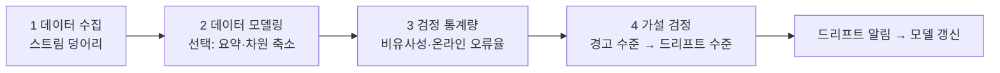

# 드리프트 감지 틀

> 개념 드리프트를 감지하는 알고리즘들이 공통으로 따르는 **4단계 틀**: ① 데이터 수집 → ② 데이터 모델링(선택) → ③ 검정 통계량 계산 → ④ 가설 검정. 대표 알고리즘 DDM은 온라인 오류율을 통계량으로 써 경고 수준과 드리프트 임계값을 둔다.

## 쉽게 말하면
화재 경보기의 구조와 같다. 연기를 감지하고(수집), 필요하면 신호를 걸러 내고(모델링), 평소와 얼마나 다른지 수치로 만든 뒤(통계량), 정해진 기준을 넘으면 경보를 울린다(검정). 기준을 두 단계(주의·경보)로 두면 미리 대비할 수 있다.

## 자세히
출처: Lu 외 "Learning under Concept Drift: A Review"(arXiv 2004.05785, 원문 PDF의 3.1절과 Fig. 5~6을 내려받아 읽음).
- **드리프트 감지의 정의(논문)**: 변화 시점이나 변화 구간을 찾아 개념 드리프트를 특징짓고 정량화하는 기법과 메커니즘.
- **4단계 틀(Fig. 5)**:
  1. **데이터 수집(Data Retrieval)**: 데이터 스트림에서 덩어리(chunk)를 가져온다. 사례 하나로는 전체 분포를 추론할 정보가 부족하므로 의미 있는 패턴이 되도록 덩어리를 구성하는 것이 중요하다.
  2. **데이터 모델링(Data Modeling, 선택)**: 가져온 데이터를 추상화하고, 드리프트하면 시스템에 가장 큰 영향을 줄 민감한 특성을 추출한다. 주로 차원 축소나 표본 수 축소로, 저장·온라인 속도 요구를 맞추는 선택 단계다.
  3. **검정 통계량 계산(Test Statistics Calculation)**: 비유사성(거리) 측정으로 드리프트의 심각도를 정량화하고 가설 검정용 통계량을 만든다. 논문은 이 단계를 드리프트 감지에서 **가장 어려운 부분**으로 본다. 정확하고 강건한 비유사성 측정을 정의하는 문제가 아직 열려 있다.
  4. **가설 검정(Hypothesis Test)**: 특정 가설 검정으로 앞 단계 통계량의 유의성을 평가해 드리프트 여부를 판정한다.
- **창(window)**: 기준 구간은 **고정된 랜드마크 창**(Fig. 6, 시작점 고정)이거나 새 데이터가 오면 늘어나는 창 등으로 둔다.
- **대표 알고리즘 DDM(논문 서술)**: 가장 많이 인용되는 알고리즘 중 하나이며, 경고 수준과 드리프트 임계값을 정의한 첫 알고리즘이라고 한다. 모델을 두는 단계(Stage 2)에서 학습기를 쓰고, 통계량(Stage 3)은 **온라인 오류율**이며, 가설 검정(Stage 4)은 온라인 오류율의 분포를 추정해 관찰된 오류율 변화의 신뢰 수준을 계산한다. 경고 수준에 이르면 새 학습기 구축을 시작하고 드리프트 수준에 이르면 새 학습기로 교체한다(요지).
- **경고·드리프트 수준 예(논문)**: EDDM, STEPD, HDDM 등도 경고 수준을 둔다. 경고는 느슨한 조건(예: 95% 또는 2σ), 드리프트는 더 엄격한 조건(예: 99% 또는 3σ)이며 둘 사이에 쌓인 데이터를 새 모델의 학습 데이터로 쓴다.
- **한계(논문)**: 알림 시점은 실제 드리프트 시점보다 늦고, 대부분의 감지기는 상태를 평가하려면 최소한의 새 데이터가 필요하다.

## 그림으로 보기

## 예시
- DDM식 운영: 운영 중 오류율을 계속 계산해 2σ를 넘으면 경고(새 모델 준비), 3σ를 넘으면 드리프트로 판정해 교체.
- 라벨이 늦게 오는 영역에서는 오류율을 쓰기 어려워 입력·예측 분포 기반 통계량을 쓴다([지연 라벨 모니터링](#delayed-label-monitoring)).

## 헷갈리는 것과 비교
| 개념 | 차이 |
|---|---|
| 드리프트 감지 | 변화가 있는지 알리는 단계 |
| 드리프트 이해 | 언제·얼마나·어디서인지 분석(논문 4절) |
| [드리프트 적응](#drift-adaptation) | 모델을 갱신하는 단계 |
| [드리프트 통계 검정](#drift-statistical-tests) | 4단계 중 3~4단계에서 쓰는 도구 |

## 더 읽을거리
- [Learning under Concept Drift: A Review (arXiv 2004.05785)](https://arxiv.org/abs/2004.05785) — 3절 감지 틀과 DDM(원문 확인)
