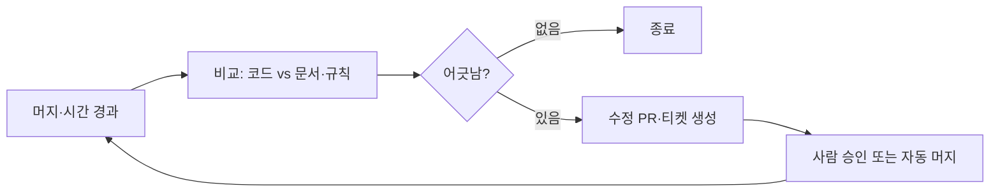

# 드리프트 감지 루프

> 시간이 지나며 **코드와 문서, 규칙과 실제 구현이 서로 어긋나는 것(드리프트)** 을 사람이 기억에 의존하지 않고 **정기적·자동으로 찾아내 수정 작업으로 만드는 순환**. AI 에이전트가 기존 패턴을 복제하는 코드베이스에서는 드리프트가 빨리 쌓이므로 하네스의 필수 부품이다.

## 쉽게 말하면
도서관 지도(문서)가 책장 배치(코드)와 달라지면 길 안내가 틀린다. 매주 관리인이 지도와 실제 책장을 대조해 다르면 수정 요청서를 올리는 것이 드리프트 감지 루프다.

## 자세히
- **왜 생기나**: OpenAI 글에 따르면 Codex는 저장소에 있는 패턴을 **나쁜 것까지 복제**해 시간이 갈수록 드리프트가 생긴다. 처음엔 매주 금요일(주 20%)을 "AI slop" 정리에 썼지만 확장되지 않아 자동화했다.
- **OpenAI의 대응**(2026-02 원문): ① **doc-gardening 에이전트**가 주기적으로 코드 동작을 반영하지 않는 낡은 문서를 찾아 수정 PR을 연다, ② 린터·CI가 지식 베이스의 최신성·교차 링크·구조를 검증, ③ 저장소에 "golden principles"를 적고 백그라운드 작업이 정기적으로 이탈을 찾아 품질 등급을 갱신하고 작은 리팩터링 PR을 연다(대부분 1분 안에 리뷰해 자동 머지). 기술 부채를 "고금리 대출"에 비유하며 매일 조금씩 갚는 편이 낫다고 한다.
- **Mastra의 문서 표류 루프**(블로그): 머지된 PR을 문서와 비교해, 어긋남이 생기면 **새 triage 항목**으로 만든다. 모니터링 루프(운영 이상이 새 작업이 됨)와 같은 구조다.
- **구성**: ① 기준(진실의 원천: 코드·스키마), ② 비교 규칙(기계가 확인할 수 있는 형태), ③ 주기(머지 후·매일·매주), ④ 출력(수정 PR 또는 티켓), ⑤ 사람 승인 지점([사람 관문 설계](#human-gates)).
- **직접 만든 작은 예**(Python `ast`+정규식 20줄 미만을 실행): `README.md`에 적힌 함수 이름과 `app.py`의 실제 함수를 비교해 "문서에만 있음: `archive_user`, `remove_user`(낡은 문서 의심)", "코드에만 있음: `delete_user`(문서 누락)"을 출력했다. 실제로는 이 결과를 수정 PR로 바꾸는 단계가 붙는다.
- 한계: 자동 비교로 잡히는 드리프트는 이름·스키마처럼 **기계적으로 비교 가능한 것**에 한정된다. 의도·설명의 어긋남은 LLM 판단이 필요하며 오탐이 있을 수 있다.

## 그림으로 보기


## 예시
```python
code = {n.name for n in ast.walk(tree) if isinstance(n, ast.FunctionDef)}
docs = set(re.findall(r"`(\w+)\(", readme_text))
print("문서에만 있음:", sorted(docs - code))
print("코드에만 있음:", sorted(code - docs))
```
- 사내 AI 가이드라인 문서도 월 1회 "현재 사용 중인 도구 목록"과 대조하는 점검 루프를 둔다.

## 헷갈리는 것과 비교
| 개념 | 차이 |
|---|---|
| 드리프트 감지 루프 | 어긋남을 찾아 수정 작업으로 만드는 순환 |
| [기계적 제약](#mechanical-constraints) | 어긋남을 처음부터 막는 규칙 |
| [하네스 부품의 유통기한](#harness-decay) | 모델 개선으로 부품이 낡는 문제 |
| [모니터링 루프](#monitoring-loop) | 운영 이상을 새 작업으로 되돌리는 순환 |

## 더 읽을거리
- [OpenAI: Harness engineering](https://openai.com/index/harness-engineering/) — doc-gardening·golden principles·가비지 컬렉션.
- [Mastra: Software factory](https://mastra.ai/blog/software-factory) — 문서 표류 감지 루프.
