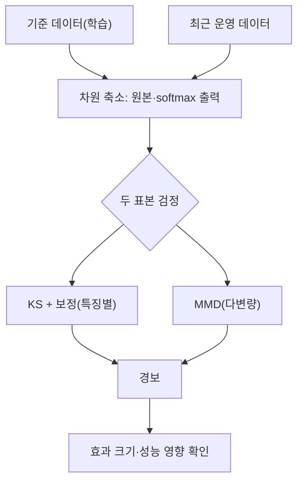

# 드리프트 탐지기 KS·MMD

> 학습 때 데이터와 운영 중 데이터의 분포가 달라졌는지 **통계적 두 표본 검정**으로 감지하는 도구다. KS(콜모고로프-스미르노프) 검정은 특징 하나씩의 분포를 비교하고, MMD(최대 평균 불일치)는 여러 특징을 한꺼번에 커널로 비교한다.

## 쉽게 말하면
두 학급의 키 분포가 같은지 알아보려고 키 히스토그램을 겹쳐 보는 것이 KS(특징 하나), 키·몸무게·나이를 한꺼번에 보는 것이 MMD(여러 특징)다. 다만 "차이가 있다"는 통계적 증거와 "차이가 크다"는 실제 영향은 다른 이야기다.

## 자세히
(Rabanser·Günnemann·Lipton의 「Failing Loudly」(arXiv 1810.11953) 방법·결과 절을 PDF로 직접 읽어 확인하고, 오탐률과 검출력은 SciPy로 직접 시뮬레이션했다.)
- **방법(논문)**: 데이터셋 이동 검출을 ① **차원 축소**(원본, 주성분, 오토인코더, **블랙박스 분류기의 softmax 출력 BBSDs**, 분류기의 예측 클래스 BBSDh, 도메인 분류기 등)와 ② **두 표본 검정**(특징마다 KS 검정을 하고 **Bonferroni 보정**으로 합치는 다중 일변량 검정, 또는 **MMD** 같은 다변량 커널 검정)의 조합으로 비교했다.
- **논문 결과(MNIST·CIFAR-10)**: 놀랍게도 **강한 보정에도 불구하고 다중 일변량 검정이 다변량 검정과 비슷한 성능**을 냈다. 차원 축소로는 일변량 검정에서 **BBSDs(분류기 softmax 출력)가 가장 좋았고**, 다변량 검정에서는 오토인코더 계열이 가장 좋았다. 도메인 분류기는 표본이 적을 때(≤100) 성능이 나쁘지만 표본이 늘면 따라잡는다. 다변량 검정을 **차원 축소 없이** 쓰는 일반적 기준선은 성능이 나빴다. 저자들은 분류기를 이미 갖고 있다면 BBSDs를 쓰는 것이 실무에 좋은 소식이라고 말한다.
- **직접 시뮬레이션(정상 분포에서 두 표본, 특징 10개, SciPy `ks_2samp`)**
  | 실험 | 결과 |
  |---|---|
  | 같은 분포에서 특징 10개 각각 KS 검정(α=0.05), 하나라도 p<0.05면 경보, 표본 500, 300회 | **보정 없음 오탐 38.7%**, Bonferroni 보정 5.0% |
  | 한 특징의 평균만 0.2 이동(표본 500), KS+Bonferroni 검출률(60회) | 0.50 |
  | 같은 조건에서 MMD 순열 검정(표본 200, 60회) | 0.25 |
  | 한 특징 평균 0.1 이동 | KS+Bonferroni 0.13, MMD 0.08 |
  특징이 많을수록 **보정 없이는 오탐이 흔하다**(10개면 약 39%). 이 설정(한 특징만 변함)에서는 일변량 KS가 MMD보다 검출률이 높았는데, 변화가 소수 특징에 집중될 때 유리하다는 논문의 관찰과 방향이 같다(MMD는 표본 200개로 줄여 비교한 조건이라 표본 수 차이가 영향을 줬을 수 있다).
- **표본 크기와 '유의함 ≠ 중요함'(직접 계산, 평균 0.05만 이동한 미미한 변화, 한 번 추출)**: n=500은 KS 통계량 0.086, p=0.05, n=5,000은 통계량 0.021, p=0.22, n=50,000은 통계량 0.024, **p=2.4×10⁻¹³**. 표본이 크면 실무상 무시할 만한 이동도 **통계적으로 극도로 유의**해진다(한 번의 무작위 추출이라 통계량은 표본 크기 순으로 단조롭지 않음). 그래서 p값만 보지 않고 **효과 크기**(KS 통계량, 평균 이동량)와 **모델 성능 변화**를 함께 본다.
- **운영 설계(제안)**: ① 특징별 KS + 보정(Bonferroni 또는 BH)과, 모델 출력(softmax)에 대한 검정을 함께 ② 기준 윈도(학습 데이터)와 최근 윈도(예: 일/주 단위)를 비교 ③ 경보 임계값은 효과 크기와 비즈니스 영향으로 정하고 ④ 경보 후 원인 조사(입력 파이프라인, 새 고객군) ⑤ 이동 검출 후 성능이 실제로 떨어졌는지 라벨이 생기는 대로 확인.
- **한계**: 검정은 이동을 "검출"할 뿐 위험한 이동인지 알려 주지 않는다(논문도 이동의 악성도 정량화를 별도 주제로 다룬다). 범주형·결측 처리, 시계열 상관(독립 가정 위반)도 고려해야 한다.

## 그림으로 보기

## 예시
- 대출 심사 모델의 입력 15개에 대해 일별 KS 검정(BH 보정)과 모델 확률(softmax) KS 검정을 돌려 경보를 만들고, 경보가 난 날 거절률·연체 지표가 실제로 변했는지 후속 확인.
- 교육 소재: "AI 모니터링: 데이터가 바뀌었는지 어떻게 아나"를 가상 숫자로 체험(MLOps 입문).

## 헷갈리는 것과 비교
| 개념 | 차이 |
|---|---|
| KS 검정 | 특징 하나씩 분포 비교 |
| MMD | 다변량 커널 기반 비교 |
| [분포 변화 유형](#distribution-shift-types) | 무엇이 바뀌는지의 분류 |
| [라벨 변화 추정](#label-shift-estimation) | 클래스 비율 변화의 추정·교정 |

## 더 읽을거리
- [Failing Loudly: An Empirical Study of Methods for Detecting Dataset Shift (arXiv 1810.11953)](https://arxiv.org/abs/1810.11953) — 차원 축소와 두 표본 검정 조합의 비교(PDF 직접 확인).
