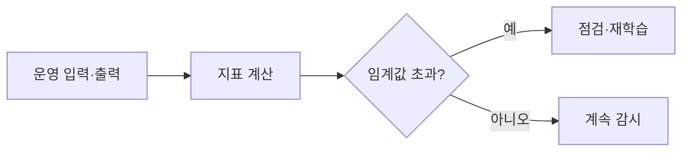
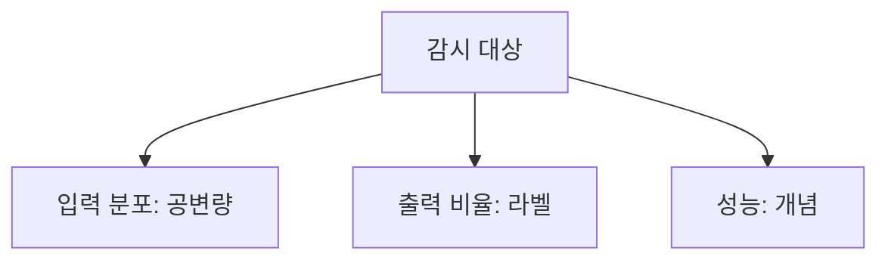

# 드리프트 모니터링

> 배포한 모델의 **입력·라벨·성능이 시간이 지나며 변하는지 지속적으로 감시**하는 운영 활동. [분포 이동](#distribution-shift)을 발견해 재학습·점검 시점을 정한다.

## 쉽게 말하면
자동차 계기판과 같다. 속도(정확도)와 연료(데이터 상태)를 계속 보다가 경고등이 켜지면 정비소(재학습)로 간다.

## 자세히
(검색 요약 기준.)
- 방법군: ① **통계 검정**(Kolmogorov-Smirnov 등)으로 입력 분포 비교 ② **순차·스트리밍 탐지기**(DDM·EDDM)가 온라인 오류율의 유의한 변화를 감지 ③ **마팅게일 기반** 탐지기 ④ **KL 발산** 추정으로 이동 유형별 검정.
- 라벨 제약: 배포 라벨이 없으면 일반적으로 공변량 이동만 탐지할 수 있고, 라벨이 지연되면 개념 이동 탐지가 늦어진다. 추가 가정이 있으면 더 가능하다.
- 현실: 대부분의 탐지기는 특정 이동 유형에 맞춰져 있고 일반적인 형식 검정이 어렵다는 지적이 있다.
- 운영 설계(내 정리): ① 기준선 기간 정하기 ② 입력 지표(길이·분포), 출력 지표(클래스 비율, 신뢰도), 성능 지표(라벨 도착 시) 분리 ③ 경보 임계값과 대응 절차(사람 점검·롤백·재학습) ④ 점검 주기 기록.
- LLM 서비스에서는 평가 세트 통과율을 정기 실행해 회귀를 확인하는 방식과 병행할 수 있다([CI에서의 평가](#eval-in-ci), 해석).
- 한계: 이 글은 일반 개념 요약이며 특정 모니터링 도구를 평가하지 않았다.

## 그림으로 보기

## 예시
- 챗봇의 질문 길이·주제 분포와 만족도 지표를 주간 비교하고 급변 시 알림.
- 교육: 가상 데이터로 기준선 대비 편차를 그래프로 그려 경보 기준을 정해 보는 실습.

## 헷갈리는 것과 비교
| 개념 | 차이 |
|---|---|
| 드리프트 모니터링 | 운영 중 변화 감시 |
| [CI 평가](#eval-in-ci) | 변경 시점의 사전 검증 |
| [분포 이동](#distribution-shift) | 감시 대상 현상 |

## 더 읽을거리
- [Towards Practicable Sequential Shift Detectors](https://arxiv.org/pdf/2307.14758) — 순차 탐지(검색 결과 확인).
