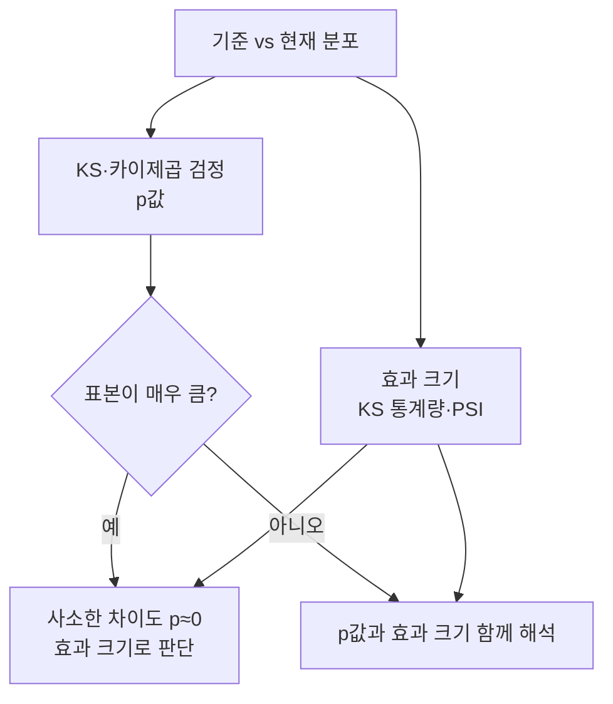

# 드리프트 통계 검정

> 기준 데이터와 현재 데이터의 분포가 같은지를 p값으로 판정하는 방법(수치형은 Kolmogorov-Smirnov, 범주형은 카이제곱 등). 표본이 크면 **실용적으로 무의미한 차이도 "유의하다"고 나오는** 과민성이 있어 해석에 주의가 필요하다.

## 쉽게 말하면
아주 정밀한 저울은 0.001g 차이도 잡아낸다. 하지만 그 차이가 빵 맛에 영향을 주는지는 별개다. 데이터가 많을수록 검정은 점점 사소한 변화에도 "달라졌다"고 외친다.

## 자세히
출처: Evidently AI 가이드(앞서 열어서 읽음: 수치형 KS, 범주형 카이제곱, 큰 데이터에서 과민), 이 세션의 직접 실험(scipy 1.17.1).
- **방법(Evidently)**: 수치형 특성은 Kolmogorov-Smirnov(KS) 검정, 범주형은 카이제곱 검정을 쓰며 p값을 반환한다. 통계적으로 유의한 차이가 실용적으로 중요하지 않을 수 있고, 큰 데이터셋에서는 지나치게 민감하다고 가이드가 적는다.
- **직접 실험(합성 정규 분포, `scipy.stats.ks_2samp`, 한 번의 난수 시드)**: 두 표본의 평균이 **0.02**(표준편차 대비 2%)만 다르게 만들었다.
  - 표본 200건: KS 통계량 0.1, p = 0.2705(유의하지 않음)
  - 표본 2,000건: KS 통계량 0.0295, p = 0.349
  - 표본 200,000건: KS 통계량 0.0081, p ≈ 0.0
  - 같은 미미한 차이가 표본 크기만 키웠더니 p값이 거의 0이 됐다. 효과 크기(KS 통계량)는 오히려 작아졌다. 이 설정에서 나온 숫자이며 중간 표본에서 p가 오르내린 것은 우연의 변동이다.
- **시사점**: p값만으로 경보를 울리면 대규모 서비스에서는 항상 울린다. **효과 크기**(KS 통계량, PSI, 분포 거리)와 함께 보고, 실용적 임계값을 정한다([PSI](#psi)). 신용 스코어카드 문헌도 고전적 적합도 검정이 큰 표본에서 문제를 일으킨다고 지적하고 효과 크기 기반 검정을 제안한다(arXiv 2303.01227 초록).
- **한계**: 검정은 한 특성씩의 주변 분포를 보므로 특성 간 관계 변화(개념 드리프트)는 놓친다. 많은 특성을 동시에 검정하면 다중 비교로 오경보가 늘어난다(일반 통계 상식, 이번 출처로 확인한 것은 아님).

## 그림으로 보기

## 예시
- 일일 수백만 건을 처리하는 서비스: p<0.05 경보는 매일 울리므로 KS 통계량 0.1 이상, PSI 0.1~0.25 같은 효과 크기 기준을 병행.
- 점검: 경보 후 데이터 품질 문제인지 먼저 확인하고 성능 지표와 연결해 본다([지연 라벨 모니터링](#delayed-label-monitoring)).

## 헷갈리는 것과 비교
| 개념 | 차이 |
|---|---|
| 통계 검정(p값) | 차이가 우연인지 판정, 표본에 민감 |
| 효과 크기 | 차이의 크기, 표본 수에 덜 민감 |
| [PSI](#psi) | 분포 거리 점수, 경험 규칙 기반 |
| [데이터 드리프트](#data-drift) | 대상 현상 |

## 더 읽을거리
- [Data drift (Evidently AI)](https://www.evidentlyai.com/ml-in-production/data-drift) — 검정 방법과 과민성(열어서 확인)
- [scipy.stats.ks_2samp](https://docs.scipy.org/doc/scipy/reference/generated/scipy.stats.ks_2samp.html) — 두 표본 KS 검정 함수(열어서 확인하지 못함, 함수 사용만 실행 확인)
