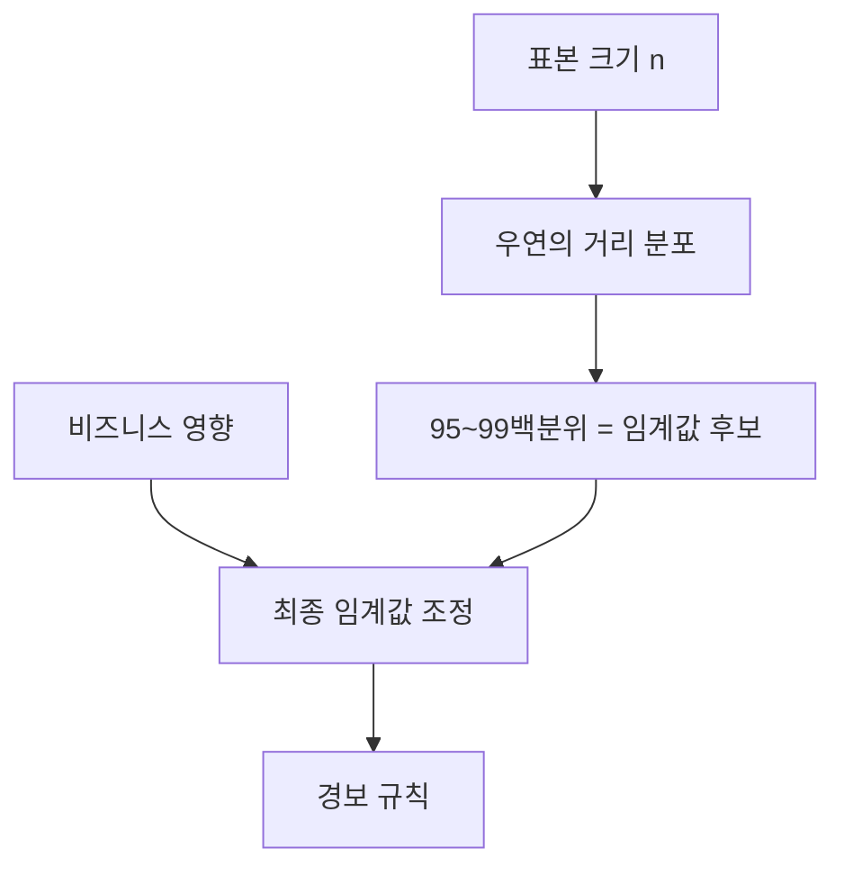
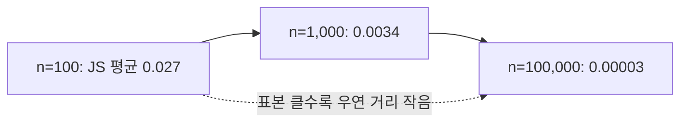

# 드리프트 임계값 정하기

> 데이터 드리프트 경보의 임계값(예: L-infinity 0.01)은 **표본 크기와 비즈니스 영향**에 맞춰 정해야 한다. 같은 분포에서 뽑은 두 표본도 표본이 작으면 거리가 크게 나오므로, 임계값이 너무 작으면 **가짜 경보**가 쏟아진다.

## 쉽게 말하면
동전을 10번 던지면 앞면이 7번 나올 수 있다. 동전이 이상해서가 아니라 던진 횟수가 적어서다. 표본이 작을수록 "우연한 차이"가 커지므로, 경보 기준도 표본 크기에 맞춰 느슨해야 한다.

## 자세히
(이 세션에서 numpy로 **직접 시뮬레이션**한 결과. 같은 표준정규분포에서 뽑은 두 표본을 10개 구간(−4~4)으로 나눠 히스토그램 비율을 비교하고 200번 반복했다. JS 발산은 **log2 기준**(0~1)으로 계산했으며, TFDV 내부 정규화 방식과 같은지는 확인하지 않았다. 임계값 설정 문법은 TensorFlow 문서(skew/drift 비교기)를 참고한 것이다.)
- **같은 분포인데도 나오는 "우연의 거리"(실행 결과)**
  | 표본 크기 n | JS 평균 | JS 95백분위 | L-infinity 평균 | L-infinity 95백분위 |
  |---|---|---|---|---|
  | 100 | 0.02696 | 0.05163 | 0.0818 | 0.1405 |
  | 1,000 | 0.00340 | 0.00648 | 0.0270 | 0.0481 |
  | 10,000 | 0.00033 | 0.00064 | 0.0086 | 0.0150 |
  | 100,000 | 0.00003 | 0.00006 | 0.0026 | 0.0047 |
  → 두 표본이 **완전히 같은 분포**여도 n=1,000이면 L-infinity가 평균 0.027, 5%는 0.048을 넘는다. 문서 예시 임계값 **0.01**을 n=1,000에 쓰면 **거의 매번 가짜 경보**가 난다.
- **진짜 변화는 얼마나 보이나(실행 결과)**: 평균이 0.2 표준편차 이동한 n=10,000 표본에서 JS=0.00768, L-infinity=0.0412로, 같은 크기의 "우연" 95백분위(JS 0.00064, L-infinity 0.0150)를 **넘었다**. 표본이 클수록 작은 진짜 변화도 우연과 구분된다.
- **정하는 방법(제안)**
  1. 정상 기간 데이터를 **같은 크기로 여러 번 나눠** 거리의 분포를 구하고 **95~99백분위를 임계값 후보**로 삼는다(위 표와 같은 방식).
  2. 표본 크기가 바뀌면 임계값도 다시 계산한다(크기에 반비례하는 경향, 위 표에서 JS는 n이 10배일 때 약 1/10).
  3. 임계값을 **비즈니스 영향**과 연결한다: 놓쳤을 때 손실이 크면 낮추고, 경보 대응 비용이 크면 높인다.
  4. 경보 후 조치(조사·재학습·무시)와 임계값을 함께 문서화한다.
- **한계**: 이 시뮬레이션은 정규분포·10개 균등 구간 가정이다. 실제 범주형 특징, 희소 범주, 시계열 상관이 있는 데이터에서는 다를 수 있다. 문서의 0.01은 예시일 뿐 권장값이 아니다.

## 그림으로 보기

## 예시
- 일일 데이터 1,000건인 특징에 L-infinity 0.01을 쓰면 매일 경보. 정상 주간 데이터를 쪼개 95백분위(≈0.05)를 임계값으로 사용.
- 교육 활동: 동전 던지기 100번 vs 10,000번의 앞면 비율 차이를 비교하며 표본 크기 효과를 체험.

## 헷갈리는 것과 비교
| 개념 | 차이 |
|---|---|
| 임계값 튜닝 | 우연 변동을 고려해 경보 기준 설정 |
| 고정 임계값(0.01 등) | 표본 크기를 무시해 가짜 경보 위험 |
| [L-infinity·JS 발산](#l-infinity-js-divergence) | 거리 척도 정의 |
| [숫자 특징 구간화](#binning-numeric-features) | 구간 수가 거리 값에 미치는 영향 |

## 더 읽을거리
- [Get started with TensorFlow Data Validation (TensorFlow 문서)](https://www.tensorflow.org/tfx/data_validation/get_started) — 임계값 설정 문법(`skew_comparator`/`drift_comparator`, 직접 확인). 표의 수치는 이 노드의 직접 시뮬레이션이다.
