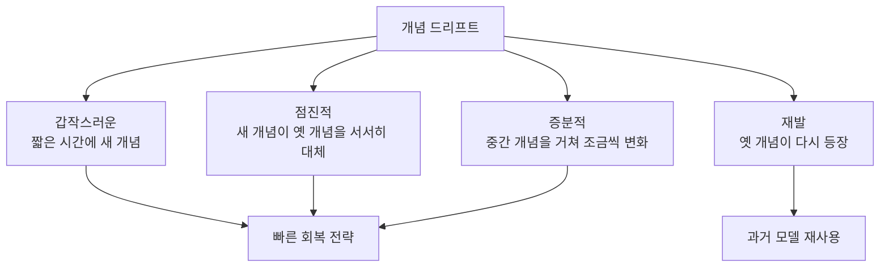

# 드리프트 네 유형

> 개념 드리프트가 시간에 따라 나타나는 방식의 네 가지 분류. **갑작스러운(sudden)**, **점진적(gradual)**, **증분적(incremental)**, **재발(reoccurring)**. 유형에 따라 감지·적응 전략이 달라진다.

## 쉽게 말하면
계절이 바뀌는 모습과 같다. 하루아침에 겨울이 되기도 하고(갑작스러움), 가을과 겨울이 번갈아 오가다 겨울이 자리 잡기도 하며(점진적), 기온이 매일 조금씩 내려가기도 하고(증분적), 해마다 같은 계절이 돌아오기도 한다(재발).

## 자세히
출처: Lu 외 "Learning under Concept Drift: A Review"(arXiv 2004.05785, 원문 PDF의 2.2절과 Fig. 4를 내려받아 읽음) + 이 세션의 시계열 모양 확인 스크립트.
- **갑작스러운 드리프트(Sudden)**: 새 개념이 짧은 시간 안에 나타난다.
- **점진적 드리프트(Gradual)**: 새 개념이 한동안 옛 개념을 **서서히 대체**한다. 전환 기간에는 옛 개념과 새 개념의 데이터가 섞여 나온다.
- **증분적 드리프트(Incremental)**: 옛 개념이 한 기간에 걸쳐 새 개념으로 **조금씩 변한다**. 전환 중에는 옛 개념과 새 개념의 혼합 같은 **중간 개념(intermediate concept)**이 나타난다.
- **재발 개념(Reoccurring)**: 옛 개념이 얼마 뒤 다시 나타난다. 새 개념이 갑자기, 증분적으로, 점진적으로 재발할 수도 있다.
- **전략의 차이(논문)**: 앞의 세 유형(1~3)은 개념이 바뀌는 동안 정확도 하락을 최소화하고 **가장 빨리 회복**하는 데 초점을 둔다. 네 번째 유형은 **과거 개념을 활용**해 가장 잘 맞는 과거 개념을 최단 시간에 찾는 데 초점을 둔다. 재발 개념에는 과거 모델을 보존·재사용하는 앙상블 방법이 제안된다는 논문 서술이 있다.
- **중간 개념**: 논문은 변환 중 나타나는 중간 개념이 증분적 드리프트처럼 시작·끝 개념의 혼합일 수도, 점진적 드리프트처럼 시작 또는 끝 개념 중 하나일 수도 있다고 설명한다.
- **직접 확인(이 세션, 합성 시계열 400시점)**: 평균 이동 패턴을 네 가지로 만들어 고유 값을 세었다. 갑작스러움·점진적·재발은 평균이 0 또는 2 둘 중 하나(점진적은 두 값이 섞여 나옴)였고, **증분적만 0과 2 사이의 중간값이 나타났다**. 논문의 정의와 맞는 모양이며 실제 데이터의 모양을 뜻하지는 않는다.

## 그림으로 보기

## 예시
- 갑작스러운: 법 개정으로 신용 평가 규칙이 어느 날부터 바뀜.
- 증분적: 센서가 노후해 값이 매달 조금씩 이동.
- 재발: 계절성 수요가 매년 같은 패턴으로 돌아옴 → 과거 계절 모델을 보관해 재사용.

## 헷갈리는 것과 비교
| 유형 | 차이 |
|---|---|
| 갑작스러운 | 전환 구간이 거의 없음 |
| 점진적 | 두 개념이 섞여 번갈아 나옴 |
| 증분적 | 중간 개념을 거쳐 연속적으로 변함 |
| 재발 | 과거 개념이 되돌아옴 |
| [개념 드리프트](#concept-drift) | 상위 노드 |

## 더 읽을거리
- [Learning under Concept Drift: A Review (arXiv 2004.05785)](https://arxiv.org/abs/2004.05785) — 2.2절 유형과 Fig. 4(원문 확인)
