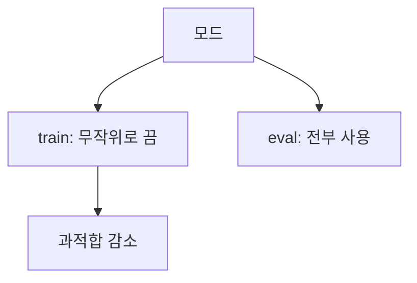

# 드롭아웃 (Dropout)

> 드롭아웃은 학습 중 뉴런(과 그 연결)을 무작위로 꺼서 특정 뉴런에 의존하지 못하게 하고 과적합을 줄이는 정규화 기법이다. 추론 때는 전체 네트워크를 쓴다.

## 쉽게 말하면
축구팀 훈련에서 매번 무작위로 몇 명을 빼고 연습시키면, 어느 한 선수에 기대지 않고 모두가 골고루 실력을 키운다. 시합 땐 전원 출전한다.

## 자세히
Srivastava 외 JMLR 2014 논문 초록 기준:
- 큰 신경망은 과적합되기 쉽고, 많은 네트워크의 예측을 평균내는 앙상블은 테스트 때 너무 느리다.
- **학습 중**: 유닛과 연결을 무작위로 제거. 매 스텝이 "얇아진(thinned)" 서로 다른 서브네트워크를 학습하는 셈이고, 유닛들이 서로에게 과하게 기대는 것(co-adaptation)을 막는다.
- **테스트 때**: 여러 네트워크를 돌리는 대신, 가중치를 줄여 맞춘 **하나의 전체 네트워크**로 서브네트워크 평균을 근사한다.
- 논문은 비전·음성 인식·문서 분류·계산 생물학에서 다른 정규화보다 낫고 여러 벤치마크에서 최고 성능을 냈다고 주장한다.
- 구현 참고(일반 지식, 이번에 PyTorch 문서는 열지 못함): PyTorch의 `nn.Dropout(p)`는 학습 모드에서만 동작하고 `model.eval()`에서는 꺼진다. 현대 구현은 학습 때 남은 값을 1/(1-p)배 키우는 "inverted dropout"이 흔하다.
- [L1/L2 정규화](#regularization-loss)가 손실에 벌점을 더하는 방식이라면 드롭아웃은 구조를 흔드는 방식이다. LLM 사전학습에서는 데이터가 방대해 쓰지 않는 경우도 있다(일반적 관행, 모델별 상이).

## 그림으로 보기



## 예시
```python
import torch.nn as nn
model = nn.Sequential(nn.Linear(100, 64), nn.ReLU(), nn.Dropout(p=0.5), nn.Linear(64, 10))
model.train()  # dropout 동작
model.eval()   # dropout 꺼짐
```
`eval()`로 바꾸는 것을 잊으면 같은 입력에도 예측이 매번 달라지는 버그가 생긴다.

## 헷갈리는 것과 비교
| 개념 | 차이 |
|---|---|
| 드롭아웃 | 학습 중 뉴런을 무작위로 끔 |
| [조기 종료](#early-stopping) | 학습 시점을 조절 |
| [정규화 손실](#regularization-loss) | 가중치에 벌점 |
| 앙상블 | 실제 여러 모델 평균(비용 큼) |

## 더 읽을거리
- [Dropout (JMLR 2014)](https://jmlr.org/papers/v15/srivastava14a.html) — 원 논문 초록.
