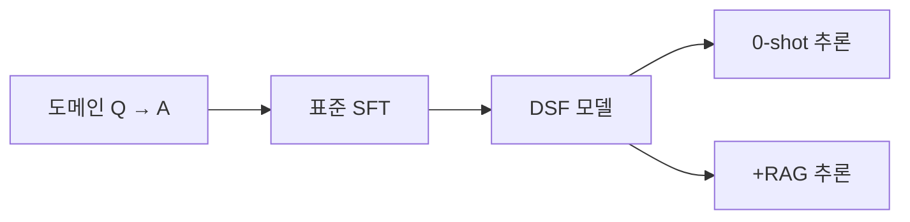

# 도메인 특화 미세조정 DSF

> 검색 문서 **없이** 도메인 질문과 답으로 모델을 표준 지도 미세조정(SFT)하는 방법이다. RAFT 논문이 비교 기준으로 쓴다.

## 쉽게 말하면
참고서를 덮고 해당 분야 문제를 풀어 답 스타일과 지식을 몸에 익히는 공부다. 시험장에서 참고서를 건네줘도 그걸 읽는 연습은 안 했다.

## 자세히
(RAFT 논문 §4 베이스라인과 결과 설명을 직접 읽었다.)
- **정의(논문)**: DSF = 문서 없이 표준 SFT, 0-shot으로 추론. 주로 **답변 스타일을 맞추는 데** 유용했다고 적는다. **DSF + RAG**는 도메인 미세조정 모델에 검색 문서를 붙여 추론.
- **비교 베이스라인(논문)**: LLaMA2-7B-chat 0-shot, +RAG, DSF, DSF+RAG, GPT-3.5.
- **결과(논문)**: LLaMA2-7B는 답변 스타일이 정답과 맞지 않아 낮은 성능. DSF로 스타일을 배우면 크게 향상. 그러나 **DSF에 RAG를 붙여도 늘 좋아지지는 않는다** — 문맥 처리와 유용 정보 추출을 훈련하지 않았기 때문이라는 해석. RAFT는 이를 보완해 모두를 앞선다. 기본 Llama-2 대비 최대 **HotpotQA +35.25%, Torch Hub +76.35%**, DSF 대비 **HotpotQA +30.87%, HuggingFace +31.41%**. PubMed QA(예/아니오)는 DSF+RAG 대비 유의한 이득이 없었다.
- **한계**: 저자 실험(Llama2-7B), 일부 수치는 논문 표 기준이며 우리 데이터에서는 다를 수 있다.

## 그림으로 보기

## 예시
- 사내 용어와 답변 어조를 맞추는 1차 미세조정은 DSF로 충분할 수 있고, 문서를 읽고 답하는 능력이 중요하면 RAFT식 학습이 후보(제안).

## 헷갈리는 것과 비교
| 방법 | 학습 데이터 |
|---|---|
| DSF | Q → A (문서 없음) |
| RAFT | Q + 문서(golden+방해) → CoT 답 |
| [도메인 오픈북 QA](#open-book-domain-qa) | RAFT·RAG가 겨냥하는 설정 |

## 더 읽을거리
- [RAFT 논문](https://arxiv.org/abs/2403.10131) — 직접 읽음.
