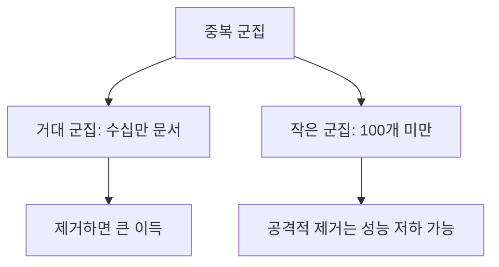
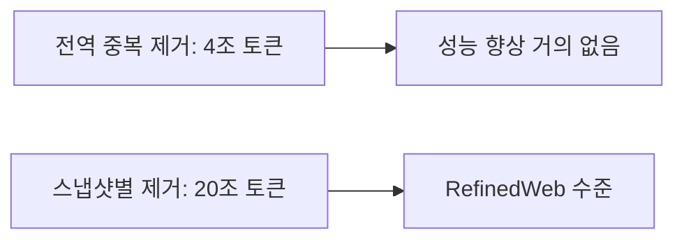

# 중복 군집 크기와 효과

> 중복 제거의 이득은 **수십만 문서가 같은 내용으로 묶이는 거대 군집을 없애는 데서 대부분 나온다**는 가설이다. 중복이 몇 개뿐인 작은 군집까지 공격적으로 지우면 오히려 성능이 나빠질 수 있다.

## 쉽게 말하면
도서관에서 같은 광고 전단이 수십만 장 쌓여 있다면 치워야 한다. 하지만 같은 책이 두세 권씩 있는 정도는 오히려 인기 있고 쓸 만한 책이라는 뜻일 수 있다. 다 치우면 좋은 책이 사라진다.

## 자세히
(FineWeb 논문, arXiv 2406.17557 PDF 본문을 직접 읽음)
- **군집이란**: MinHash로 같은 버킷에 걸린 문서끼리 이어서(A–C, B–C면 A·B·C 모두) 전이적으로 묶은 중복 군집. 군집마다 무작위 1개만 남기고 나머지는 지운다. FineWeb 설정: 112개 해시, 14버킷×8해시, 단어 5-그램, 자카드 약 75% 이상을 노린다([FineWeb 예제](#datatrove-fineweb-example)).
- **논문의 가설(주장)**: 중복 제거의 주된 이득은 모든 크롤에 존재하는 **수십만 문서짜리 거대 군집**을 제거하는 데 있고, **약 100개 미만(크롤 수 정도)의 작은 군집**까지 더 제거하는 것은 성능을 해칠 수 있다. 논문은 이를 가설로 제시하며 직접 입증한 인과는 아니다.
- **근거 실험**: 크롤(스냅샷) 96개 전체를 한꺼번에 중복 제거하면 4조 토큰이 남았는데, 그중 350B 토큰으로 학습한 모델이 중복 제거 전과 거의 차이가 없었다(RefinedWeb보다 크게 낮음). 반면 스냅샷별로 따로 중복 제거하면 20조 토큰이 남았고 RefinedWeb 수준 성능을 냈다.
- 해석: 거대 군집은 어느 쪽 방식으로든 제거되지만, 전역 제거는 오래된 스냅샷에서 90%까지 지우며 작은 군집(여러 크롤에 걸쳐 조금씩 반복된 글)까지 모두 건드린다. 남은 데이터의 질이 오히려 나빠졌다([데이터 품질 점검](#dedup-quality-check)).
- 실무 시사점(제안): 군집 크기 분포를 먼저 그려 보고, 거대 군집만 제거하는 설정부터 시작해 작은 군집 제거 효과를 따로 시험한다.

## 그림으로 보기

## 예시
- 약관·쿠키 안내 같은 보일러플레이트가 크롤마다 수십만 번 반복되는 경우 → 군집 크기 상위 몇 개만 지워도 큰 효과.
- 교육: "다 지우는 게 최선이 아니다" — 정제 강도를 실험으로 정하는 사례.

## 헷갈리는 것과 비교
| 개념 | 차이 |
|---|---|
| 거대 군집 제거 | 큰 보일러플레이트 제거(이득 큼) |
| 소군집 제거 | 약한 반복까지 제거(해로울 수 있음) |
| [스냅샷별 vs 전역 제거](#per-snapshot-vs-global-dedup) | 비교 범위 선택의 문제 |

## 더 읽을거리
- [The FineWeb Datasets (arXiv 2406.17557)](https://arxiv.org/abs/2406.17557) — 군집·스냅샷별 vs 전역 제거 실험(PDF 본문 읽음).
