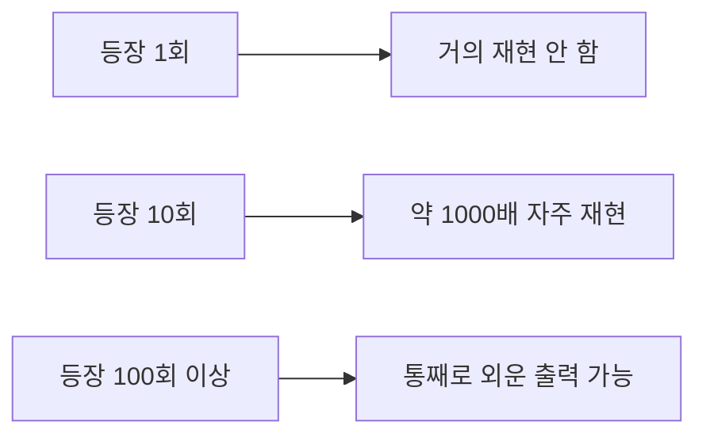
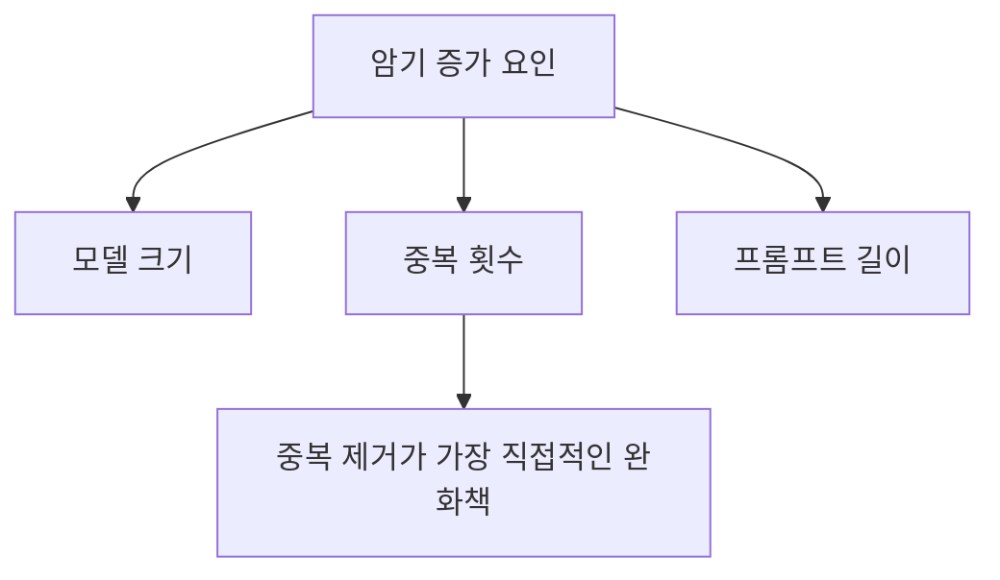

# 중복 횟수와 암기 확률

> 학습 데이터에 같은 문장이 많이 나올수록 모델이 그 문장을 그대로 내놓을 확률이 **선형보다 훨씬 가파르게** 올라간다. 한 번 나온 문장과 열 번 나온 문장의 차이는 열 배가 아니라 수백~천 배일 수 있다.

## 쉽게 말하면
노래 가사는 한 번 들으면 못 따라 부르지만 열 번 들으면 거의 외운다. 그런데 열 번이 한 번보다 "열 배 더 잘 외운다" 정도가 아니라 "거의 못 외운다 → 거의 다 외운다"로 단계가 달라진다. 모델도 비슷하게 반복이 쌓이면 암기가 급격히 늘어난다.

## 자세히
- **Kandpal 외(2022, arXiv 2202.06539)**: 모델이 학습 시퀀스를 재생성하는 비율이 시퀀스의 학습셋 등장 횟수와 **초선형(superlinear)** 관계라고 한다. 초록 기준으로 10번 나온 시퀀스는 1번 나온 것보다 약 1,000배 자주 생성된다(초록 확인). 지수로 환산하면 대략 횟수의 3제곱 꼴이지만, 이것은 이 한 수치를 이은 단순 계산이며 논문의 적합 결과가 아니다.
- **Carlini 외(2022, arXiv 2202.07646)**: 암기가 ① 모델 크기, ② 중복 횟수, ③ 프롬프트 길이에 대해 **로그-선형**으로 커진다고 보고한다. 모델 가족을 가로지르면 결과가 복잡해지고, 암기는 생각보다 흔하며 규모가 커질수록 심해질 수 있다고 결론짓는다(초록 확인, 세부 수치는 본문 필요).
- [Lee 외 2021](#lee-2021-dedup-paper)의 중복 제거가 암기 출력을 약 10배 줄인 결과와 같은 방향이다.
- **함의(해석)**: 평균 중복률이 낮아도 **소수의 많이 반복된 문장(약관, 라이선스, 공개된 개인정보 서명)** 이 암기 위험을 거의 다 만들 수 있다. 그래서 전체 비율이 아니라 "많이 반복된 꼬리"를 먼저 지운다.
- 한계: 두 논문의 정의(재생성 비율 vs 추출 가능성)와 모델이 달라 수치를 서로 바꿔 쓸 수 없다.

## 그림으로 보기

## 예시
- 사내 모델 학습 전: 가장 많이 반복된 상위 문장(법적 고지, 이메일 서명)부터 찾아 제거 또는 가중치 하향.
- 교육: 횟수 1, 2, 5, 10에 대해 "선형이면 1,2,5,10 / 3제곱이면 1,8,125,1000"을 비교하며 초선형의 감각을 익히게 한다.

## 헷갈리는 것과 비교
| 개념 | 차이 |
|---|---|
| [중복과 암기](#memorization-from-duplicates) | 이 노드의 부모, 중복 제거가 암기를 줄인다는 결과 |
| 로그-선형 | 규모 변수에 로그로 비례(Carlini) |
| 초선형 | 횟수보다 빠르게 증가(Kandpal) |
| [학습 데이터 중복 제거](#training-data-deduplication) | 이 위험을 줄이는 방법 |

## 더 읽을거리
- [Deduplicating Training Data Mitigates Privacy Risks in Language Models](https://arxiv.org/abs/2202.06539) — 초선형 관계, 10회→약 1,000배(초록 확인).
- [Quantifying Memorization Across Neural Language Models](https://arxiv.org/abs/2202.07646) — 모델·중복·프롬프트 길이의 로그-선형 관계(초록 확인).
