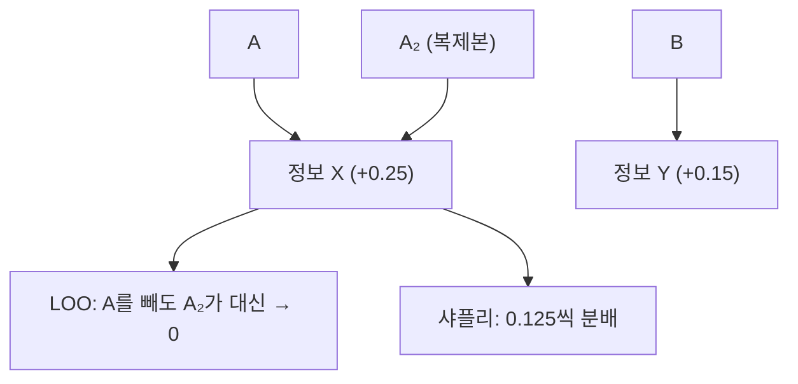
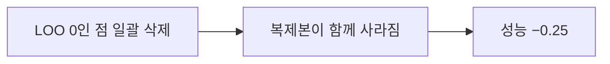

# 중복 데이터의 대체 효과

> 같은 정보를 가진 **복제본(중복·거의 중복 데이터)** 이 있으면, 하나를 빼도 다른 복제본이 그 역할을 대신해 **Leave-One-Out(LOO) 가치가 0에 가깝게** 나온다. 그래서 LOO는 중복 데이터의 가치를 과소평가하고, 샤플리 값은 몫을 나눠 보여 준다.

## 쉽게 말하면
같은 책을 두 권 샀다고 하자. 한 권을 치워도 도서관이 잃는 게 없으니 "이 책은 필요 없다"로 보이지만, 둘 다 치우면 큰 손실이다. 두 권은 서로의 대체재라 LOO로 재면 둘 다 0이다.

## 자세히
- **LOO의 정의(Ghorbani & Zou, arXiv 1904.02868 본문 확인)**: φᵢ = V(D) − V(D−{i}), 즉 i번째 데이터를 제거했을 때 잃는 성능. 저자는 이 방식이 공정한 평가 조건을 만족하지 못한다고 보고, 오라벨 탐지 실험에서 로지스틱 회귀에서는 쓸 만하지만 다른 두 모델에서는 무작위 검사 수준이었다고 보고한다.
- **직접 계산한 3점 예(가상 효용)**: A와 A₂는 **같은 정보를 가진 복제본**, B는 다른 정보. U(S) = 0.50 + 0.25·[A 또는 A₂가 S에 있음] + 0.15·[B가 S에 있음].
  | 데이터 | LOO | 샤플리 |
  |---|---|---|
  | A | **0.000** | 0.125 |
  | A₂ | **0.000** | 0.125 |
  | B | 0.150 | 0.150 |
  | 합 | 0.150 | 0.400 = U(전체) − U(∅) |
  LOO는 A·A₂를 0(무가치)으로 보고 합이 0.15로 전체 향상 0.40에 못 미친다. 샤플리는 복제본이 정보 몫 0.25를 **공평하게 반씩** 나눠 가져 합이 0.40(효율성).
- **중복을 지우면 안 되는 이유**: LOO 값이 0인 점을 모두 삭제하면 A·A₂가 **함께 사라져** 성능이 0.25 떨어진다. 가치 평가 결과로 일괄 삭제는 위험하다([가치 평가 결과로 삭제하지 않기](#valuation-vs-deletion)).
- **현실의 중복**: 웹 크롤링 중복 문서, 증강으로 만든 거의 동일한 이미지, 같은 사용자의 반복 대화, 템플릿 문장. 이들은 서로를 가려 LOO·민감도 기반 평가가 약해진다.
- **대응**
  1. 중복·근사 중복 탐지(해시, 임베딩 유사도)로 먼저 군집화하고 **군집 단위**로 가치를 평가한다.
  2. 샤플리·Beta Shapley처럼 대체 관계를 반영하는 값을 쓴다([세미밸류](#semivalue)).
  3. 중복 제거는 가치 낮은 점이 아니라 **중복 탐지 결과**에 따라 하되, 군집당 대표 1개는 남긴다.
- **한계**: 위 예는 두 복제본이 완전히 같은 정보라는 이상화이며, 실제에는 부분 중복이다.

## 그림으로 보기



## 예시
```python
def U(S): return .5 + .25*(('A' in S) or ('A2' in S)) + .15*('B' in S)
# LOO: U(all) - U(all - {p});  Shapley: 모든 순열의 한계 기여 평균 (앞 글의 코드)
```
- 사내 FAQ 문서 3개가 거의 같은 내용이면 개별 LOO는 0이지만 군집으로 보면 하나의 중요한 지식 원천이다.

## 헷갈리는 것과 비교
| 방법 | 중복 데이터 처리 |
|---|---|
| LOO | 서로 가려 0에 가까움 |
| 샤플리 | 몫을 분할 |
| 중복 제거 | 정보는 남기고 중복만 제거 |
| 군집 단위 평가 | 중복을 하나로 묶어 평가 |

## 더 읽을거리
- [Data Shapley (arXiv 1904.02868)](https://arxiv.org/abs/1904.02868) — LOO 정의와 한계(PDF 본문 확인). 위 3점 계산은 이 글의 직접 계산.
