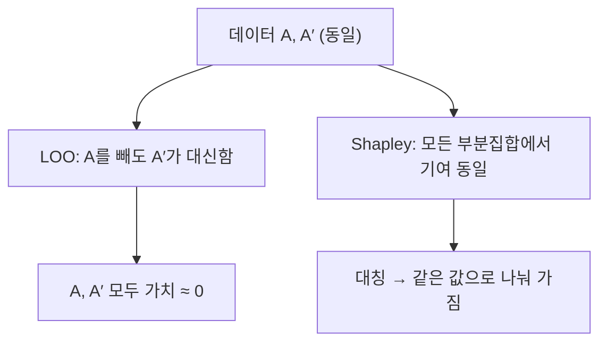
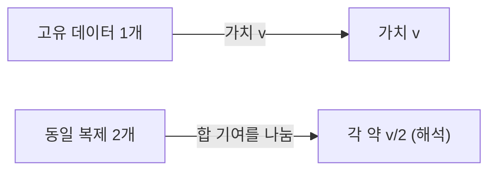

# 중복 데이터와 가치 평가

> 같은 데이터가 두 개 있으면 **한 개를 빼도 성능이 거의 안 변하므로**, 빼기 방식(LOO) 평가는 둘 다 가치가 거의 0이라고 말한다. 중복·유사 데이터는 데이터 가치 평가에서 값이 과소평가되는 대표적 함정이다.

## 쉽게 말하면
교실에 똑같은 교과서가 두 권 있다. 한 권을 치워도 수업에는 지장이 없으니 "이 책은 필요 없다"고 결론낼 수 있다. 그런데 두 권을 다 치우면 수업이 안 된다. 하나씩 빼 보는 방법은 이 "서로 대신해 주는 관계"를 놓친다.

## 자세히
(Ghorbani & Zou, 「Data Shapley: Equitable Valuation of Data for Machine Learning」(ICML 2019, arXiv 1904.02868) PDF를 직접 읽어 확인. 이 논문은 중복 데이터를 직접 실험하지 않는다. 아래 중복에 관한 결론은 논문의 정의와 공리에서 **이 노드가 도출한 해석**이다.)
- **LOO의 정의(논문)**: φ_i = V(D) − V(D−{i}). "i번째 데이터를 빼면 성능을 얼마나 잃는가"다. 논문은 이 방식이 **공정한 평가의 조건을 만족하지 않는다**고 말한다.
- **Data Shapley의 공리(논문)**: ① 어떤 부분집합에 더해도 성능이 안 변하면 가치 0 ② 어떤 부분집합에서든 기여가 같은 두 데이터는 **같은 가치**(대칭) ③ 성능 점수가 합이면 가치도 합(선형성).
- **중복의 경우(해석)**: 완전히 같은 데이터 i, j가 있으면 V(D−{i}) ≈ V(D)이므로 **LOO는 둘 다 약 0**을 준다. 반면 Shapley는 모든 부분집합에서 둘의 기여가 같아 **대칭 공리에 의해 같은 값**을 받고, 쌍이 함께 만든 기여를 **나눠 갖는다**. 따라서 중복은 값이 약 절반씩이 되고, 0이 되지는 않는다. (검색에서 이 "절반" 결론은 1차 출처에 직접 나오지 않았고 도출한 추론임을 밝힌다.)
- **실험 증거(논문, 중복과는 별개)**: 레이블 오류 탐지에서 Shapley가 가장 적은 점검으로 오류를 찾았고, LOO는 로지스틱 회귀에서는 잘 맞았지만 다른 두 모델에서는 무작위 점검 수준이었다.
- **실무 함정(해석)**: 데이터 시장이나 보상 체계에서 "빼 보기" 값을 정산 기준으로 쓰면, 같은 자료를 여러 번 올린 제공자가 있을 때 모두 0에 가까워지거나, 반대로 복제본 제출로 이득을 노리는 전략을 만들 수 있다. 대칭·효율성이 이 문제를 줄이지만 계산 비용이 크다.

## 그림으로 보기

## 예시
- 사진 100장 중 50장이 중복인 데이터셋: LOO는 중복 쌍에 낮은 값을 주고, Shapley는 쌍에 같은 값을 준다.
- 교육 활동: 같은 문장 2개와 고유 문장 1개로 "하나씩 빼기"와 "모든 조합 평균"의 값을 손으로 계산해 비교.

## 헷갈리는 것과 비교
| 개념 | 차이 |
|---|---|
| LOO 평가 | 하나 빼고 성능 차이. 중복에 취약 |
| Data Shapley | 모든 부분집합 평균. 대칭·선형성 만족 |
| 데이터 중복 제거 | 학습 전 정제. 가치 평가 문제와는 별개 |
| [AI 콘텐츠 라이선스 계약](#ai-content-licensing-deals) | 가치 평가가 보상 정산으로 이어지는 맥락 |

## 더 읽을거리
- [Data Shapley: Equitable Valuation of Data for Machine Learning (arXiv 1904.02868)](https://arxiv.org/abs/1904.02868) — LOO의 한계, 공정한 평가 3 공리, 레이블 오류 탐지 실험(PDF 직접 확인).
