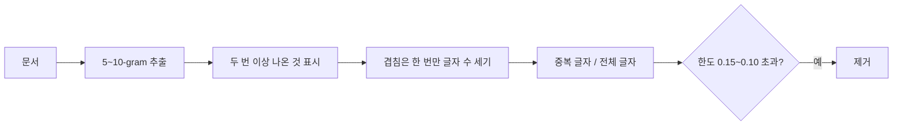
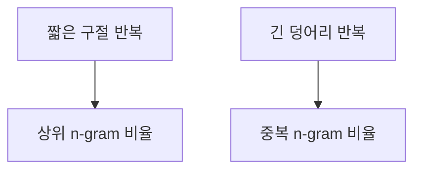

# 중복 n-그램 문자 비율

> 문서 안에서 두 번 이상 나온 5~10-gram이 차지하는 글자 비율이다. 겹치는 n-gram의 글자는 한 번만 세며, 한도를 넘으면 반복이 심한 문서로 제거한다.

## 쉽게 말하면
리포트에서 문단을 통째로 복붙해 분량을 채우면 같은 문장이 여러 번 나온다. 그 복붙된 부분이 전체의 몇 %인지 재는 것이다.

## 자세히
(Gopher 논문 arXiv 2112.11446 부록 A.1, 표 A1을 직접 읽고 확인.)
- n ∈ {5,…,10} 각각에 대해 **중복된 n-gram에 포함된 글자 비율**을 계산한다. 겹치는 n-gram에 속한 글자는 **중복해 세지 않는다**.
- 임계값(표 A1): 5-gram 0.15, 6: 0.14, 7: 0.13, 8: 0.12, 9: 0.11, 10: 0.10. n이 클수록 우연히 겹칠 확률이 낮아 한도도 낮다.
- 저자는 "짧은 중복 구절이 많은 문서"와 "크고 긴 중복 구간이 적은 문서" 둘 다 잡으려고 여러 방식을 병행했다고 설명한다.
- 이 필터는 문서 **내부** 반복을 본다. 서로 다른 문서 간 중복은 MinHash 13-gram 자카드 0.8 기준의 별도 단계다([근접 중복 제거](#near-duplicate-removal)).

## 그림으로 보기

## 예시
- 약관 복붙이 반복된 템플릿 페이지가 5~10-gram 중복으로 걸림.
- 교육 활용: "같은 글을 여러 번 학습하면 모델도 반복한다"는 연결 설명.

## 헷갈리는 것과 비교
| 개념 | 차이 |
|---|---|
| 중복 n-gram 비율 | 문서 내부, n=5~10 |
| [상위 n-gram 비율](#top-ngram-fraction) | 문서 내부, n=2~4, 가장 흔한 것 하나 |
| 문서 간 중복 제거 | 다른 문서와의 유사도 |

## 더 읽을거리
- [Gopher (arXiv 2112.11446)](https://arxiv.org/abs/2112.11446) — 표 A1.
