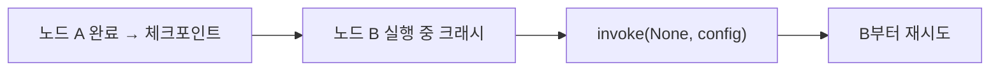
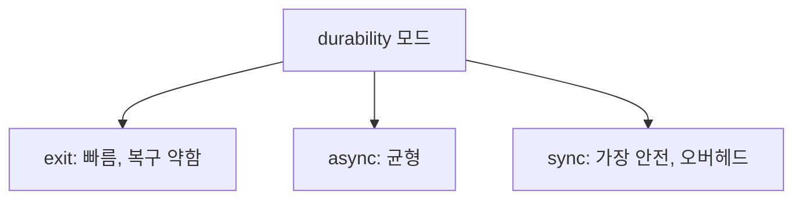

# 내구성 있는 실행

> **내구성 있는 실행(durable execution)** 은 에이전트가 중간에 멈추거나 실패해도 **마지막으로 저장된 지점부터 다시 이어서** 실행되게 하는 성질이다. LangGraph에서는 체크포인터와 `thread_id`, 재시도·멱등성 설계로 구현한다.

## 쉽게 말하면
게임에서 자동 저장 지점이 있으면 전원이 꺼져도 처음부터 하지 않고 이어서 한다. 단, 이어 하다 보니 "결제" 같은 단계가 두 번 실행되면 곤란하니 저장·재시도 규칙을 꼼꼼히 정해야 한다.

## 자세히
(LangGraph 공식 문서의 체크포인터·fault tolerance·persistence 페이지 확인. 이름이 같은 전용 정의 페이지는 찾지 못함)
- **체크포인터 필수**: 사람 개입, 메모리, 타임트래블, 장애 복구에 체크포인터가 필요하다. 체크포인트는 **슈퍼스텝마다** 저장되어 "마지막으로 성공한 단계부터 그래프를 재시작"할 수 있다.
- **`thread_id` 필수**: 체크포인터와 함께 호출할 때 config의 `configurable`에 `thread_id`를 반드시 지정한다. 없으면 상태 저장·중단 후 재개가 안 된다. 재개: `graph.invoke(None, config)`는 최신 체크포인트를 불러와 미완료 작업을 재시도.
- **멱등성**: 재시도는 **노드 함수를 처음부터 다시 실행**하므로 외부 부작용은 **최소 한 번(at-least-once)** 의미론이다. 결제 같은 효과는 애플리케이션이 **멱등하게** 만들어야 한다. 멱등성 키는 노드 안에서 새로 만들지 말고 **체크포인트된 상태**(예: `f"charge:{state['order_id']}"`)에서 유도한다. 노드 안의 작업 단위를 **task로 감싸면** 재개 시 완료된 단위를 건너뛴다(세부 API는 확인하지 않음).
- **내구성 모드**(`durability=`): `"exit"`(종료 시에만 저장, 최고 성능, 중간 크래시 복구 불가) / `"async"`(다음 단계 실행 중 저장, 크래시 시 체크포인트 소실 위험 소폭) / `"sync"`(다음 단계 시작 전 저장, 가장 안전하나 오버헤드). 기본값은 읽은 텍스트에 없다.
- **장애 대응**: 재시도(`RetryPolicy`, 기본 최대 3회), 노드별 타임아웃(비동기 노드만), 재시도 소진 후 오류 핸들러. 실패한 슈퍼스텝에서 성공한 노드는 재개 때 다시 실행되지 않는다(pending writes).
- 결정성 요구 사항은 읽은 페이지에 없어 확인하지 않았다.

## 그림으로 보기



## 예시
```python
config = {"configurable": {"thread_id": "order-42"}}
graph.stream(inputs, config, durability="sync")
# 장애 후: graph.invoke(None, config)  # 마지막 체크포인트에서 이어서
```
- 결제 노드는 `idempotency_key = f"charge:{state['order_id']}"`로 중복 결제를 막는다.

## 헷갈리는 것과 비교
| 개념 | 차이 |
|---|---|
| 내구성 있는 실행 | 중단 후 이어서 실행 |
| [체크포인터](#checkpointer-backends) | 그 저장소 |
| 멱등성 | 같은 작업을 여러 번 해도 결과 동일 |
| [프레임워크 vs 런타임](#framework-vs-runtime) | 런타임이 제공하는 기능 |

## 더 읽을거리
- [LangGraph 체크포인터](https://docs.langchain.com/oss/python/langgraph/checkpointers.md)
- [LangGraph fault tolerance](https://docs.langchain.com/oss/python/langgraph/fault-tolerance.md)
