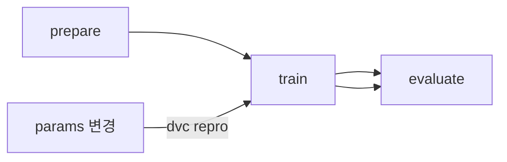
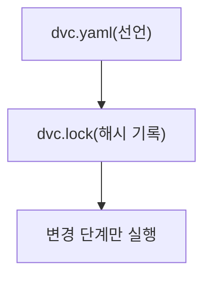

# DVC 파이프라인

> `dvc.yaml`에 단계(stage)별 명령·입력·출력을 선언하면 DVC가 의존 관계 그래프를 만들고, `dvc repro`가 바뀐 단계만 다시 실행한다.

## 쉽게 말하면
요리 레시피 단계를 적어 두고 재료가 바뀐 단계 이후만 다시 만드는 자동화다. 바뀌지 않은 단계는 건너뛴다.

## 자세히
(DVC 문서 원문을 하위 에이전트가 읽은 노트 기준.)
- **`dvc.yaml`**: `stages: {이름: {cmd(필수), deps, outs, params}}`.
- **`dvc.lock`**(스키마 2.0): 각 단계의 cmd, 의존성 md5, 매개변수, 출력 md5와 크기를 기록해 변경을 감지한다.
- **`dvc repro`**: DAG를 만들어 변경된 단계만 실행하고 변경 없는 단계는 "Stage 'x' didn't change, skipping"을 출력. 재실행 전 출력은 `persist`가 아니면 삭제된다.
- **옵션**: `-s`(단계 지정), `--dry`, `-f`(강제), `--downstream`, `--force-downstream`, `--allow-missing`, `-k`(실패해도 계속), `--pull`(필요한 파일을 원격에서 받음).
- **활용(제안)**: 전처리 → 학습 → 평가 단계를 선언하고 `params.yaml` 변경 시 필요한 단계만 재실행.

## 그림으로 보기



## 예시
```yaml
stages:
  train:
    cmd: python train.py
    deps: [train.py, data/prepared]
    outs: [model.pkl]
```
- 교육 활용: 파일 하나를 바꾸고 `dvc repro`가 어떤 단계를 재실행하는지 관찰.

## 헷갈리는 것과 비교
| 개념 | 차이 |
|---|---|
| dvc.yaml | 선언 |
| dvc.lock | 실행 결과 해시 기록 |
| Makefile | 비슷한 개념, 해시 기반 변경 감지 |

## 더 읽을거리
- [DVC 문서 저장소](https://github.com/iterative/dvc.org) — 파이프라인 문서(원문 마크다운).
