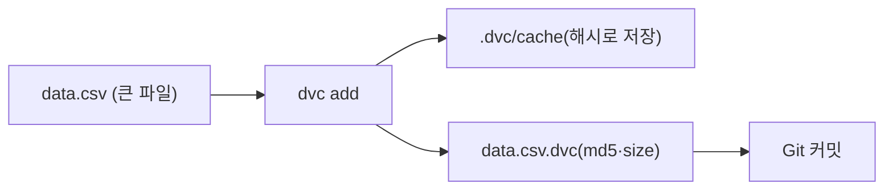
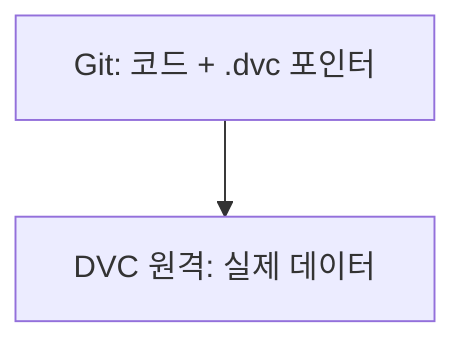

# DVC 포인터 파일

> DVC는 큰 데이터 자체를 Git에 넣지 않고 그 내용의 해시와 크기를 적은 작은 `.dvc` 텍스트 파일을 Git으로 버전 관리한다. 이 파일이 데이터의 어떤 버전인지를 가리키는 포인터다.

## 쉽게 말하면
도서관의 책(큰 파일)은 서가에 두고, 대출 카드(작은 .dvc 파일)만 Git에 보관한다. 카드에는 책의 고유 번호(해시)가 적혀 있어 어느 판인지 알 수 있다.

## 자세히
(DVC 문서 저장소 마크다운 원문을 하위 에이전트가 읽은 노트 기준.)
- **형식**: `.dvc`는 YAML 1.2. `outs: [{path, md5(hash: md5), size, nfiles(디렉터리일 때), isexec, cache, remote, persist, push}]`, 선택적으로 `deps`, `wdir`.
- **`dvc add`**: 대상 파일을 캐시로 옮기고 `.dvc` 파일을 만든다. 대상은 자동으로 `.gitignore`에 추가된다(`--no-scm`이면 제외). `core.autostage` 설정으로 `.dvc`를 자동 스테이징할 수 있다. `.dvc/cache`도 gitignore 대상.
- **흐름(제안)**: `dvc add data.csv` → `git add data.csv.dvc .gitignore` → `git commit`. 다른 사람은 `git pull` 후 `dvc pull`로 실제 데이터를 받는다([원격 저장소](#dvc-remote-storage)).
- **주의**: `.dvc` 파일만 Git에 있고 실제 데이터는 원격에 푸시하지 않으면 다른 사람이 데이터를 받을 수 없다.

## 그림으로 보기



## 예시
```bash
dvc add data/raw.csv
git add data/raw.csv.dvc data/.gitignore
git commit -m "add raw data v1"
```
- 교육 활용: 포인터 파일 한 개를 열어 md5·size를 읽어 보는 활동.

## 헷갈리는 것과 비교
| 개념 | 차이 |
|---|---|
| .dvc 포인터 | YAML, md5·size·path |
| [Git LFS 포인터](#git-lfs-pointer-file) | 3줄 텍스트(oid sha256·size) |
| dvc.lock | 파이프라인 단계의 의존·결과 해시 기록 |

## 더 읽을거리
- [DVC 문서 저장소](https://github.com/iterative/dvc.org) — .dvc 형식 문서(원문 마크다운).
