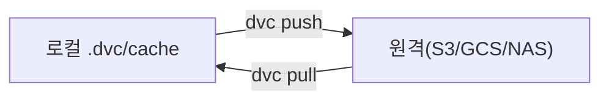
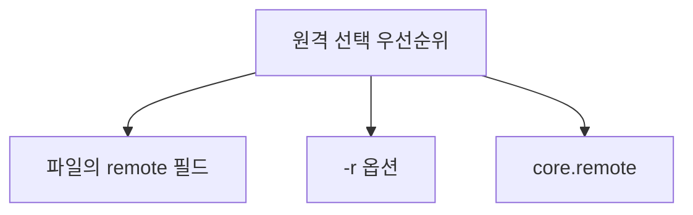

# DVC 원격 저장소

> DVC의 원격 저장소는 `.dvc` 포인터가 가리키는 실제 데이터가 보관되는 곳(S3, GCS, NAS 등)이다. `dvc push`/`dvc pull`로 캐시를 주고받는다.

## 쉽게 말하면
코드는 GitHub에, 큰 데이터는 창고(원격)에 둔다. 포인터 카드로 창고에서 같은 버전의 물건을 꺼내 온다.

## 자세히
(DVC 문서 원문을 하위 에이전트가 읽은 노트 기준.)
- **등록**: `dvc remote add [--global|--system|--project|--local] [-d] [-f] <name> <url>` — `.dvc/config`에 `['remote "x"'] url`과 `[core] remote`를 기록. `-d`는 기본 원격.
- **지원 백엔드**: S3(MinIO 포함), Azure, GCS, Google Drive, OSS, SSH, HDFS/WebHDFS, HTTP, WebDAV, 로컬 디렉터리.
- **`dvc push`**: DVC 캐시를 원격에 업로드(Git 파일은 해당 없음). 원격 선택 순서: `.dvc` 파일/dvc.yaml의 `remote` 필드 → `-r` → `core.remote`. **`dvc pull`**은 반대.
- **설계(제안)**: 기본 원격 하나와 필요 시 용도별 원격(원본/학습 결과), 접근 키는 `--local`(커밋되지 않는 설정)에 저장.

## 그림으로 보기



## 예시
```bash
dvc remote add -d storage s3://my-bucket/dvc
dvc push
```
- 교육 활용: 로컬 폴더를 원격으로 삼아 push/pull을 시연.

## 헷갈리는 것과 비교
| 개념 | 차이 |
|---|---|
| DVC 원격 | 데이터 실제 보관 |
| Git 원격 | 코드·포인터 보관 |
| [포인터 파일](#dvc-pointer-files) | 원격의 데이터 버전을 가리킴 |

## 더 읽을거리
- [DVC 문서 저장소](https://github.com/iterative/dvc.org) — remote 명령 문서(원문 마크다운).
