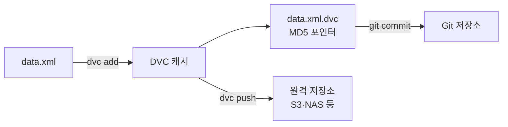
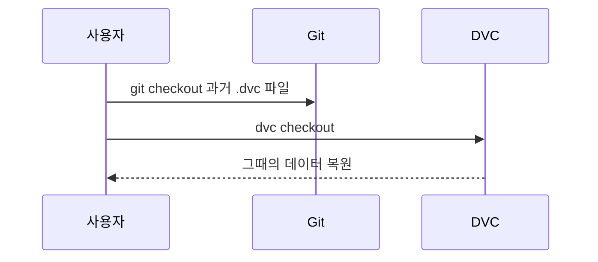

# DVC

> DVC(Data Version Control)는 **대용량 데이터·모델 파일은 Git 밖 저장소에 두고, 그 파일을 가리키는 작은 포인터 파일만 Git으로 버전 관리**하게 해 주는 오픈소스 명령줄 도구다. 코드 버전과 데이터 버전을 짝지어 되돌릴 수 있다.

## 쉽게 말하면
도서관에 책(데이터)은 서고에 두고, 책 위치가 적힌 작은 색인 카드(.dvc 파일)만 수첩(Git)에 끼워 둔다. 수첩을 예전 쪽으로 넘기면 그때의 색인 카드가 나오고, 카드가 가리키는 책을 서고에서 가져오면 과거 상태가 그대로 재현된다.

## 자세히
(공식 문서 doc.dvc.org/start와 GitHub 저장소를 직접 확인. 문서 주소는 dvc.org/doc에서 doc.dvc.org로 이전된 상태.)
- **핵심 원리**: `dvc add`가 파일을 프로젝트 캐시로 옮기고 작업 폴더에 연결한 뒤, 파일의 **MD5 해시를 담은 .dvc 메타 파일**을 만든다. 데이터 파일은 gitignore되고 Git은 .dvc 파일만 버전 관리한다. 문서는 "DVC는 기술적으로 그 자체가 버전 관리 시스템이 아니다"라고 밝힌다.
- **기본 흐름(공식 시작 가이드)**
  1. `dvc add data/data.xml`
  2. `git add data/data.xml.dvc data/.gitignore` → `git commit`
  3. `dvc remote add -d myremote /tmp/dvcstore` → `dvc push`
  4. 다른 곳에서 `git clone` → `dvc pull`
  5. 데이터 수정 후 `dvc add` → `dvc push` → `git commit`
  6. 과거로: `git checkout HEAD~1 data/data.xml.dvc` → `dvc checkout`
- **기능(GitHub README)**: 데이터·모델 버전, 영향받은 단계만 다시 도는 가벼운 파이프라인, 서버 없이 로컬 Git에서의 실험 추적, 데이터·코드·파라미터·지표·그래프 비교. 라이선스 Apache-2.0, 별 약 16.0k(확인 시점), 설치 `pip install dvc`(원격 저장소별 extra 예 `dvc[s3]`). 최신 버전 번호는 페이지에서 확인되지 않았다.
- **한계(해석)**: 원격 저장소 관리와 접근 권한은 별도로 설계해야 하고, 팀이 `dvc push`를 잊으면 포인터만 있고 데이터가 없는 상태가 생긴다. 이번에 파이프라인(dvc.yaml)·캐시 내부 문서는 열어 보지 못했다.

## 그림으로 보기

## 예시
- 학습 데이터 CSV가 매주 바뀔 때, 모델 v3는 "데이터 2026-11-12판 + 코드 커밋 abc123"으로 기록해 두고 필요하면 그대로 재현.
- 교육 소재: Git만으로 1GB 파일을 올릴 때 생기는 문제와 DVC의 포인터 방식을 비교하는 실습.

## 헷갈리는 것과 비교
| 개념 | 차이 |
|---|---|
| Git | 코드·텍스트 버전 관리 |
| DVC | 대용량 데이터를 포인터로 Git과 연결 |
| [Git LFS와 DVC 비교](#git-lfs-vs-dvc) | 대용량 파일 처리 방식 차이 |
| [실험 재현성](#experiment-reproducibility) | DVC가 돕는 목표 |

## 더 읽을거리
- [DVC 시작 가이드](https://doc.dvc.org/start) — dvc add·push·checkout 흐름(직접 확인).
- [iterative/dvc (GitHub)](https://github.com/iterative/dvc) — 기능·설치·라이선스(직접 확인).
