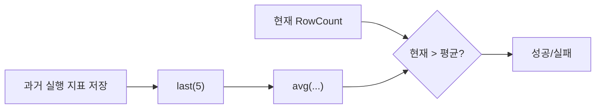
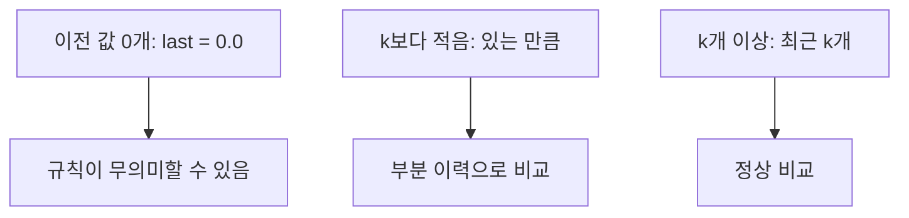

# 동적 규칙 last()

> AWS Glue Data Quality의 DQDL에서 **현재 지표를 과거 실행의 값과 비교하는 규칙**이다. `last()` 연산자로 이전 지표를 참조해 `RowCount > avg(last(5))`처럼 "최근 5번 평균보다 행이 많은가"를 쓴다. 고정 숫자 기준 대신 **추세 기반 기준**을 준다.

## 쉽게 말하면
"체중이 70kg 이하여야 한다"는 고정 기준 대신 "최근 5일 평균보다 2kg 이상 늘지 말 것"이라는 기준을 쓰는 것과 같다. 정상 범위가 서서히 변하는 데이터에서 기준을 사람이 매번 고치지 않아도 된다.

## 자세히
(AWS 공식 문서 「Data Quality Definition Language (DQDL) reference」의 Dynamic rules 절을 WebFetch로 직접 읽어 확인. Glue를 직접 실행하지는 않았다. 문서는 확인 시점(2026-11-22)의 것이다.)
- **지원 범위(문서)**: 동적 규칙은 **AWS Glue ETL에서만** 지원되고 **Glue Data Catalog 기반 데이터 품질에서는 지원되지 않는다**.
- **`last()`(문서)**: 현재 지표를 과거 값과 비교한다. `RowCount > last()`는 현재 행 수가 **같은 데이터셋의 가장 최근 이전 값**보다 크면 성공한다. 자연수 인자 `last(k)`(k ≥ 1)는 **최근 k개 지표**를 참조한다.
  - 과거 데이터 포인트가 **없으면** `last(k)`는 기본값 **0.0**을 반환한다.
  - k개보다 **적게** 있으면 있는 것 전부를 반환한다.
- **집계가 필요(문서)**: `k > 1`이면 여러 값을 하나로 줄이는 **집계 함수**가 필요하다. 예: `RowCount > avg(last(5))`(현재 행 수가 최근 5회 평균보다 큼). `RowCount > last(5)`는 숫자와 목록을 비교할 수 없어 **오류**다.
- **지원 집계(문서)**: `avg`, `median`, `max`, `min`, `sum`, `std`(표준편차), `abs`(절댓값), 그리고 `index(last(k), i)`(최근 k개 중 i번째로 최근 값; i는 0부터, `index(last(3), 3)`은 오류).
- **예시 표현식(문서)**: `ColumnCorrelation "colA" "colB" < avg(last(10))`, `DistinctValuesCount "colA" between min(last(10))-1 and max(last(10))+1`. 대부분의 숫자 조건·임계값이 있는 규칙 유형이 동적 규칙을 지원한다(문서의 분석기·규칙 표 참조).
- **분석기와 병용(문서)**: 예시 규칙셋은 `Rules = [ RowCount > avg(last(3)) ]`와 `Analyzers = [ DistinctValuesCount "Name", ColumnLength "Name" ]`를 함께 쓴다. 분석기는 조건을 단정하지 않고 통계를 쌓아 두는 용도다.
- **통계 제외(문서)**: 과거 일괄 적재처럼 평균을 왜곡하는 값은 Glue ETL 작업의 Data Quality 탭 → Statistics에서 선택해 **동적 규칙 계산에서 제외**할 수 있다.
- **주의(해석)**: 첫 실행에서 `last()`가 0.0이면 `RowCount > last()`는 항상 통과해 의미가 없다. 과거 값이 쌓일 때까지는 고정 기준을 병행한다. 과거에 문제가 있던 값이 평균에 섞이면 기준도 오염되므로 제외 기능이 필요하다. → [품질 지표 저장소](#data-quality-metrics-repository)

## 그림으로 보기

## 예시
- `RowCount > avg(last(3))`: 일일 적재량이 최근 3회 평균 아래로 떨어지면 실패 처리.
- `DistinctValuesCount "grade" between min(last(10))-1 and max(last(10))+1`: 값 종류 수가 최근 범위에서 크게 벗어나면 경보.
- 교육 활동: 최근 5일 행 수(100, 102, 98, 101, 99)로 `avg(last(5))`를 계산하고 오늘 값 80이 통과하는지 확인.

## 헷갈리는 것과 비교
| 개념 | 차이 |
|---|---|
| 동적 규칙 last() | 과거 지표 대비 비교 |
| 고정 임계 규칙 | 숫자를 직접 지정 |
| [ResultKey와 태그](#result-key-tags) | Deequ에서 과거 지표를 찾는 키(다른 도구) |
| [드리프트 임계값 정하기](#drift-threshold-tuning) | 분포 거리 기준을 정하는 법 |

## 더 읽을거리
- [DQDL reference (AWS Glue 문서)](https://docs.aws.amazon.com/glue/latest/dg/dqdl.html) — Dynamic rules, `last()`, 집계 함수, 분석기(직접 확인).
