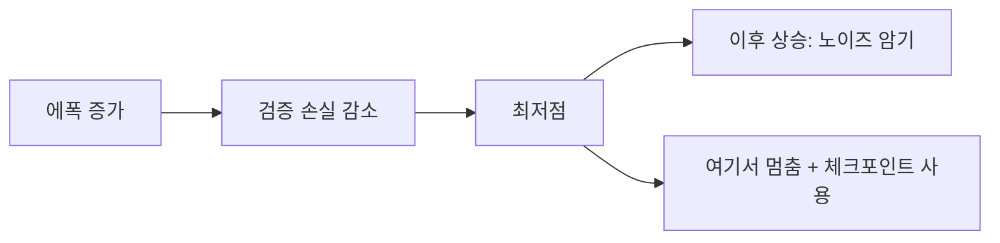
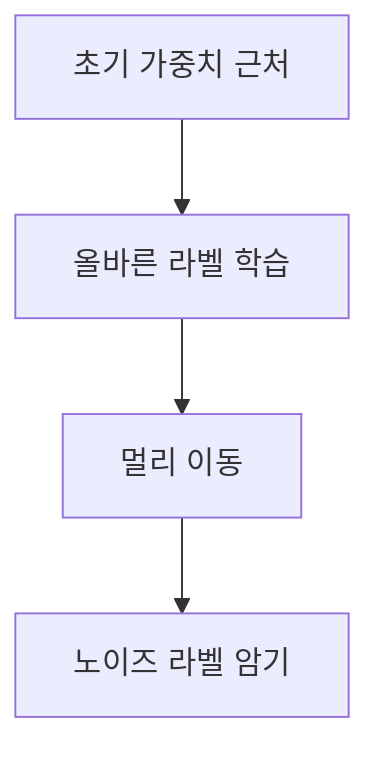

# 조기 종료와 노이즈

> 조기 종료(early stopping)는 검증 성능이 더 나아지지 않거나 나빠지기 시작할 때 학습을 멈추는 기법이다. 노이즈 라벨이 있는 데이터에서는 모델이 틀린 라벨을 외우기 전에 멈춰 영향을 줄이는 효과가 있다.

## 쉽게 말하면
시험 공부를 하다가 "이제 문제집 오타까지 외우고 있다"는 느낌이 들 때 공부를 멈추는 것이다. 초반에는 개념(단순 패턴)을 배우고, 후반에는 예외와 오타를 외우기 때문이다.

## 자세히
- **이론 근거(Li·Soltanolkotabi·Oymak, arXiv 1903.11680 초록)**: 저자들의 "rich dataset model" 가정 아래, 경사하강법은 라벨의 일정 비율이 오염돼도 증명 가능하게 견딘다. 가중치가 초기값 근처에 있는 초기 반복에서는 올바른 라벨을 주로 맞추고 노이즈 라벨은 거의 무시한다. 노이즈 라벨을 맞추려면 초기값에서 멀리 이동해야 하므로 훨씬 많은 반복이 걸린다. 이 결과들이 early stopping을 노이즈에 강한 방법으로 뒷받침한다. 이는 특정 이론 모델에서의 증명이다.
- **경험적 관찰(Arpit 외, arXiv 1706.05394)**: 신경망은 단순한 패턴을 먼저 배우고 노이즈는 나중에 외운다([노이즈 라벨 암기](#memorization-of-noisy-labels)).
- **실무 적용(해석)**: ① 검증셋 손실이 최저인 에폭의 체크포인트를 저장해 사용한다 ② 검증셋에도 라벨 오류가 있으면 멈추는 시점이 흔들리므로 [정제 평가셋](#evaluation-set-freeze)을 쓴다 ③ patience(몇 에폭 더 기다릴지)를 설정한다.
- **한계(해석)**: 라벨 오류가 많으면 일찍 멈춰도 노이즈의 영향이 남고, 어려운 정상 샘플도 덜 배운 채 멈출 수 있다([하드 샘플 제거 부작용](#hard-sample-removal)). 정리와 함께 쓴다.

## 그림으로 보기

## 예시
- PyTorch Lightning 등: `EarlyStopping(monitor="val_loss", patience=5)`로 5에폭 개선이 없으면 중단하고 최고 체크포인트를 쓴다.
- 교육 활용: 학습 곡선(학습·검증 손실)을 그리고 어느 에폭에서 멈출지 학습자가 고르게 한다.

## 헷갈리는 것과 비교
| 개념 | 차이 |
| --- | --- |
| 조기 종료 | 학습 시간을 줄여 암기를 피함 |
| 라벨 정리 | 노이즈 자체를 줄임 |
| [노이즈 라벨 암기](#memorization-of-noisy-labels) | 조기 종료가 막으려는 현상 |
| [앙상블](#ensemble-noise-robustness) | 여러 모델 평균으로 줄임 |

## 더 읽을거리
- [Gradient descent with early stopping is provably robust to label noise (arXiv 1903.11680)](https://arxiv.org/abs/1903.11680) — 이론 근거
- [A Closer Look at Memorization in Deep Networks (arXiv 1706.05394)](https://arxiv.org/abs/1706.05394) — 단순 패턴 우선 학습
