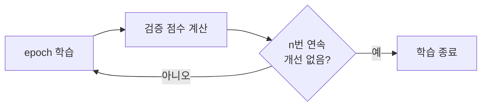
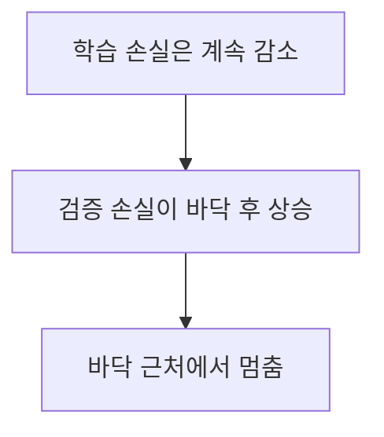

# 조기 종료 (Early Stopping)

> 조기 종료는 검증 성능이 더 나아지지 않으면 학습을 일찍 멈춰, 학습 데이터에만 맞아 가는 과적합을 막는 방법이다.

## 쉽게 말하면
시험 공부를 하다가 모의고사 점수가 3번 연속 오르지 않으면 "더 하면 외우기만 한다"고 보고 접는 것이다.

## 자세히
scikit-learn SGD 문서 기준:
- `early_stopping=True`: 데이터 일부(`validation_fraction`)를 떼어 검증 점수를 보고 판단. `False`(기본)면 학습 데이터의 목적함수를 본다.
- `n_iter_no_change`: 몇 epoch 연속 개선이 없으면 멈출지. `tol`: 이만큼 이상 좋아져야 "개선"으로 침. `max_iter`: 무조건 멈추는 상한.
- 매 epoch 지표를 계산해 개선 폭이 `tol` 미만이면 카운터를 올리고, 카운터가 `n_iter_no_change`에 닿거나 `max_iter`면 종료. `max_iter`를 충분히 크게 잡아 조기 종료가 먼저 끝내게 한다.
- `n_iter_`로 실제 실행한 epoch 수를 확인한다.
- 딥러닝 프레임워크에서는 검증 손실이 최저였던 지점의 가중치를 복원하는 옵션을 함께 쓴다(일반 관행). 검증 세트가 너무 작으면 우연한 출렁임에 일찍 멈출 수 있다.

## 그림으로 보기



## 예시
```python
clf = SGDClassifier(early_stopping=True, validation_fraction=0.1,
                    n_iter_no_change=5, tol=1e-3, max_iter=1000, random_state=0)
clf.fit(X, y); print(clf.n_iter_)
```
파인튜닝에서 검증 손실이 오르기 시작하면 멈추면 비용도 아끼고 과적합도 줄인다.

## 헷갈리는 것과 비교
| 개념 | 차이 |
|---|---|
| 조기 종료 | 언제 멈출지 |
| [드롭아웃](#dropout) | 학습 중 구조를 흔듦 |
| [하이퍼파라미터](#hyperparameter) | `n_iter_no_change`도 사람이 정하는 값 |
| 체크포인트 선택 | 최고 점수 시점 저장본을 쓰는 것 |

## 더 읽을거리
- [sklearn SGD: early stopping](https://scikit-learn.org/stable/modules/sgd.html) — 매개변수와 동작.
