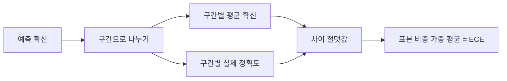
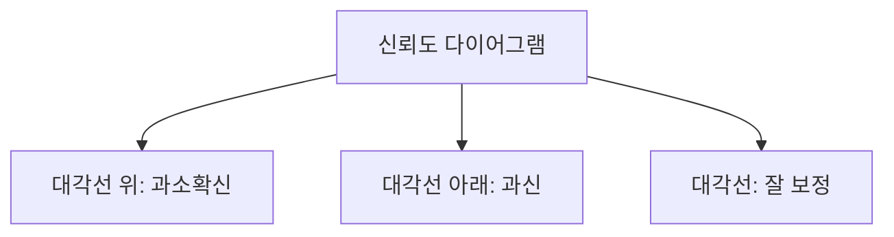

# ECE(기대 보정 오차)

> 모델이 말한 확신과 실제 정답률의 차이를 구간별로 평균 낸 단일 숫자. 0에 가까울수록 "80% 확신"이 실제로 80% 맞는 모델이다.

## 쉽게 말하면
일기예보가 "비 확률 70%"라고 한 날들을 모아 보니 실제로 70% 정도 비가 왔다면 잘 보정된 예보다. ECE는 그 어긋남을 확률 구간별로 재서 하나의 점수로 만든 것이다.

## 자세히
- **보정(calibration)**: 예측 확률이 실제 빈도와 맞는 성질. scikit-learn 문서(열람)는 잘 보정된 이진 분류기에서 0.8 근처 점수를 받은 표본의 약 80%가 양성이어야 한다고 설명한다.
- **ECE 정의(표준 정의, 이번에 열람한 페이지에는 정의가 없어 일반 지식으로 적음)**: 예측을 확신 구간으로 나눠, 구간별 |정확도 − 평균 확신|을 그 구간의 표본 비중으로 가중 평균한다. 구간 수와 나누는 방식에 따라 값이 달라진다.
- **신뢰도 다이어그램(calibration curve)**: 구간별 평균 예측 확률(x)과 실제 양성 비율(y)을 그린다. `calibration_curve`·`CalibrationDisplay.from_estimator`로 만들고 아래 히스토그램이 구간별 표본 수를 보여 준다. 구간에 표본이 적으면 점이 불안정하다.
- **현대 신경망의 보정 문제(Guo 외, ICML 2017, arXiv 1706.04599, 초록 열람)**: 깊이·너비·가중치 감쇠·배치 정규화가 보정에 영향을 주며, 현대 신경망은 과거보다 보정이 나쁘다. 온도 스케일링(Platt scaling의 단일 파라미터 변형)이 이미지·문서 분류 데이터셋 대부분에서 효과적이었다.
- **보정 방법(scikit-learn 문서)**: 시그모이드(Platt, 표본이 적을 때), 아이소토닉(유연하지만 작은 데이터에서 과적합, 대략 1,000개 이상에서 시그모이드 이상), 온도 스케일링(logit을 T로 나눠 소프트맥스, 다중 분류용, argmax 불변이라 정확도 유지). 보정기는 분류기 학습과 독립인 데이터로 맞춘다.
- **주의**: Brier 점수가 낮다고 보정이 좋은 것은 아니다(판별력도 반영). ECE는 정확도와 별개이며 보정이 잘돼도 모델이 나쁠 수 있다. LLM의 말로 한 확신에 쓸 때는 정답 라벨과 충분한 표본이 있어야 한다.

## 그림으로 보기

## 예시
- 확신 0.9 구간 100건 중 정답 60건 → 그 구간 차이 0.3. 다른 구간들과 가중 평균하면 ECE.
- 교육 실습: 표본 50개의 (확신, 정답 여부)를 5개 구간으로 나눠 구간별 격차를 손으로 계산.

## 헷갈리는 것과 비교
| 개념 | 차이 |
|---|---|
| ECE | 확신-정확도 격차 요약(보정) |
| 정확도 | 맞힌 비율 |
| Brier 점수 | 확률 제곱오차, 판별력도 섞임 |
| [신뢰도 보정과 이관](#confidence-calibration-handoff) | ECE를 이관 임계값에 활용하는 맥락 |

## 더 읽을거리
- [On Calibration of Modern Neural Networks (arXiv 1706.04599)](https://arxiv.org/abs/1706.04599) — 신경망 보정·온도 스케일링(초록 열람)
- [scikit-learn: Probability calibration](https://scikit-learn.org/stable/modules/calibration.html) — 신뢰도 다이어그램·보정 방법(열람)
