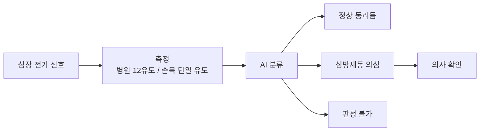
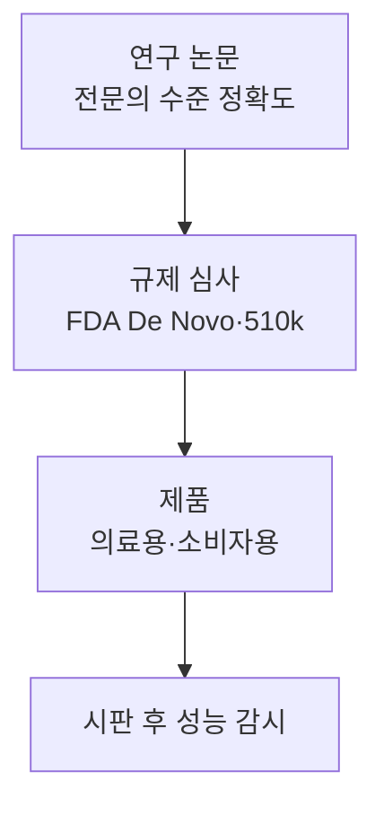

# ECG AI

> 심전도(ECG, 심장의 전기 신호 파형)를 AI로 분석해 부정맥 같은 이상을 찾는 소프트웨어. 병원용 12유도 판독 보조부터 손목시계의 단일 유도 심방세동 알림까지 범위가 넓고, 허가된 심혈관 AI 기기의 대표 사례다.

## 쉽게 말하면
심전도는 심장이 뛸 때마다 생기는 전기 신호를 그린 선이다. 숙련된 의사는 이 선의 모양과 간격으로 리듬 이상을 읽는다. ECG AI는 이런 선 수만 개를 보고 "이 모양은 심방세동"처럼 맞히도록 훈련된 프로그램이다. 병원에서는 의사의 읽기를 돕고, 손목시계에서는 본인이 직접 재서 "병원에 가 보세요"를 알려 준다.

## 자세히
출처: Apple 뉴스룸 2018-12 발표(직접 읽음, 제조사 주장), Hannun 외 Nature Medicine 2019 논문 서지(검색 결과로 확인. 본문은 접근이 막혀 열지 못함), 규제 정보는 검색 결과 요약.
- **연구 사례**: Hannun, Rajpurkar 외 "Cardiologist-level arrhythmia detection and classification in ambulatory electrocardiograms using a deep neural network", Nature Medicine 25, 65–69(2019-01-07 온라인). 초록 요약으로는 종단 간 딥러닝이 부정맥 검출·분류에서 심장 전문의와 비슷한 정확도를 보였다. 환자 수·리듬 종류 같은 세부 수치는 이번에 확인하지 못했다.
- **소비자 제품 사례(Apple Watch)**:
  - 시계 뒷면 전극과 크라운에 손가락을 대 **단일 유도에 가까운 기록**을 30초 측정, 결과는 심방세동·정상 동리듬·판정 불가 셋 중 하나.
  - 제조사 발표 임상시험(약 600명): AFib 민감도 98.3%, 동리듬 특이도 99.6%, 기록의 87.8%가 분류 가능. 제조사 주장이며 독립 검증은 확인하지 못했다.
  - **불규칙 리듬 알림**: 광학 심박 센서로 백그라운드에서 확인하고, 65분 이상에 걸친 5회 점검에서 불규칙이 나올 때 알림.
  - **규제**: FDA는 두 기능에 De Novo(새 유형, 저·중위험)를 부여했고 일반인이 처방 없이 쓸 수 있다. 검색 결과로는 Class II이며 22세 이상 성인 대상, 이미 심방세동 진단을 받은 사람은 대상에서 제외(2차 보도, 허가서 미확인).
  - **한계(제조사 문구)**: 심근경색·혈전·뇌졸중·고혈압·심부전·AFib 이외 부정맥은 찾지 못한다.
- **12유도 vs 단일 유도**: 병원용은 전극 여러 개로 심장을 여러 각도에서 본다. 단일 유도 웨어러블은 리듬 분류에 적합하지만 허혈성 변화 같은 다른 진단은 어렵다(일반 설명).
- **평가할 때 볼 것**: 민감도·특이도뿐 아니라 "판정 불가 비율", 훈련·시험 집단의 연령·인종, 현장 환경의 잡음, 결과 후 행동(의사 연결) 경로.
- 허가 분류는 심혈관 패널이지만 같은 심장 AI가 다른 패널로 갈 수 있다([패널 분류의 함정](#panel-classification-caveat)).

## 그림으로 보기

## 예시
- 건강검진센터가 ECG 판독 보조 AI로 정상 파형을 먼저 걸러 의사가 이상 파형에 집중하게 한다(일반적 활용).
- 시계에서 "불규칙 알림"이 뜬 사용자가 증상 로그를 PDF로 공유해 진료를 받는다. 알림만으로 진단이 되는 것은 아니다.

## 헷갈리는 것과 비교
| 개념 | 차이 |
|---|---|
| ECG AI | 심전도 신호 분석 AI |
| [심초음파 AI](#echocardiography-ai) | 초음파 영상에서 박출률 등을 재는 AI |
| [심혈관 AI 기기](#cardiology-ai-devices) | 심장 분야 허가 AI 전체 |
| [내장형 AI](#embedded-ai) | 기기 안 AI. 시계 알림은 소프트웨어 기능 |

## 더 읽을거리
- [ECG app and irregular heart rhythm notification available today on Apple Watch (Apple, 2018-12)](https://www.apple.com/newsroom/2018/12/ecg-app-and-irregular-heart-rhythm-notification-available-today-on-apple-watch/) — 작동 방식·제조사 수치(직접 읽음)
- [Cardiologist-level arrhythmia detection ... (Nature Medicine 2019)](https://www.nature.com/articles/s41591-018-0268-3) — 원 논문(이번에 열지 못함)
